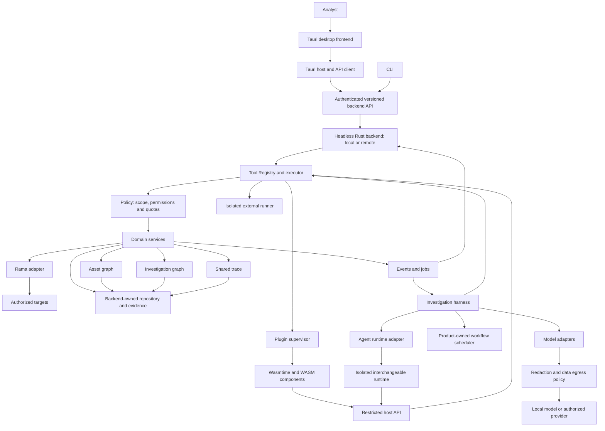

# Steady — Consolidated Product and Architecture Specification
## Black-Box and White-Box Investigation, Extensions and Automation

| Field | Value |
|---|---|
| Version | 0.2 — Independent backend and local/remote frontend amendment |
| Date | 18 November 2026; original consolidation: 16 November 2026 |
| Audience | Product, architecture and development leads |
| Objective | Agree on what will be built, how it will be organized and how each delivery will be accepted |
| Requested stack | Rust · Tauri · Rama · WebAssembly · Wasmtime · WIT |
| Product | Local-first workbench for web, API and source code security investigation |

> **Status and provenance.** This version consolidates the historical Spanish v0.9 specification and the contributor's Steady “Complete Product Feature Specification.” It incorporates the team's instruction to keep the choice of frameworks open and follow ARTEX's investigation approach. “Steady” is used as a working name. Features and phases remain proposals subject to review; this document does not establish that they have been implemented. The provenance limitation of the Spanish v0.9 source is retained: the original chat was only partially recovered. The comparison is explained in the companion document “Comparison and Decisions for a Consolidated Specification.”

> **Deployment amendment.** The backend and the approved Tauri frontend are independently runnable. An analyst may use a backend on the same device or explicitly connect the Tauri app to one on an operator-controlled remote device. Closing the frontend or sleeping the analyst's laptop does not stop work on a separate, running backend. The existing pathname is retained for references; earlier R0 specifications and evidence do not establish acceptance of this new deployment contract.

## Table of Contents

1. [Executive Summary](#1-executive-summary)
2. [Provenance, Decisions and Priorities](#2-provenance-decisions-and-priorities)
3. [Product Goals and Boundaries](#3-product-goals-and-boundaries)
4. [Functional Scope by Module](#4-functional-scope-by-module)
5. [Technical Architecture](#5-technical-architecture)
6. [Domain Model, Data and Events](#6-domain-model-data-and-events)
7. [Tool Registry](#7-tool-registry)
8. [Plugin SDK: WASM, Wasmtime and WIT](#8-plugin-sdk-wasm-wasmtime-and-wit)
9. [Agents, Skills, Workflows and Swarms](#9-agents-skills-workflows-and-swarms)
10. [Security and Privacy](#10-security-and-privacy)
11. [Nonfunctional Requirements and Verification](#11-nonfunctional-requirements-and-verification)
12. [Roadmap and Deliverables](#12-roadmap-and-deliverables)
13. [Acceptance Criteria](#13-acceptance-criteria)
14. [Work Organization and Definition of Done](#14-work-organization-and-definition-of-done)
15. [Risks and Pending Decisions](#15-risks-and-pending-decisions)
16. [Technical References](#16-technical-references)
17. [Glossary](#17-glossary)
18. [Consolidation Traceability](#18-consolidation-traceability)
19. [Decisions in This Version](#19-decisions-in-this-version)

## 1. Executive Summary

Steady is a security investigation workbench that combines manual testing, agents, workflows and code auditing. The common process is **goal → hypothesis → task → tool → evidence → validation → next decision**, for analysts and agents alike.

The **Rust** backend, **Tauri** desktop application, **Rama** transport, **Tool Registry** and **WASM/Wasmtime/WIT** SDK are retained. Tauri remains the approved frontend; its host is a client of the independently running backend, not the owner of backend execution. A **product-owned investigation harness** is proposed on top of the backend, independent of the agent framework and model provider. Its domain, policy, state and scheduler belong to the backend; runtimes connect through adapters.

ARTEX's approach translates into goal-driven planning, concrete tasks claimed by workers and evidence-based state updates. The asset graph, investigation graph, workflow DAG and execution traces remain separate. The product adds its own contracts and controls: it does not adopt ARTEX's code, stack or security behavior by association.

The main additions relative to the Spanish v0.9 source are white-box auditing, a visual canvas, investigation memory, an expanded inventory, navigable traces, human↔agent handoffs, isolated integrations and an explicit path toward collaboration. The manual core remains useful without AI or remote services.

**First shared demonstration:** capture a request; link it to an asset and, where one exists, a handler pinned to a commit; formulate a hypothesis; run an authorized check; record the evidence; review the finding and export it. Subsequent delivery slices add autonomous planning, swarms and deep analysis.

The consolidation materially expands the scope: it inherits neither an estimate nor a delivery date from the Spanish v0.9 source. Priorities and estimates are defined per delivery, with acceptance criteria. The product draws inspiration from capabilities in Burp, ARTEX and external analyzers without promising full parity or universal compatibility with their extensions.

## 2. Provenance, Decisions and Priorities

### 2.1. Verifiable Basis

| Source | Contribution | Treatment |
|---|---|---|
| Spanish v0.9 specification | 56 requirements, Rust/Tauri/Rama architecture, Tool Registry, SDK, security and 39 criteria | IDs are retained; extensions or phase changes are stated explicitly |
| Contributor's document, blocks A–L | Human/agent investigation, black-box, white-box, builder, memory, graphs, traces, findings, governance, integrations, team features and optional contribution | Integrated through requirements FUN-57 to FUN-94 and technical detail |
| Current team instruction | Keep the product open to different frameworks; investigate ARTEX and follow its approach | Explicit constraint on the consolidated architecture |
| Team clarification on memory | Two local levels: user and session | Replaces the previous design of project/target/organization memory scopes |
| Team clarification on modes | Copilot combines manual work and delegated execution; Autonomous uses parallel agents with continuous human intervention | Human control is specified in FUN-58–59 and §9.9 |
| Partially recovered original conversation | Plugin design and PortSwigger examples | The provenance warning is retained; historical agreements are not invented |
| Primary sources on ARTEX | AhnLab laboratory analysis and documentation of a community continuation | Conceptual reference with version attribution; not evidence of capabilities implemented here |
| Rama, Tauri, Wasmtime and WIT documentation | Stack contracts and boundaries | Technical validation, with exact versions to be pinned in R0 |

**Conventions:** “proposed” expresses a decision made in this specification. Only the team's instructions are presented as accepted instructions. The consolidated version requires review before it becomes an implementation commitment.

### 2.2. Proposed Architecture Decisions

| ID | Proposed decision | Rationale and consequence |
|---|---|---|
| ADR-01 | Independently runnable Rust backend, independent of presentation | Owns execution and canonical state; runs headlessly on the local device or an explicitly selected remote device |
| ADR-02 | Retain the approved Tauri 2 desktop application and TypeScript frontend, with React as the initial option | The Tauri host connects to the local or remote backend through the same API; no browser-client replacement or frontend-framework migration |
| ADR-03 | Rama behind a product-owned transport interface | Prevents its types from spreading into agents, the SDK and storage |
| ADR-04 | Separate Tauri application, backend and isolated runner processes | Backend lifecycle is independent of windows, client connections and client-side process supervision |
| ADR-05 | Tool Registry as the execution gateway for application actions | Unifies validation, scope, permissions, quotas and auditing |
| ADR-06 | Component Model + WIT for the plugin API | Establishes versioned contracts between the host and extensions |
| ADR-07 | Wasmtime in a supervised process, with explicit limits | Combines WASM isolation with process recovery |
| ADR-08 | Project data and execution reside on the selected backend; same-device operation is the default | Remote placement is explicit, not cloud synchronization; frontend connection credentials are separate from backend project/provider secrets |
| ADR-09 | Product-owned, persistent and separate investigation harness and workflow scheduler | Agent runtimes do not own the domain or authorization |
| ADR-10 | A single writer engine per project in early versions | The later multiuser service provides its own coordination controls |
| ADR-11 | Separate `AgentRuntimeAdapter` and `ModelProviderAdapter` | Changing framework or model does not require rewriting tools, evidence or UI |
| ADR-12 | Linked asset and investigation graphs; separate DAG and trace | Distinguishes knowledge, investigation, procedure and actual execution |
| ADR-13 | Isolated runners for CLIs, scripts, analyzers and external runtimes | The sandbox covers the entire process and its descendants |
| ADR-14 | White-box analysis tied to commits and supported languages | Avoids attributing universal precision to syntactic analysis or AI |
| ADR-15 | Exactly two levels of local memory: user and session | Reusable general knowledge is separated from specific history and context; both levels retain provenance, status and expiry |
| ADR-16 | Single-user local or self-hosted remote backend in R1; team controls remain R5 | Start with one backend process and one client API; remote access alone does not require tenants, distributed workers or shared database files |

### 2.3. Priorities and Delivery Slices

| Phase | Priority | Product slice |
|---|---|---|
| R0 | Blocking | Network, SDK, isolation and framework-neutral harness feasibility |
| R1 | P0 | Manual MVP with an independent local/remote backend, reconnectable frontend, investigation, assets and basic traces |
| R2 | P0 | SDK, two plugins, basic fuzzing and minimal white-box reading |
| R3 | P1 | Framework-neutral harness, agent, memory, static analysis integration and initial visual builder |
| R4 | P1 | Swarms, deep correlation, advanced testing, scheduling and portability |
| R5 | P2 | Team deployment, organizational integrations and optional extensions |

**MVP** means R1, after passing R0. **First extensible version** means R1 + R2. **First version with agents** means R1 + R2 + R3. The full vision includes team capabilities in R5; data contribution, incentives, a marketplace and additional protocols are separate optional extensions. No delivery slice commits to shipping the entire catalog at once.

## 3. Product Goals and Boundaries

### 3.1. Goals

- Capture, search, inspect, modify and replay web and API traffic within a project.
- Bring targets, test identities, hypotheses, executions and findings into a shared context.
- Provide useful manual tools independently of AI.
- Allow a contributor to extend codecs, checks, actions and views without changing the core.
- Automate repeatable tasks with permissions, budgets and verifiable evidence.
- Coordinate specialist agents without uncontrolled increases in requests, costs or duplicate findings.
- Generate reports that distinguish observations, hypotheses and confirmed vulnerabilities.
- Link code, traffic, artifacts and decisions in a shared investigation.
- Retain general local user memory and memory specific to each session, with provenance, validity and authorization limits.
- Support takeover, steering and human↔agent handoffs without duplicating effects.
- Design reusable visual workflows without depending on an agent framework.
- Keep authorized backend work running independently of the frontend, including when the analyst disconnects or closes a laptop while a separate backend device remains available.

### 3.2. Users and Main Journeys

| User | Journey they must be able to complete |
|---|---|
| Analyst | Create project → define targets → capture → replay → compare → document |
| Plugin developer | Create extension → test with fixtures → package → install → verify permissions |
| Automation operator | Select skill/workflow → review scope and limits → execute → inspect results |
| Reviewer | Open evidence → identify origin and changes → reproduce where appropriate → confirm or dismiss |
| Code auditor | Pin commit → explore handler → formulate hypothesis → link traffic → validate and propose fix |
| Workflow author | Design DAG → validate types/permissions → test nodes → inspect execution → version |
| Team, R5 | Assign investigation → apply roles → share authorized knowledge → review and deliver |

### 3.3. Initial Boundaries

- Single-user workbench with a local or explicitly selected self-hosted remote backend; not a public scanning service or multiuser SaaS in R1–R4.
- No direct execution of Burp Java/Jython extensions. Their patterns are studied and product-specific equivalents are implemented.
- No initial promise of full support for HTTP/3, QUIC, native gRPC or arbitrary protocols.
- No unrestricted shell or arbitrary native code inside the host. CLIs and scripts are enabled only in isolated runners with their own contracts and permissions.
- No automatic changes to system trust, silent disabling of TLS validation or automatic bypass of certificate pinning.
- No mandatory cloud synchronization, training on project data or implicit remote transmission.
- No finding is treated as confirmed solely because a model asserts it.
- No simultaneous collaboration on the same project until the relevant phase.
- No attempt to be an IDE or a universal taint engine in the first white-box delivery.
- No automatic execution of a repository's code, hooks, installers or executable configuration when it is opened.

Active tests are implemented by family and subject to limits. The first version does not promise an exhaustive vulnerability catalog.

## 4. Functional Scope by Module

Each requirement has a stable identifier. The phase indicates its first planned delivery; extensions are explicitly separated.

### 4.1. Projects, Targets and Context

| ID | Feature | Phase | Expected behavior |
|---|---|---|---|
| FUN-01 | Backend-owned projects | R1 | Create, open, close, duplicate configuration and archive on the selected backend; same-device storage by default, with data and permission isolation |
| FUN-02 | Target scope | R1 | Rules by scheme, host, port and path; exclusions; preview and versioned review |
| FUN-03 | Environments | R1 | Environment-specific variables and secret references without including values in exports |
| FUN-04 | Notes, tags and collections | R1 | Associate traffic, endpoints and evidence with an investigation |
| FUN-05 | Project exchange | R2 | Export and import a versioned package with integrity checks and redaction options |
| FUN-06 | Shared context | R3 | Query targets, endpoints, identities, findings and executions through bounded tools |

Network scope and permission to send data to an AI provider are separate decisions. Authorizing a target does not authorize sending its content to a remote model.

### 4.2. Proxy, Capture and Interception

| ID | Feature | Phase | Expected behavior |
|---|---|---|---|
| FUN-07 | Explicit HTTP proxy | R1 | Configurable local listener; HTTP/1.1 forwarding, persistent connections, timeouts and visible errors |
| FUN-08 | HTTPS and CONNECT | R1 | Tunneling and authorized MITM; local CA per installation, certificate management and trust guidance |
| FUN-09 | HTTP/2 | R1 | Negotiation and forwarding validated in the protocol matrix; identifiable streams and errors |
| FUN-10 | Request/response interception | R1 | Pause, edit, forward or drop; visible queue, timeout and defined shutdown behavior |
| FUN-11 | Modification rules | R1 | Declarative rules by scope and condition; stable ordering; original/modified comparison |
| FUN-12 | Streaming, WebSocket and SSE | R2 | Bounded capture, frame/event inspection and protocol-supported manual replay |
| FUN-13 | Routing and upstream proxy | R2 | Per-project configuration, protected credentials and consistent scope enforcement |
| FUN-14 | HTTP/3 and additional transports | R5 | Separate evaluation and delivery; not advertised as available merely because Rama is used |

Rama provides building blocks for network services and proxies; the product's actual support depends on the composition, configuration and testing of each protocol. It will be encapsulated behind an adapter. See the [official Rama documentation](https://ramaproxy.org/).

**Behavior rules:**

- The listener binds to loopback by default. Exposing it on another interface requires explicit configuration and access controls.
- If observed traffic is outside the inspection scope, the initial policy is to reject it or allow an undecrypted tunnel, depending on the project profile; the selected mode is displayed before the listener starts.
- No analysis, modifications or additional requests take place outside scope. An external tunnel does not grant inspection permissions.
- The CA private key is never passed to plugins, the web interface or models. The application explains how to install and remove trust.
- The representation available at the capture point is preserved. For HTTP/2, the semantic object is not presented as an exact copy of the original TLS/HTTP/2 frame stream.
- An editor that does not modify content must return the original body bytes. When content is modified, the host validates framing, derived headers and length before transmission.

### 4.3. History, Map and Search

| ID | Feature | Phase | Expected behavior |
|---|---|---|---|
| FUN-15 | Searchable history | R1 | Filters by URL, method, status, size, time, tags, origin and presence of findings |
| FUN-16 | Message viewers | R1 | Text, hexadecimal and structured views; repeated headers, binary content and encodings |
| FUN-17 | Attack surface map | R1 | Group hosts, paths, methods, parameters and content types; link samples |
| FUN-18 | Content search | R1 | Paginated, cancellable search; regex and size limits; results with references |
| FUN-19 | Passive discovery | R2 | Extract links, forms and API/JavaScript references from already captured traffic |
| FUN-20 | Browsing and active crawler | R4 | In-scope URL queue, deduplication, limits and browser isolation |

The map distinguishes **observed**, **inferred** and **imported** endpoints. Detecting a path in JavaScript does not demonstrate that it exists or is accessible.

### 4.4. Replay, Comparison and Utilities

| ID | Feature | Phase | Expected behavior |
|---|---|---|---|
| FUN-21 | Manual repeater | R1 | Tabs/collections, editing, sending, cancellation, history and response metrics |
| FUN-22 | Comparer | R1 | Header, body and structure diffs; visible, reversible normalization rules |
| FUN-23 | Encoder/decoder | R1 | URL, Base64, hexadecimal and common transformations; preserve the original |
| FUN-24 | Parameterized test generator | R2 | Insertion points, value sets, FUN-82 strategies and bounded combinations; queue and rate limit |
| FUN-25 | Differential testing | R3 | Compare identities, states and variations with an explicit hypothesis and baseline |
| FUN-26 | Token and format utilities | R2 | Inspect JWTs and common formats; do not conflate decoding with cryptographic validation |

Any replay that generates a network request is classified as an active action. The HTTP method alone does not determine whether an operation is harmless.

### 4.5. Identities, Cookies and Test Sessions

| ID | Feature | Phase | Expected behavior |
|---|---|---|---|
| FUN-27 | Separate identities | R2 | Cookie jars, headers and secrets per identity; explicit selection for every execution |
| FUN-28 | Session macros | R3 | Sequences to obtain/refresh tokens and apply extractors with limits and expiry |
| FUN-29 | Invalid session detection | R3 | Observable rules; pause and notify before continuing with an unknown identity |
| FUN-30 | Authorization matrix | R4 | Compare resources and roles with evidence; distinguish content differences from an actual authorization failure |

These features are part of the product proposal. They do not originate from the `session-tracking-checks` plugin, which serves a different purpose.

### 4.6. Security Analysis and Findings

| ID | Feature | Phase | Expected behavior |
|---|---|---|---|
| FUN-31 | Passive analysis | R1 | Local checks on captured traffic, without new requests |
| FUN-32 | Initial passive rules | R1 | Headers, cookie attributes, observable exposure and third-party references; contextual severity |
| FUN-33 | Bounded active checks | R3 | Versioned rule packages; preconditions, budget, cancellation and verification |
| FUN-34 | Expanded active catalog | R4 | Selected injection, authorization and logic families; coverage declared per rule |
| FUN-35 | Finding lifecycle | R1; expand R3/R4 | Hypothesis, pending, confirmed, dismissed, duplicate, fixed pending retest and closed; justified changes and historical evidence |
| FUN-36 | Evidence and deduplication | R1 | Messages, versions, markers, reproduction steps and deduplication fingerprint |

A passive pattern result is stated as an observation or indication when it does not prove impact. Active rules are accepted based on precision and evidence, not alert volume. Checks with potentially destructive effects remain disabled unless a profile has been explicitly granted.

### 4.7. Protocols, Codecs and Extension Experience

| ID | Feature | Phase | Expected behavior |
|---|---|---|---|
| FUN-37 | Format detection | R2 | Select codecs by metadata and content; the analyst's manual choice takes precedence |
| FUN-38 | Extensible editors | R2 | Declarative text, JSON, byte and form views; errors and read-only mode |
| FUN-39 | gRPC-Web reference plugin | R2 | Decode, edit and reconstruct supported bodies; explicit typing and unchanged-content preservation |
| FUN-40 | Artifact analyzers | R2 | Actions on captured content to extract structured results |
| FUN-41 | Additional protocol plugins | R4 | Contracts for frames and streams; each protocol has its own support matrix |

The [gRPC-Web Coder](https://github.com/PortSwigger/grpc-web-coder) repository demonstrates the value of combining payload editing and JavaScript analysis. The proposal adopts this pattern through product-specific APIs; it does not promise to execute its JAR.

### 4.8. AI, Automation and Reporting

| ID | Feature | Phase | Expected behavior |
|---|---|---|---|
| FUN-42 | Contextual assistant | R3 | Query authorized data, explain messages and formulate hypotheses with references |
| FUN-43 | Model providers | R3 | Local/remote adapters, protected credentials, declared capabilities and selection per task/node |
| FUN-44 | Execution agent | R3 | Visible plan, granted tools, limits, pause and traceable results |
| FUN-45 | Skill catalog | R3 | Versioned packages of operational knowledge, inputs, tools and exit criteria |
| FUN-46 | Workflows | R3 | Validated graph, persistent execution, dependencies, conditions, approvals and checkpoints |
| FUN-47 | Swarms | R4 | Coordinator and specialists with tasks, budgets and structured results |
| FUN-48 | Project report | R1 | Export Markdown and JSON with scope, findings, evidence and limitations |
| FUN-49 | Assisted report | R3 | Evidence-linked draft; flag uncertainty and require review of the final status |
| FUN-50 | Templates and additional formats | R3; expand R4 | Markdown/JSON plus sanitized HTML/PDF; versioned templates; SARIF according to adapter and schema |

### 4.9. Operations and Ecosystem

| ID | Feature | Phase | Expected behavior |
|---|---|---|---|
| FUN-51 | Plugin manager | R2 | Install, enable, disable, configure, update and roll back versions |
| FUN-52 | Execution console | R1 | Active jobs, errors, cancellation, resource usage and relevant events |
| FUN-53 | Core CLI | R2 | Selected queries and jobs with the same policies and contracts |
| FUN-54 | Application packages and updates | R1 | Independent backend and frontend builds; documented backend start/stop, persistent data directory, pilot client installation and update/recovery procedure |
| FUN-55 | Additional desktop platforms | R4 | macOS, Windows and Linux desktop clients with an explicit matrix of verified versions |
| FUN-56 | Advanced collaboration | R5 | Multiuser coordination through a team service; API/MCP are separated into FUN-89 to FUN-91 |

The proposed desktop pilot remains **macOS**. R1 also declares and validates one **Linux headless-backend deployment profile** for remote operation; this does not promise a Linux desktop client or every server architecture. Broader desktop portability remains R4. Only verified frontend/backend/platform combinations are advertised.

### 4.10. Shared Investigation and Human Control

| ID | Feature | Phase | Expected behavior |
|---|---|---|---|
| FUN-57 | Investigation as a first-class entity | R1; expand R3 | Goal, hypotheses, tasks, assets, evidence and actors; manual work and agents share the same ID |
| FUN-58 | Manual, Copilot and Autonomous modes | R3 Copilot; R4 parallel Autonomous | Copilot supports delegated task execution; Autonomous plans and coordinates workers; supervision and workflows are combinable dimensions |
| FUN-59 | Continuous human intervention | R3; expand to parallel R4 | Interrupt, pause, edit actions/plan, cancel branches, steer or take control; a control revision invalidates obsolete pending actions |
| FUN-60 | Branches and checkpoints | R3 | Fork hypotheses, resume and compare; the branch retains references to its origin without cloning expired authorizations |
| FUN-61 | Per-task configuration | R3 | Model, effort where supported, tools, skills and limits per task/node; authorized fallback |
| FUN-62 | Recover successful procedures | R4 | Turn manual or agentic sequences into workflow drafts with variables, preconditions and review |

**Interaction modes:** Manual, Copilot and Autonomous. Copilot combines manual tools and AI-executed tasks under the analyst's direction; Autonomous coordinates investigation and workers in parallel within granted limits. Supervision configures allow/ask/deny policies and checkpoints; a workflow defines a procedure. Both combine with the modes without creating separate products or memories. Human control is available in all of them; details are provided in §9.9.

### 4.11. White-Box Auditing and Validation

| ID | Feature | Phase | Expected behavior |
|---|---|---|---|
| FUN-63 | Version-pinned local code | R2 | Open a directory/repository snapshot; pin a commit or content hash; read and search without executing the project |
| FUN-64 | Git integration and multiple repositories | R3 | Clone with bounded credentials; select branch/commit/PR; GitHub/GitLab/self-hosted; monorepos, multiple repositories and diffs |
| FUN-65 | Code exploration | R2; expand R4 | Viewer/editor for proposed changes, highlighting and search; subsequently symbols, references, LSP and AST by language |
| FUN-66 | Assisted auditing and analyzers | R3; expand R4 | Select file/function/module/repository/diff; import Semgrep/CodeQL results or run the tools where licensing and the runner permit |
| FUN-67 | Deep structural analysis | R4 | Call graph, source-to-sink, taint, trust boundaries and CPG where verifiable support exists |
| FUN-68 | Code↔endpoint correlation | R3; expand R4 | Manual/inferred and validated association of handlers, routes, RPC and consumers with traffic and assets |
| FUN-69 | Dynamic validation from code | R4 | Generate a request or harness for a hypothesis; isolated execution; runtime evidence and regression tests |
| FUN-70 | Remediation and fix verification | R4 | Propose a patch, inspect the diff, apply only with permission, test the fix and compare the retest with previous evidence |

Auditing covers controlled inputs, sensitive operations, authentication/authorization, validation, serialization, cryptography, secrets, dependencies, business logic and privilege boundaries. Coverage is declared by rule, language and analyzer; a text search or LLM inference is not presented as demonstrated taint flow.

The language matrix is decided in R0, with an initial maximum of two families. The viewer may display other files, but semantic navigation, AST, taint and remediation testing are advertised only where verified. Paths and commits form part of the evidence.

### 4.12. Visual Workflow Builder

| ID | Feature | Phase | Expected behavior |
|---|---|---|---|
| FUN-71 | DAG canvas | R3 | Nodes and connectors, properties, groups/annotations, types, variables, referenced secrets and versioned templates/subworkflows |
| FUN-72 | Debugging and partial execution | R3; expand R4 | Effect-free dry-run, tests with mocks, selected nodes, intermediate artifacts, pause/resume, errors and run comparison |
| FUN-73 | Import, share and extract workflows | R4 | Validated JSON/YAML, duplicate/fork, extract trace sequences as drafts and share packages without secrets |

Categories: input (target, repository, request, file, diff); tool (proxy, crawler, fuzzing, scanner, analyzer); agent/classifier; control (condition, fan-out/join, bounded iteration/retry); human (approve, edit, select, annotate, investigate); data (parse, filter, transform); context (memory/code/assets); output (finding, evidence, report); and external adapters (CLI/script/MCP) under a runner.

Running an isolated node requires existing inputs or explicit fixtures; it does not silently execute active predecessors. Changing a definition does not alter an execution already pinned to a version. A dry-run inspects contracts/permissions without connecting to the target or executing scripts; a test with effects is a distinct, clearly indicated mode.

### 4.13. Two Levels of Local Memory: User and Session

**Team decision:** there are exactly two levels of local memory. Project, target, asset and client are metadata and access restrictions; they do not create additional memory levels. Possible future team sharing is a separate feature and does not implicitly add a third local level.

| Level | Content | Persistence and scope |
|---|---|---|
| User memory | General knowledge, personal or cross-cutting progress, general rules and requirements, preferences, methodologies and reusable lessons | Local, owned by `user_id`; persists across sessions and future investigations |
| Session memory | Interaction and tool history, decisions, specific progress, target context, hypotheses, specific knowledge, code/traffic references, evidence and checkpoints | Local, owned by `session_id` and its user; retained to resume that session |

An **investigation session** is a persistent product container. In the initial version, it is associated with an investigation and its branches; it may include multiple agents, workers, workflows and internal model sessions. Closing a window, changing model/runtime or compacting its context neither creates a new session nor deletes its memory. It must not be confused with the target's HTTP authentication session.

| ID | Feature | Phase | Expected behavior |
|---|---|---|---|
| FUN-74 | Local user memory | R3 | Create, query, edit and delete general knowledge, progress, rules, requirements and reusable lessons; explicit ownership and provenance |
| FUN-75 | Local session memory and retrieval | R3; expand R4 | Persistent history/context/specific knowledge; retrieve the active session and relevant user memory with identifiable sources |
| FUN-76 | Learning, promotion and validity | R3 | Propose generalized lessons from a session, review duplicates/conflicts and promote according to policy; retain origin, status and expiry |
| FUN-77 | Isolation and management of the two levels | R3; R5 sharing separate | Separate users and sessions; independent import/export, retention and deletion; share only through an explicit operation |

**Retrieval:** each execution combines the current context and its session memory with a relevant selection of user memory. It does not load all memory into every prompt or retrieve histories from other sessions by default, even if they belong to the same project. The UI allows inspection of both levels and of the items supplied to an agent. Structured and keyword search come first; semantic search and relationships extend retrieval without changing these boundaries.

**Writing and learning:** history, decisions and facts about the target are stored in the session. Users may write rules, requirements or general knowledge directly into their user memory. Automatic extraction proposes learning candidates; promotion requires generalization, removal of specific/confidential data and validation of provenance, conflicts and the configured review policy. General rules and requirements are modified only by an explicit user decision. Captured content or an agent's instruction does not become a rule on its own.

Example: “at this endpoint, role A received a different response” belongs in the session; “when comparing authorization, also control for identity, cache and session state” may become a general lesson. Credentials, cookies, private code and client details are not promoted as reusable knowledge.

**Conflicts and priority:** host policy and current grants always apply. Within those constraints, the analyst's current instructions and session-specific requirements take precedence over general preferences. Discrepancies are retained and explained; no memory expands permissions or scope. Hypotheses, verified facts and negative results retain their status and conditions.

A vector database is one possible adapter. The two levels are logical data and access contracts; they require neither different technology for each level nor copies of bodies/code: session memory links to the product's canonical evidence.

### 4.14. Assets, Exploration and Traces

| ID | Feature | Phase | Expected behavior |
|---|---|---|---|
| FUN-78 | Asset inventory and graph | R1 basic; expand R3 | Applications, domains, IPs, hosts, services, repositories, commits, functions and endpoints; relationships, tags, origin and deduplication |
| FUN-79 | Investigation graph | R1 manual; expand R3 | Goals, intents, hypotheses, observations, actions, facts and findings; support/refutation, branches and manual nodes |
| FUN-80 | Trace inspector | R1 tools; expand R3 | Timeline with actor, redacted inputs/outputs, errors, duration, HTTP/code/artifacts, model/tokens/cost and links between branches |
| FUN-81 | Coverage and exploration | R3; expand R4 | Tested/untested/inconclusive by asset, version, identity and test class; filters, gaps and export |

From a trace, users can send a request to the repeater or its values to the fuzzer, annotate a step, compare runs and fork from a checkpoint. Reproducing deterministic read operations does not imply repeating active actions. The global inventory is global within the authorized scope; discovering an asset does not bring it into scope.

### 4.15. Manual Workbench Extensions

| ID | Feature | Phase | Expected behavior |
|---|---|---|---|
| FUN-82 | Detailed fuzzing | R2; expand R3 | Visual position selection; single-position, same-value-across-positions, synchronized-list and bounded Cartesian-product strategies |
| FUN-83 | Concurrency and race conditions | R4 | Coordinated request launch, explicit limits, ordering/timing measurements and evidence of results |
| FUN-84 | Out-of-band testing | R4 | Correlation tokens/callbacks, TTL, own/authorized provider and evidence of interactions; no scope expansion |
| FUN-85 | API/HTTP artifact import | R2 HAR/cURL; expand R3 | OpenAPI, Postman and GraphQL with a support matrix; import as data without executing scripts/commands |
| FUN-86 | Statistical and token utilities | R4 | Hashing, session token samples, distribution/repetition and statistical limits; no promise of proving unpredictability |

The fuzzer includes numeric, string, wordlist and structure generators; custom lists; encoding chains; session maintenance; regex matching/extraction; classification by status/size/latency/values; baseline comparison; assisted triage and anomaly analysis; progress, cancellation and safe resumption. The strategies correspond to the patterns known as Sniper, Battering Ram, Pitchfork and Cluster Bomb; the implementation is product-specific and the Cartesian product is always bounded.

The repeater supports chaining requests with variables/cookies, saving sequences, analyzing a selection with an agent and proposing a workflow. JSON/XML/form-data/multipart/binary formats are displayed according to verified parser support; HTML escaping and common transformations are added to the decoder catalog.

Importing cURL does not execute a shell; importing Postman does not execute scripts; resolving external OpenAPI references or performing GraphQL introspection is a separately authorized read/network action. An OOB callback does not, by itself, prove exploitability or authorize access to the origin of the interaction.

### 4.16. Runtimes, External Tools and Integrations

| ID | Feature | Phase | Expected behavior |
|---|---|---|---|
| FUN-87 | Interchangeable agent runtimes | R0 contract; R3 delivery | Sessions, events, tools, context, steering, models and checkpoints through a neutral runtime adapter |
| FUN-88 | CLI/script/analyzer runners | R3; expand R4 | Typed tools and pinned versions; verified container/VM/sandbox; restricted filesystem and network |
| FUN-89 | MCP adapter | R3 | Import capabilities as verified tools; separate local and remote service permissions; logs and cancellation |
| FUN-90 | Organizational connectors | R5 | GitHub/GitLab issues, CI, authorized programs, webhooks/Slack/email; separate installation/read/write grants |
| FUN-91 | External automation and scheduled executions | R4 single-user; R5 team | API/scheduled/CI triggers with identity, current scope, quota and cancellation status, using the backend API introduced in R1 rather than a second privileged control interface |

The catalog may integrate Nmap, nuclei, ffuf, product-specific tools, Playwright and analyzers where an appropriate runner, license and tests exist. Support for all their flags or capabilities is not guaranteed. Allowed protocols, privileges and destinations are declared; a network scanner is not governed solely by counting HTTP requests.

No package installs or executes code when it is discovered. Compatibility with a framework extension is evaluated against its contract; importing all its modules, terminal UI or permissions is not promised. Product-specific panels and nodes are described through validated schemas.

### 4.17. Operations, Team and Deployment

| ID | Feature | Phase | Expected behavior |
|---|---|---|---|
| FUN-92 | Operational dashboard | R3 | Multiple projects/investigations, templates, queue/priorities, status, costs, activity and coverage |
| FUN-93 | Self-hosted team service | R5 | Roles, tenants/clients, assignments, annotations/handoffs, shared knowledge, policies and backups |
| FUN-95 | Independent backend and reconnectable clients | R1; automation as delivered in R3/R4 | Run headlessly on the local device or an explicitly selected remote device; keep authorized jobs and canonical state independent of frontend connections; reconnect through the same versioned API (§5.2) |

The R1 remote profile serves one operator and is not the R5 team service. R5 adds roles, tenants/clients, shared assignments and coordination over the existing backend boundary. Remote access requires authentication and action/resource authorization from its first delivery, not only in R5. Project storage stays on the backend; a local SQLite database is never opened concurrently through a shared folder. Tenant sharing does not create another level of local memory.

### 4.18. Optional Data Contribution

| ID | Feature | Phase | Expected behavior |
|---|---|---|---|
| FUN-94 | Trace and investigation contribution | R5 optional | Per-investigation/artifact consent, redaction, secret scanning, preview, provenance and integrity; disabled by default |

Synthetic data is labeled, and human attestation is recorded as a statement, not conclusive proof of expertise. Quality, review and abuse detection precede any incentive; credits remain an open option, not a committed feature. Contribution is separate from telemetry and training; confidential code is not shared without specific authorization and a compatible organizational policy.

## 5. Technical Architecture

### 5.1. Overview



**Reading the diagram:** frontend and CLI are clients of the same independently running backend. The backend validates policy before using the network, storage or extensions; it does not require a frontend connection to continue authorized work. Plugins access only granted APIs; models receive only filtered context. Captured traffic is distributed for analysis through events and snapshots, without waiting for a model to respond.

### 5.2. Processes and boundaries

| Process/component | Responsibility | Boundary |
|---|---|---|
| Tauri frontend | History, editors, forms, plans and visualization | Reconnectable desktop client; traffic content is inert data, not OS authority or canonical execution state |
| Tauri host | Desktop windows, native dialogs, connection credentials and backend API transport | Client-only lifecycle; minimal capabilities; no privileged alternative to backend policy |
| `engine` backend | API, projects, policies, tools, network, persistence and jobs | Independent headless process; authority and execution context belong to this device, not the frontend laptop |
| `plugin-runner` | Instantiate and run Wasmtime components | Supervised process; no inherited credentials or general connectivity |
| Investigation harness | Goals, tasks, planning, sessions and consolidation | Domain/control in the Rust engine; the decision runtime may reside in another process |
| Workflow scheduler | Procedure graph and node state | Owned by the product; independent of any LLM runtime |
| External runtime | Session and decision loop of an interchangeable framework | Supervised adapter; receives minimal context and uses tool/model brokers |
| Tool runner | CLI, scripts, LSP and analyzers | Isolated environment; authorized working copy; restricted network and child processes |
| Test browser, R4 | Dynamic navigation and capture | Isolated process, ephemeral profile and destination control |

**Keep the deployment small:** one Rust backend process owns application services; the approved Tauri app remains its frontend. They have separate builds and lifecycles. No browser client, static-UI hosting service, production Node server or replacement frontend framework is introduced. Process-isolated plugin/tool runners remain security boundaries, not independently deployed microservices. No service mesh, distributed queue or worker cluster is required for R1.

**Local and remote profiles use the same contract.** The default is an authenticated loopback HTTP/JSON API with Server-Sent Events (SSE) for updates. The Tauri host identifies the selected backend explicitly, manages connection credentials outside captured content, and checks API version/capabilities before sending work. Internal Unix sockets or named pipes may remain private implementation details, not a separate privileged frontend API. Remote single-user operation uses the same backend binary, persistent data directory and API on an operator-controlled Linux host. A normal OS service supervisor or optional container can keep it running; neither the Tauri application nor a laptop-side launcher owns that lifecycle.

**Disconnect is not cancellation.** Already authorized jobs continue on the backend within their grants, budgets and deadlines when all clients close, a tunnel drops or the analyst's laptop sleeps. Pending approvals and held interceptions remain blocked or expire under their declared policy; losing the UI never authorizes sending them. The disconnected frontend shows state/control as unavailable rather than claiming live progress or an acknowledged cancellation. Reconnection authenticates again and retrieves canonical job/session IDs, outcomes and events from a saved cursor; a missing cursor requires a state refresh, never resubmission of active actions. Explicit cancellation, backend shutdown and recovery remain separate operations. A backend on the sleeping laptop cannot continue while that device is suspended; unattended operation requires a separate backend device that stays running.

**Execution and data placement are explicit.** Proxy traffic, jobs, runtimes, secrets and project storage live on the selected backend. Targets must be reachable from that device, and scope/DNS checks apply to its actual destinations. Frontend files/repositories reach it only through an explicit authorized upload/import or backend-side checkout; there is no implicit laptop filesystem mount or synchronization. A remote traffic-recording proxy is a separate opt-in endpoint or private tunnel, not a side effect of exposing the console. Closing a laptop also stops traffic generated on that laptop; it does not migrate those connections to the server.

**Remote access is private by default.** Bind control endpoints to loopback; support operator-managed SSH tunneling or a private network. Any non-loopback exposure must be explicit, authenticated and encrypted with server identity validation; a TLS reverse proxy is an option, not a mandatory service tier. Check caller identity and project/action permissions on commands, data and event streams, including loopback access. Restrict allowed webview origins and protect cookie-authenticated mutations against CSRF if cookies are used; do not use wildcard origins or credentials in URLs/logs. Frontend connection credentials do not grant project actions by themselves. Backend CA private keys, provider credentials and project keys never become frontend state; client-local trust installation remains explicit.

Tauri capabilities restrict command exposure to the frontend; they do not by themselves implement network policy, tool authorization or the SDK sandbox. Those layers are validated in Rust. See [Tauri: capabilities](https://v2.tauri.app/security/capabilities/).

### 5.3. Layers and dependencies

1. **Domain:** projects, scope, messages, findings, tools, permissions and executions; no dependencies on the UI or Rama.
2. **Application:** use cases, Tool Registry, validation and job coordination.
3. **Ports:** interfaces for transport, repositories, secrets, clock, models, agent runtime, external runner and plugin runtime.
4. **Adapters:** Rama, SQLite, operating system, Wasmtime, Tauri and model providers.
5. **Presentation:** the approved Tauri desktop application and CLI; both are backend clients.

Adapters implement core interfaces. A plugin receives no internal Rama structures, database references or access to Tauri objects.

### 5.4. Proposed initial organization

```text
workspace/
├── crates/
│   └── engine/                  # One backend crate initially
│       └── src/
│           ├── bin/             # Headless service and isolated runner entry points
│           ├── domain/          # Entities and invariants
│           ├── application/     # Policy, tools, jobs and API use cases
│           └── adapters/        # Rama, storage, secrets and runtime integrations
├── apps/
│   ├── desktop/                 # Approved Tauri application
│   │   ├── src/                 # TypeScript frontend
│   │   └── src-tauri/           # Native host and backend API client, not the engine
│   └── cli/                     # Backend API client, as delivered in R2
├── sdk/                         # Public WIT, bindings, templates and conformance
├── plugins/                     # Reference extensions, as delivered in R2
├── skills/                      # Operational knowledge packages
├── workflows/                   # Declarative definitions
├── fixtures/                    # Traffic and lab targets
└── docs/                        # ADRs, contracts and guides
```

Begin with modules inside one backend crate and the process-isolated runner binaries that security requires. Separate frontend and backend builds do not require a crate or service for every responsibility. Extract additional crates only for a concrete dependency or isolation need; the layout is not a commitment to create every future module in R1.

### 5.5. Traffic path and automation path

**Traffic path:** accept connection → evaluate profile/scope → negotiate transport → capture snapshot → apply authorized interception and mutators → validate output → send → capture response → persist references → publish event.

**Analysis path:** consume persisted reference → select rules/plugins → execute within budget → validate results → consolidate findings → notify the UI.

**Automation path:** goal → planner or workflow node → bounded intent → quota reservation/lease → worker → Tool Registry → policy/runner → evidence → validated write-back → graph/memory update → checkpoint → replan or finish.

LLM calls are prohibited in the synchronous forwarding path. Fast mutators have a maximum execution time and configured failure behavior. Heavy analyzers operate outside that path.

### 5.6. Capture, buffers and errors

- Large bodies use chunked reads and bounded temporary storage; do not copy the entire body between every layer.
- Limits on body size, decompression, frame count and stream duration are configurable per project.
- A truncated capture is labeled as such. It is not analyzed as though it were complete.
- For a codec that requires a full buffer, exceeding the limit makes the view read-only or rejects the edit; the message is not replaced with an incomplete version.
- If passive analysis fails, the proxy continues and records an incomplete result. A mandatory security mutator rejects sending on failure; an optional mutator preserves the original. The profile determines this behavior before activation.
- The manual interception queue has a limit and a timeout. When the application closes, held requests are rejected by default; releasing them is an explicit profile option.
- If disk space runs out, the initial mode blocks new capture/inspection that cannot record evidence and alerts the user; tunneling without capture is allowed only if the profile had previously authorized it.

## 6. Domain Model, Data and Events

### 6.1. Essential entities

| Entity | Essential fields and relationships |
|---|---|
| `Project` | ID, schema, configuration, retention policy and revision |
| `Engagement` | Optional client/tenant, projects, authorization and scope of work |
| `Investigation` | Goal, closure criteria, mode, supervision profile, `control_revision`, actors, branches, budget and associated investigation session |
| `InvestigationSession` | `session_id`, `user_id`, investigation, active branch, history/checkpoints and archival status |
| `UserMemory` | Durable local user knowledge, independent of any specific session |
| `SessionMemory` | History, context and local knowledge specific to a session |
| `Intent` | Specific task, preconditions, assets, hypotheses, lease, state and exit criterion |
| `Hypothesis/Observation` | Claim and state; supporting/refuting evidence and conditions |
| `Asset/AssetRelation` | Type, normalized identity, versions and relationships with provenance |
| `ExplorationNode/Anchor` | Investigation lineage and link to specific assets |
| `SourceRef` | Repository, commit/hash, path, lines/symbol, analyzer version and reference content |
| `MemoryItem` | ID, `level = user/session`, `user_id`, `session_id` required only at session level, type, content/reference, author, origin, status/confidence, validity and promotion lineage |
| `ExecutionTrace` | Events, actions, actor, attempt, inputs/outputs and artifacts |
| `RuntimeBinding` | Adapter, implementation/version, capabilities and session handle |
| `RunnerProfile` | Image/runtime, filesystem, network, user, resources and granted tools |
| `ScopePolicy` | Destination/exclusion rules and monotonically increasing revision |
| `IdentityProfile` | ID, cookie jar, environment and secret references |
| `HttpExchange` | ID, origin, destination, protocol, optional identity and request/response snapshots |
| `MessageSnapshot` | Immutable version, metadata, ordered/repeated headers, body reference and hash |
| `MessagePatch` | Base snapshot, operations, author and validation; produces a new version |
| `Endpoint` | Host, path, method, parameters and observed/inferred/imported origin |
| `Artifact` | Captured or generated content, type, provenance, version and hash |
| `Finding` | Rule/author, title, severity, confidence, status and evidence references |
| `Evidence` | Snapshot, markers, steps, context and redaction status |
| `ToolDescriptor` | ID/versions, schemas, permissions, effect, limits and provider |
| `ToolInvocation` | Caller, project/session, control revision, attempt/causality, redacted input, policy decision, state and output |
| `PluginPackage` | Identity, version, digest, interfaces, permissions and provenance |
| `SkillPackage` | Versioned instructions, inputs, tools and evaluation |
| `WorkflowDefinition/Run` | Graph/versions and persistent node/attempt state |
| `AgentRun/SwarmRun` | Goal, roles, delegations, budgets and results |
| `ApprovalGrant` | Authorized action/template, limits, versions, scope and expiry |

A finding never references only a mutable URL. It must link to the specific snapshot supporting the claim.

### 6.2. Persistence

**Initial proposal:** SQLite for metadata and queries plus a blob store on the backend's own disk; hashes for integrity; project keys in backend-controlled secure storage available to the authorized headless service. Same-device storage is the default. Remote mode requires explicit placement on that backend, not a client database replica or a network-shared SQLite file.

- Migrations are versioned; backup and recovery are validated before changing the schema.
- The original and modified versions are retained; base evidence is not overwritten.
- Relevant state and event writes are coordinated through a transactional outbox.
- Sensitive bodies and fields are encrypted using a maintained cryptographic library and authenticated encryption; no custom cryptography is designed.
- The initial index catalog includes only approved, redacted fields. The list of metadata visible on disk is documented and shown to the user. **SQLite alone does not provide full database encryption.**
- Optional full-project encryption, including search and indexes, requires an additional backend decision in R5; it is not advertised as part of the initial partial encryption.
- Retention by size/age, temporary artifact purging, process locking and recovery after unexpected shutdown are defined.
- Exporting a project creates a new package; it does not automatically reuse or include secrets, CAs or keys from the machine.

The frontend stores only connection preferences/credentials and bounded disposable presentation caches, not the authoritative job queue or project database. Reconnecting or replacing a frontend does not move project data or reset execution state. Export/download is explicit. A headless deployment documents secure key provisioning/unlock; lack of an unlocked key blocks access rather than falling back to plaintext.

### 6.3. Events and jobs

Additional harness events: `investigation.created`, `intent.proposed`, `intent.claimed`, `observation.recorded`, `memory.conflicted`, `graph.updated`, `runtime.steered` and `goal.review_required`.

Initial traffic and tool events: `exchange.captured`, `response.available`, `message.revised`, `endpoint.discovered`, `finding.created`, `finding.updated`, `tool.started`, `tool.finished`, `plugin.failed`, `workflow.checkpointed`, `budget.exhausted` and `approval.required`.

Each event contains `event_id`, `project_id`, type, schema version, per-aggregate sequence, timestamp, `correlation_id`, `causation_id`, control revision where applicable and data references. It does not carry full bodies or credentials by default.

**Proposed semantics:** at-least-once delivery for persisted events, per-consumer deduplication and per-aggregate ordering; no guarantee of global ordering or exactly-once execution. The backend publishes the same event schemas over SSE; clients use sequences/cursors after reconnection and refresh canonical state when history is unavailable (§5.2).

Jobs have priority, quotas, cancellation, a deadline and a retry policy. Retrying a read differs from repeating an active request. If a network operation may have completed before a failure, its state becomes `outcome_unknown` and requires reconciliation; it is not blindly resent.

### 6.4. Four related structures

| Structure | Content | Ownership and meaning |
|---|---|---|
| Asset graph | Entities, relationships, version and provenance | The host normalizes/deduplicates; observation does not imply authorization |
| Investigation graph | Goal, intent, hypothesis, action, observation, fact, finding and their relationships | Summarizes the process and evidence; does not require storage of private reasoning |
| Workflow DAG | Procedure definition and dependencies | The user versions the outer structure; internal replanning does not alter it |
| Trace | Actual execution, calls, results and timings | Records what happened; does not constitute a grant to run it again |

Anchors link investigation nodes to assets and versions. Edges may express origin, dependency, support, refutation and coverage; every important relationship has provenance. These may initially be implemented using SQLite tables/relationships and indexed queries; a graph database is not a mandatory dependency.

The host controls fact/finding states and transitions. Model output is a proposal. Text that looks like evidence does not establish a fact without references and validation. A coverage percentage states its denominator—assets in scope, identity, version and test class—and does not mean that vulnerabilities are absent.

### 6.5. Memory persistence, budgets and restart

**User memory:** a local store tied to the user's profile, outside the lifecycle of any session/project. **Session memory:** a local partition identified by `user_id` and `session_id`, containing history and investigation/evidence references. Storage may share infrastructure, but indexes, queries, permissions and deletion operations respect both boundaries. Deleting a project does not delete user memory.

A model's internal conversation is a runtime implementation detail, not a third memory level. The canonical history is retained in session memory and links traces, decisions and artifacts. Original snapshots and bodies remain in their canonical repositories. Summaries/compaction are derived views: they neither replace nor delete the saved history. A different runtime reconstructs context from the session and authorized user memories.

Every memory query receives a host-derived identity, active session and purpose. Retrieval filters by `user_id`, level and `session_id` before searching/expanding; it does not search globally and filter afterward. An investigation's agents/workers share that session's memory according to their permissions. Relevant general rules come from their user's memory; neither a worker nor a session can automatically read another session's history.

Session→user promotion creates a new, generalized item with source lineage and review rules. It does not move confidential evidence or turn the original item into global knowledge. Editing, export and deletion operate by level; selecting both is an explicit decision. Duplicate candidates are consolidated without losing provenance.

Archiving/closing a session retains its memory for resumption. Permanently deleting a session removes its indexes/summaries/caches according to retention policy, without deleting learning already promoted independently; such items retain a marker indicating that their source is unavailable if their reference has been deleted. The UI allows them to be deleted separately and does not present them as directly verifiable evidence if their source is no longer available. User memory and each session have identifiable backup/restore operations.

Budgets and reservations are persisted at investigation, intent, node and worker level. A crash does not reset the counter. Uncertain usage is reconciled conservatively; restoring a session does not repeat actions to reconstruct its history.

The asset inventory may span a project and the team service may manage clients/roles, but those structures do not change the two local memory levels. Sharing knowledge or a session package requires an export/import operation with permissions and redaction; it does not enable implicit retrieval across clients.

## 7. Tool Registry

### 7.1. Purpose and boundaries

The Tool Registry is the catalog of the product's executable capabilities. It is used by the UI, CLI, agents, workflows and authorized extensions. It is neither a list of prompts nor a mechanism for bypassing policy.

There are two entry classes:

- **Explicit query or action:** invocation of a tool with validated input/output.
- **Traffic processing:** hooks registered by services/plugins that run within the listener's already authorized context. Their registration and effects pass through policy, without turning every packet into an interactive Registry invocation.

Reads are also authorized: a search tool does not allow querying another project or retrieving secrets through a special filter.

### 7.2. Descriptor contract

| Field | Requirement |
|---|---|
| `id`, `version` | Stable name, namespace and contract version |
| `provider` | Core/plugin/integration and implementation digest where applicable |
| `input_schema`, `output_schema` | JSON Schema; length and collection limits; rejection of unexpected fields |
| `permissions` | Required capabilities, checked by the host |
| `effect` | Local read, local write, active network access, data egress or sensitive action |
| `risk_class` | Classification registered/validated by the host; not blindly accepted from the plugin |
| `scope_binding` | How destinations and resources are obtained from the input |
| `preconditions` | Required protocol, snapshot, identity, state and permissions |
| `limits` | Time, bytes, requests, concurrency and output size |
| `approval_policy` | Prior grant or specific approval according to profile |
| `idempotency` | Idempotent, deduplication key or non-retryable |
| `cancellation` | Cancellation point and handling of partial results |
| `audit_policy` | Retained metadata and redaction rules |

Costs declared by an extension are indicative. The engine accounts for actual usage and enforces the aggregate budget.

### 7.3. Initial tool catalog

| Proposed tool | Effect | First phase |
|---|---|---|
| `project.read`, `scope.preview` | Local read | R1 |
| `traffic.search`, `traffic.get`, `traffic.body.read` | Bounded evidence read | R1 |
| `message.patch`, `message.diff` | New local version / query | R1 |
| `http.send`, `replay.run` | Active network access | R1 |
| `passive.analyze`, `finding.list`, `finding.update` | Local analysis/write | R1 |
| `report.export` | Write to a selected local destination | R1 |
| `codec.decode`, `codec.encode`, `artifact.analyze` | Local transformation | R2 |
| `test.batch.run` | Parameterized active network access | R2 |
| `identity.select`, `session.refresh` | Context or active network access depending on the operation | R2/R3 |
| `active.check.run`, `workflow.start`, `agent.start` | Governed work | R3 |
| `swarm.start`, `browser.navigate` | Delegation / active network access | R4 |
| `investigation.read`, `intent.propose`, `intent.claim`, `observation.propose` | Investigation state with validated transitions | R1/R3 |
| `asset.query` | Authorized inventory read | R3 |
| `memory.user.query/update`, `memory.session.query/append`, `memory.promote` | User/session memory and proposed learning; authority and level validated by the host | R3 |
| `code.read`, `code.search`, `code.diff` | Code snapshot read | R2/R3 |
| `analysis.run`, `runner.execute` | Isolated process over fixed inputs | R3 |
| `code.patch.propose`, `code.patch.apply`, `test.run` | Proposal / modification / process, with separate permissions | R4 |
| `callback.create`, `callback.poll` | Authorized OOB service | R4 |
| `connector.invoke`, `schedule.create` | External effect or future execution | R3/R5; R4 scheduling |

The published version of the catalog will specify exact fields. This list establishes capabilities, not irrevocable API names.

### 7.4. Invocation flow

1. Identify the caller and derive the project and effective permissions from the host.
2. Resolve a specific tool version and validate the input.
3. Resolve actual destinations, base snapshot and identity; apply scope and data policy.
4. Calculate effective permissions and reserve work/request/cost quota.
5. Obtain the required grant or produce `approval_required` without executing the action.
6. Create an invocation record and dispatch to the provider.
7. Validate the output, link evidence, record usage and final state.
8. Emit an event and return a structured result, including a partial result where applicable.

In addition to destination scope, validation covers repository/commit scope, filesystem paths, write effects, data sent to the model and external services. The current scope is reevaluated before every connection, redirect, destination change or delegated step. Callbacks or discovered destinations require a granted scope; they do not inherit it from the initial host.

### 7.5. Authorizations and errors

An authorization is bound to the tool/version, plugin digest, project, scope revision, identity, destination, limits and specific input or bounded template. A variation beyond those limits invalidates the grant. The user may authorize a class of operations within a budget without confirming every identical call.

Minimum errors: `invalid_input`, `permission_denied`, `out_of_scope`, `approval_required`, `budget_exhausted`, `stale_snapshot`, `unsupported_protocol`, `timeout`, `cancelled`, `plugin_trap`, `output_invalid`, `provider_unavailable` and `outcome_unknown`.

An error contains a code, useful message, invocation, actual retryability and redacted diagnostic references. A failure is not converted into an empty successful result.

## 8. Plugin SDK: WASM, Wasmtime and WIT

### 8.1. What a plugin is

A plugin is an installable package that provides one or more capabilities: check, transformation, codec, editor, tool or analyzer. Its logic runs as a WASM component; the host retains authority over the network, data, UI and findings.

**WASM** is the execution format; **Wasmtime**, the runtime; **WIT**, the contract between host and component. WIT defines interfaces, types and worlds, not an extension's behavior. See the [WIT reference](https://component-model.bytecodealliance.org/design/wit.html) and the [Wasmtime Component Model API](https://docs.rs/wasmtime/latest/wasmtime/component/index.html).

The first SDK version will use Rust as the reference language. Other languages will be added once a verified toolchain and conformance suite are available; using WIT does not by itself guarantee compatibility with every language.

### 8.2. Types and hooks

| Extension | Proposed product hook/API | Can do | Does not itself grant |
|---|---|---|---|
| Passive analyzer | `on-response` / `analyze-exchange` | Read granted snapshots and return observations | Additional requests or mutation |
| HTTP mutator | `before-request` / `before-response` | Propose a patch against a specific version | Unlimited transport access |
| Codec | `detect`, `decode`, `encode` | Convert representations and describe errors | Sending the result to the network |
| Editor | `view-schema`, `validate-edit` | Request a declarative view and validate changes | Arbitrary JavaScript within the frontend |
| Contextual action | `context-actions`, `invoke-action` | Create a visible tool for the current selection | Execution outside the tool's permissions |
| Active check | `plan-check`, `evaluate-result` | Propose requests and evaluate evidence | Opening sockets without a broker or bypassing quotas |
| Artifact analyzer | `analyze-artifact` | Extract endpoints, structures or metadata | Treating inferences as confirmed facts |
| Frame processor | `on-frame`, R4 | Inspect/modify supported frames | Automatic compatibility with every protocol |

The names above are part of the proposed API, not Burp interface names.

### 8.3. Host–guest contract

The SDK will include separate WIT worlds for each profile. A passive analyzer must be able to compile without importing network access, active tool execution or mutation.

**Planned host services:** partial body reads; metadata; extension KV storage within the project; redacted logging; controlled clock for tests; validated result emission; invocation of explicitly granted tools; cancellation checks. The host injects the authority context, which is not accepted from guest arguments.

**Guest outputs:** plugin metadata, typed results, patches, view descriptions, errors and artifact references. All outputs are validated for size, schema, project membership and base version.

A reduced WIT contract example for a passive profile; it illustrates the boundary and does not replace the complete set of interfaces to be delivered in R2:

```wit
package security:plugin-sdk@0.1.0;

interface types {
    record invocation-context {
        invocation-id: string,
        exchange-id: string,
        snapshot-revision: u64,
    }
    record evidence-range {
        start: u64,
        end: u64,
    }
    record observation {
        rule-id: string,
        title: string,
        detail: string,
        ranges: list<evidence-range>,
    }
    record sdk-error {
        code: string,
        message: string,
    }
}

interface host {
    use types.{sdk-error};
    read-response-body: func(
        exchange-id: string,
        snapshot-revision: u64,
        offset: u64,
        max-bytes: u32
    ) -> result<list<u8>, sdk-error>;
}

interface passive-check {
    use types.{invocation-context, observation, sdk-error};
    analyze: func(
        context: invocation-context
    ) -> result<list<observation>, sdk-error>;
}

world passive-plugin {
    import host;
    export passive-check;
}
```

Ranges are interpreted as `[start, end)` over the specified body snapshot. If a decompressed or decoded view is analyzed, the result identifies that derived artifact and its relationship to the original; its offsets are not applied to compressed bytes.

### 8.4. Runtime permissions and limits

Example permissions: `traffic.metadata.read`, `traffic.body.read`, `finding.propose`, `message.patch.propose`, `project.kv.own`, `tools.invoke:<id>`, `ui.view.declare` and `artifact.create`. A plugin receives only the intersection of its declared permissions, those granted to the package and those allowed by the project and execution.

General directories are not preopened, and environment, sockets and secrets are not inherited. WASI capabilities, if needed, are added minimally and explicitly. Network calls go through the engine's tools/broker.

| Resource | Proposed initial policy, adjustable after R0 |
|---|---|
| Linear memory | 64 MiB per instance; the number of memories and instances is also limited |
| Body delivered to the guest | Chunked reads of up to 64 KiB; cumulative budget per invocation |
| Synchronous hook | Initial deadline of 50 ms per hook; aggregate pipeline budget of 100 ms |
| Background analysis | Initial deadline of 5 s per unit; larger jobs must be segmented |
| WASM CPU | Fuel and/or epoch interruption configured per profile |
| Host calls | Their own timeout, byte limit and cancellation |
| Output | Up to 1 MiB per result; larger results through bounded artifacts |
| Concurrency | Quota per plugin and project; queues with a maximum capacity |
| Repeated failures | Quarantine after a configurable threshold; visible disabling |

Wasmtime provides interruption and limit mechanisms that must be configured. Fuel or epochs do not automatically cancel a blocked host operation; the broker enforces its own deadlines. Nor does the linear memory limit amount to a limit on all process memory. See [execution interruption](https://docs.wasmtime.dev/examples-interrupting-wasm.html) and [StoreLimitsBuilder](https://docs.rs/wasmtime/latest/wasmtime/struct.StoreLimitsBuilder.html).

The supervisor process also enforces a global memory/time limit where the platform permits, monitors usage and can terminate a runner without shutting down the engine. WASM isolation is not presented as an absolute guarantee against vulnerabilities in the runtime or host code; versions are maintained and additional defensive controls are retained. See [Wasmtime security](https://docs.wasmtime.dev/security.html).

### 8.5. Mutation and concurrency

- Each invocation works on an immutable snapshot and returns a patch with a base revision.
- Mutators are applied in order of priority and stable ID; each step sees the previous step's validated result.
- A stale patch fails with `stale_snapshot`; it is not applied to different content.
- The host recalculates derived fields and rejects framing ambiguities unsupported by the profile.
- Passive analyzers run in parallel over snapshots; their results are consolidated afterward.
- Depth, invocation count and causality are limited to prevent a plugin from indefinitely reactivating itself through its own events.
- Updating a plugin does not change an execution in progress: versions remain pinned until it finishes or is explicitly migrated.

### 8.6. Packaging and lifecycle

The package contains a `manifest`, `.wasm` component, interface description, configuration/view schemas, documentation, license, fixtures and a digest for each file. The extension and its signature are versioned separately from the SDK.

The manifest declares identity, publisher, version, SDK range, WIT worlds, hooks, tools, permissions, requested limits and allowed dependencies. Requesting a capability does not imply receiving it.

Lifecycle: discover/import → validate package and integrity → check compatibility → review grants → install disabled → enable in project → execute → observe → update/roll back/disable.

Published packages are signed; development mode allows unsigned local packages with visible identification and limited grants. A signature establishes provenance/integrity, not harmlessness. An update that expands permissions does not automatically inherit that expansion. Third-party native code or untrusted precompiled caches are not loaded as substitutes for the validated component.

### 8.7. Reference plugin: Session Tracking Checks

PortSwigger's code registers a scanner check, analyzes responses using `doPassiveScan`, marks matches and returns issues; it also implements duplicate consolidation. It detects references to known session recording services. It does not manage authentication or by itself demonstrate a leak. Source: [plugin code](https://github.com/PortSwigger/session-tracking-checks/blob/master/session-tracking-checks.py).

**Proposed product implementation:**

1. Receive a reference to an already captured response through the passive profile.
2. Search for indicators from a versioned, configurable catalog, without network access.
3. Emit observations with domain/rule, snapshot and valid ranges.
4. Distinguish active inclusion, textual reference and uncertain result where context permits.
5. Consolidate by rule, indicator and normalized resource, retaining every piece of evidence.
6. Show severity and confidence as separate fields editable by the analyst.

**Extensibility demonstration:** the contributor must implement and test this extension using only the public SDK, without modifying the engine.

### 8.8. Reference plugin: gRPC-Web

The public reference shows codecs for textual/binary variants and payload editing, with JavaScript analysis as a complementary feature. Types inferred without a schema may be ambiguous. Source: [gRPC-Web Coder](https://github.com/PortSwigger/grpc-web-coder).

**Product scope in R2:**

- Detection of the gRPC-Web content types included in the compatibility matrix.
- Parsing of data frames and trailers, Base64 where applicable and explicit size limits.
- Structured view of protobuf fields by number; optional import of type definitions supported by the plugin.
- Validated editing and body reconstruction; exact preservation of the original body when no changes are made.
- Preservation of unknown fields; if an edit cannot preserve them safely, block it and explain why.
- Explicit handling of supported compression and rejection of unimplemented flags/encodings.
- Contextual action to extract possible services, methods and fields from captured JavaScript; results labeled as inferred.

**Limitation:** reconstructing an original `.proto`, inferring all types or covering every form of minified JavaScript is not guaranteed. Native gRPC, HTTP/2 and gRPC-Web are distinct capabilities.

### 8.9. Three extension profiles; one common policy

| Profile | Use | Execution | Contract |
|---|---|---|---|
| WASM | Codec, check, patch, declarative view | Supervised Wasmtime | WIT and host permissions |
| Agent runtime | A framework's sessions and decisions | Adapter in a separate process where applicable | Protocol for sessions, context, proposals, calls and events |
| External tool | CLI, script, LSP, browser or analyzer | Validated sandbox/VM/container | Typed input/output, OS capabilities and artifacts |

Registering a tool does not turn its provider's code into safe code. Third-party extensions are enabled only if process isolation prevents access beyond their capabilities. Project configurations and executable dependencies are not automatically detected/loaded with host privileges.

The runner receives a copy/snapshot of inputs, an ephemeral output directory and capability references. The home directory, container manager socket and secret store are not mounted. Network access is denied by default; connections to the target or to models go through a broker that enforces policy. If the analyzer needs to resolve dependencies, that is an authorized and recorded phase, not an implicit effect of reading code.

The sandbox applies to the process and its descendants, not just to tool names visible to the model. If the isolation backend cannot guarantee policy on an OS, the product declares the capability unavailable there. A framework's hooks or a command filter do not replace this boundary.

## 9. Agents, Skills, Workflows and Swarms

### 9.1. Definitions and relationships

| Concept | What it contains | What it does not replace |
|---|---|---|
| Tool | A typed executable operation governed by policy | A goal or strategy |
| Plugin | Packaged code that implements capabilities | Unlimited execution permission |
| Skill | Reusable knowledge and instructions, requirements and exit criteria | A privileged executable function |
| Workflow | Versioned graph of steps, dependencies and conditions | User authorization |
| Agent | Loop that interprets a goal and chooses steps/tools within limits | The policy engine |
| Swarm | Coordination of agents with work allocation and consolidation | Multiplication of permissions or budgets |

A plugin may provide a tool and a skill may explain when to use it. A workflow may call that tool or assign a step to an agent. A swarm coordinates several agents within a project; all actions retain the same traceability.

### 9.2. Neutral harness and agent execution

Inputs: goal, investigation/intent, authorized context references, identity, tool set, versioned skills, runtime adapter, model and budget.

The harness owns goals, tasks, grants, quotas, leases, evidence and closure. The agent runtime interprets context and proposes steps. An `AgentRuntimeAdapter` translates its framework's capabilities into product events and calls. No specific language, provider or framework is required for that runtime.

Cycle: minimal context → proposal → policy → tool → result → evidence/write-back → new decision or finish. The loop requires neither an infinite conversation nor a stored chain of thought.

States: `queued`, `running`, `waiting_approval`, `paused`, `cancelling`, `cancelled`, `completed`, `failed`, `budget_exhausted` and effect outcome `outcome_unknown` where applicable. Completing a session does not confirm its findings or prove that the goal has been achieved.

The modes in FUN-58 configure who directs the next step; the supervision profile determines which actions may run without fresh approval, and the workflow may prescribe its procedure. The UI allows an action to be edited before reservation/authorization; changing its parameters triggers policy reevaluation. The harness accepts intervention and blocks affected new actions before delivering steering to the runtime; the new direction is incorporated at a safe point and recorded. During takeover, admission of new agent actions stops, pending work is reconciled and the person continues in the same investigation.

A fork creates a branch with checkpoint/evidence references; it does not replay I/O or duplicate granted budgets. Resumption checks current versions, scope, identity and permissions. The UI shows steps, concise operational explanations, sources and usage, with bounded error recovery.

### 9.3. Models and data policy

- Interchangeable adapters for local and remote models; provider, model and capabilities are recorded for each execution.
- Declared support for tools, context size, streaming and structured output, without assuming equivalence between providers.
- Context selected by reference, with search/pagination; the entire history is not sent by default.
- Redaction of cookies, credentials, tokens and configured fields before egress to a remote model.
- A view of the data that will be sent and an authorization profile per provider/project.
- Limits on tokens, requests, time and estimated cost. If reliable pricing is unavailable, limits are enforced by tokens/calls and monetary cost is marked as approximate.
- Fallback to another provider only if it is authorized for that data type; an error does not justify a new transmission to a third party.
- Reproducible tests through mock adapters and tool transcripts. A real execution against a model or a changing target is not declared deterministic.

### 9.4. Skills

Each package contains: ID, version, goal, inputs/outputs, instructions, required tools, maximum permissions, references, completion criteria, examples and evaluation. It may include a `SKILL.md` as a readable format, with a structured manifest for validation.

Proposed initial skills:

| Skill | Input | Verifiable output |
|---|---|---|
| Explain an HTTP exchange | Snapshot | Explanation linked to specific fields |
| Review a response passively | Exchange/collection | Observations with rules and evidence |
| Prepare a differential test | Baseline and identities | Plan, proposed changes and budget |
| Inspect gRPC-Web | Body and available codec | Structured view and typing limitations |
| Investigate a finding | Hypothesis and samples | Evidence that confirms, limits or rules it out |
| Draft a report | Selected findings | Draft with sources and reproduction steps |

A skill cannot grant itself permissions, install plugins, change scope or declare an action approved. Its installation and version changes are audited; third-party text and documentation are treated as untrusted content.

### 9.5. Workflows

The workflow scheduler belongs to the product and is independent of the agent framework. The visual editor and JSON/YAML manipulate the same versioned contract. The engine executes directed acyclic graphs as its initial format. Loops are represented by iteration steps with a maximum count, stop condition and budget. Arbitrary unbounded cycles are not supported.

Minimum nodes: query, transformation, tool, agent, condition, approval, bounded fan-out, fan-in and export. Each node declares input, output, versions, timeout, retry policy and dependencies.

**Workflow example: passive review of a collection**

```text
Select collection and pin snapshots
    → Validate scope and budget
    → Run passive rules and plugins
    → Consolidate observations without losing evidence
    → Agent summarizes and proposes priorities
    → Analyst reviews statuses
    → Export report
```

**Active workflow example:** obtain baseline → propose variations → evaluate grant → execute a bounded batch → compare → verify indicators → record result. If sufficient authorization is unavailable, the flow stops before the batch.

Agents within a node may replan their internal steps, but may not alter the outer DAG, its permissions or its dependencies. Manual, API, scheduled or CI triggers are identified as actors and authorized in the same way as an interactive execution.

Checkpoints are saved per node and attempt. On restart, safe queries resume; actions with uncertain effects are reconciled. A workflow rollback cannot undo a request that has already reached the target; compensations run only if they were defined and authorized.

### 9.6. Swarms

The initial swarm will be **centralized and local**, with a coordinator and up to four workers per project as the proposed limit. A distributed network of agents will not be implemented in R4.

| Role | Responsibility | Restriction |
|---|---|---|
| Coordinator | Divide the goal and assign tasks | Do not expand permissions or the global budget |
| Surface specialist | Group endpoints and select samples | Distinguish observed/inferred |
| Protocol specialist | Analyze formats and codecs | Do not alter traffic outside granted tools |
| Validation specialist | Test hypotheses against evidence | Do not declare confirmation without a verifiable criterion |
| Consolidator | Deduplicate and prepare results | Preserve disagreements and sources |

Creating one agent per role in every execution is not mandatory. The plan selects the minimum needed and may run them sequentially.

**Coordination:** tasks with IDs, inputs and structured output; central queue; leases and heartbeats; bounded retries; shared fact store with references. An agent's messages are not executed as host commands. Writes and conflicts are resolved by engine services.

**Resource control:** child budgets deducted from the parent; quotas shared by host and identity; deduplication of equivalent requests; delegation depth limit; cascading cancellation; stopping when there is no progress or sufficient evidence has been obtained.

**Utility criterion:** a fixed task benchmark compares a swarm with a single agent on verifiable coverage, false positives, cost and time. Improvement from using more agents is not promised; if there is no benefit, the system recommends a simpler execution.

### 9.7. Runtime adapter contract

Minimum capabilities: create a session with explicit context; execute an intent; deliver tool calls to the broker; return structured output and events; cancel; report state and usage; close. Declared optional native capabilities: steering, internal pause, session fork, custom compaction, effort selection and checkpoint restoration. Human control through the harness is mandatory: if native steering/pause is unavailable, it cancels or isolates the affected execution and reconstructs a runtime session with the updated canonical context before continuing. The adapter may provide call lifecycle hooks and skill/prompt resources; any tools, panels and nodes it registers pass through host schemas and policy. A hook may restrict an action, but may not expand its grant or hide it from auditing.

| Boundary | Required data |
|---|---|
| Start | Adapter/version, investigation, intent, context, model, tools and referenced grants |
| Tool | Call ID, version, arguments, causality and deduplication key; the host derives authority |
| Event | Type/versions, sequence, actor, timestamp, correlation and state |
| Result | State, proposed observations, evidence, errors and usage; never a new authorization |
| Checkpoint | Opaque/versioned runtime handle plus the product's canonical checkpoint |
| Compatibility | Capability map, limits and visible degradation for unsupported operations |

R0 demonstrates a test adapter; R3 delivers at least one runtime selected through evaluation. The evaluation compares typed tools, context control, hooks/events, cancellation, checkpointing, models, license, isolation and maintenance. Changing adapters must preserve the product contract. Migrating internal conversational memory between frameworks is not required: if no verified conversion exists, a new session is started from canonical context and the previous trace is linked.

### 9.8. Goal-based planning inspired by ARTEX

AhnLab's direct analysis describes roles for goal organization, planning and workers. Documentation for a community continuation further details linked assets and exploration. It is used as a conceptual reference; the semantics below are the product's own. [AhnLab](https://asec.ahnlab.com/en/95845/), [documentation for the consulted fork](https://github.com/BaaRai/ARTEX#how-it-works).

1. **Formalize goal:** success/failure conditions, limits, assets and evidence criteria; the goal does not change authorization.
2. **Plan:** review state, coverage and memory; propose intents for open questions, with preconditions and budget.
3. **Validate/admit:** check policy, quotas and equivalences; accept the task or return a rejection reason.
4. **Claim:** assign an intent through a lease and context snapshot; prevent duplicates and incompatible concurrent writes.
5. **Execute:** a human or agent worker uses granted tools; produces observations/artifacts and evidence of the result.
6. **Consolidate:** the host validates references, separates facts/hypotheses, updates graphs and proposes memory items.
7. **Replan:** relevant changes trigger a new review with debouncing; they do not indefinitely wake a planner that is making no progress.
8. **Close or pause:** goal demonstrated according to the criterion, refuted, inconclusive, no current avenues, blocked, cancelled or budget exhausted.

The planner's failure to find another task does not amount to proving security or completing the goal. Closure retains the condition, evidence and required review. Goals/plans/skills cannot by themselves access another network, install tools or elevate capabilities.

The investigation graph may grow dynamically. Within a fixed workflow, that growth remains contained in the investigation node and does not rewrite the author's procedure. Swarms apply the same cycle with multiple workers and a shared budget.

### 9.9. Interactive Copilot and parallel Autonomous mode with human control

The intended experience combines an assisted manual workbench—similar to the pattern of an editor with a copilot, applied to the proxy, repeater, fuzzer and code—and an autonomous investigation mode. Both operate on the same session, tools, memory and evidence.

| Dimension | Manual | Copilot | Autonomous |
|---|---|---|---|
| Usual direction | Analyst | Analyst, with delegation of steps/subtasks | Planner and workers pursuing the granted goal |
| AI use | Only when the analyst invokes assistance | Contextual and during manual work | Iterative planning, allocation, execution and validation |
| Tool execution | Requested by the person | Person or agent for the delegated task and its limits | Workers through the Registry, with quotas and grants |
| Parallelism | Explicit manual batches | Bounded delegated subtasks when available | Coordinated concurrent workers, with shared limits |
| Intervention | Direct editing | Editing, new instruction, pause and takeover | Global or selective pause/cancellation, redirection and takeover |

**Copilot:** select a request, response, endpoint, finding or code fragment and ask for an explanation, hypotheses, variations, tests or a review. The AI may propose a patch, prepare requests/collections, run a delegated batch, compare results and return evidence within the grant. The UI allows proposals to be accepted/edited/rejected and results to be passed between tools; it preserves attribution of manual and delegated work. Interaction is integrated into inspectors, editors, menus and the investigation panel; it is not limited to a chat window.

Delegation is bound to the selection, purpose, limits and point at which control returns. Asking for a response to be analyzed does not by itself initiate autonomous exploration of the target. The agent may execute a subtask's granted steps without asking about every identical step; it escalates whatever policy requires or exceeds the assignment.

**Autonomous:** the user provides the goal, assets, restrictions, criteria and budget. The harness admits intents, distributes work to specialist agents, consolidates facts and evidence, and replans open avenues. Parallelism respects aggregate quotas, leases, deduplication and resource/identity conflicts. The UI shows the plan, branches, queues, active actions, evidence and usage live. R3 may validate the cycle with a single worker; full Autonomous mode with parallel agents is accepted in R4.

**Intervene at any time:** persistent controls to pause the entire investigation or selected agents/tasks; cancel; edit an action not yet sent; change priority, hypotheses, restrictions or goal; add context; and switch to Copilot or Manual. Each intervention declares which part it affects. For example, the user may say, “discard that hypothesis and focus the agents on authorization” without restarting the investigation. A change requiring destinations or effects that have not been granted is treated as a new authorization decision, not as implicit permission for workers.

**Technical enforcement of an intervention:**

1. The host's control channel takes priority over work admission; it does not wait for a model response to accept pause/cancellation.
2. The host increments a `control_revision` for the investigation or affected tasks, blocks new actions and revokes pending execution tickets incompatible with the revision.
3. It requests cancellation of in-flight I/O where possible and records what has already been sent. A request delivered to the target cannot be withdrawn; the result or `outcome_unknown` is retained and no retroactive edit is simulated.
4. It saves the new instruction/plan and its relationships in session memory and the investigation graph. Late results retain the revision in which they originated; they may provide evidence, but do not enable further steps from the previous plan.
5. It updates or replaces runtime sessions where appropriate; before continuing, it revalidates scope, identity, permissions, quotas and the current plan. If native support is unavailable, the UI shows the recovery performed and never keeps a stale worker running in the background.

Every active invocation includes a control revision, attempt, input version and causality; the broker checks that it is current at the point where the effect is admitted. Switching modes retains the session and relevant user memory, history, evidence and budget already consumed. An investigation-specific instruction is saved in its session; only a promoted generalization may update user memory.

**Supervision and workflows:** the supervised profile determines checkpoints and grants in both Copilot and Autonomous. A DAG may contain manual steps, Copilot delegations and autonomous investigation nodes. Redirecting an agent changes the work within its node; editing the outer structure requires an explicit new workflow revision and reconciliation of nodes already executed.

## 10. Security and Privacy

### 10.1. Mandatory principles

1. Deny by default and apply least privilege to plugins, tools, and outbound data.
2. The host enforces scope before every network effect.
3. Separate identities, projects, and keys.
4. Keep evidence immutable and changes auditable.
5. Treat captured content, LLM responses, and external packages as untrusted data.
6. Apply resource limits and cancellation at every boundary.
7. Be transparent about data sent and capabilities granted.

### 10.2. Threats and controls

| Risk | Required control | Acceptance evidence |
|---|---|---|
| Out-of-scope destination | Canonicalization, exclusions, and checks for every connection/redirect | Lab with redirects, equivalent hosts, and disallowed IPs |
| DNS rebinding | Resolve and check every address used; pin the connection to a validated address | A resolution change does not allow connection to a denied destination |
| Accidental access to local/metadata services | Explicit policy by address and port; deny loopback, private, and link-local addresses unless granted by the project | An allowed target does not implicitly authorize those ranges |
| Prompt injection in pages/artifacts | Separate data from instructions; tools have independent policy enforcement | Captured text does not change permissions, provider, or scope |
| Malicious plugin | Wasmtime, minimal API, separate process, quotas, and validation | Without permission, it cannot read other projects or open sockets/files |
| Denial of service | Limits on memory, CPU, queues, regex, decompression, and bodies | Compression bombs and loops are canceled without shutting down the engine |
| UI compromised by traffic | Inert rendering, escaping, CSP, and minimal commands | Captured HTML/scripts do not execute host actions |
| Leakage to an LLM provider | Outbound broker, redaction, and specific authorization | Fixture secrets are absent from payloads and logs |
| Identity confusion | Separate cookie jars and secret references | A batch using identity A does not use B's cookies |
| Patches against incorrect evidence | Base revision, hash, and validation | A stale patch is rejected |
| Supply chain | Digests, signatures, provenance, pinned versions, and reviewable permissions | An altered package or an ungranted capability expansion is blocked |
| CA/credential theft | Secure store, minimal access, and exclusion from exports | No plugin, model, or ordinary export obtains keys |
| Repetition after failure | Attempt log, deduplication keys, and reconciliation | An action with an uncertain outcome is not automatically resent |
| Exposed or disconnected control client | Authenticated local/remote API, private defaults, origin/CSRF checks and backend-owned job lifetime | Unauthorized callers cannot read data/events or admit effects; disconnect/reconnect does not cancel, approve or duplicate work |
| Untrusted repository | Read a snapshot; no automatic hooks, builds, or executable configuration | Opening an adversarial repository does not execute code |
| CLI or runtime bypassing the broker | Isolation of the process/descendants, filesystem, and egress | Direct read/socket tests are blocked outside the grant |
| Cross-user/session access through memory | Host-derived identity and level; prefiltering and promotion through generalization | Session B does not retrieve A's private history or another user's memories |
| Cross-client access through graphs | Authorization before querying/retrieval and IDs scoped to their domain | Traversal does not access another tenant |
| Implicit code changes or publication | Separate permissions to propose, apply, test, commit, and send | Read permission does not permit modification or communication |
| Stale schedule | Valid actor and grant at trigger time; revocation and persistent quotas | A scope change blocks incompatible future execution |
| Unintentional data contribution | Granular consent, preview, and organization policy | No transmission without valid opt-in |

Blocking private ranges is configurable because many authorized environments are internal. The required range or destination is explicitly granted; DNS resolution of an allowed name is not sufficient to expand that grant.

### 10.3. Data matrix

| Data | Local retention | Disclosure to plugins/models | Export |
|---|---|---|---|
| CA private key | Host/secure store only | Never | Dedicated procedure only, outside the ordinary package |
| Credentials and API keys | Secure store; references in the project | Not disclosed; the broker applies them where appropriate | Excluded by default |
| Captured cookies/tokens | Encrypted sensitive evidence | Plugins only if required by their grant; redacted by default for remote models | Redacted by default |
| HTTP bodies | Encrypted blobs according to policy and retention rules | Bounded reads or selected context | Visible selection and redaction |
| URL/index metadata | Documented minimal list; potentially sensitive information | Filtered by project/purpose | Configurable |
| Logs | Structured, without secrets or full bodies by default | Limited diagnostic access | Reviewable support package |
| Findings and reports | Versioned and linked to evidence | Minimum authorized context | Prior review of content and recipient |
| Source code | Authorized snapshot/commit; sensitive fields protected | Allowed files/snippets; denied paths excluded before retrieval | Explicit selection and permission |
| User memory | Local per user; general knowledge with provenance and validity | Only a relevant, granted selection; rules remain outside the runtime's authority | Explicit export of the user level, without session histories |
| Session memory | Local per user/session; sensitive history, context, and references protected | Authorized active session; no implicit search of other sessions | Redacted and authorized session package |
| Graphs | Scope, provenance, and validity metadata | Filtering before expansion and retrieval | Inventory/evidence sharing separate from general memory |

Redaction does not guarantee removal of every possible secret: rules, configurable fields, and review of selected material are combined. Local mode allows remote providers to be disabled entirely. External runners do not inherit provider credentials: the model broker can apply credentials outside them. A plugin/runtime within the same sandbox could see that process's context; the data it receives and the packages enabled together are therefore also restricted.

### 10.4. Auditing and revocation

The system records who or what requested an action, the tool/versions, grant, destinations, limits, consumption, evidence, and outcome. Sensitive inputs and outputs are redacted.

Changing scope or revoking permissions invalidates incompatible grants and blocks new steps in ongoing jobs. Cancellation attempts to stop pending I/O, but cannot retract a request already delivered to the target; this limitation is shown in its status.

The log is not claimed to be tamper-proof against the computer's owner. If third-party-verifiable auditing is required, signing/export and external storage are a separate extension.

## 11. Nonfunctional Requirements and Verification

### 11.1. Proposed measurable targets

These values are **initial design thresholds**, not measured results or commercial commitments. R0 defines the hardware, fixtures, version, and method before they become delivery gates.

| Area | Initial target | Method |
|---|---|---|
| Proxy latency | p95 overhead ≤ 25 ms on lab HTTP traffic, without manual interception or AI | Compare direct/proxy traffic, warm connections, a local server, and a fixed distribution |
| Stability | 30 min at 25 exchanges/s with 4 KiB bodies, without crashes or silent loss | Reconcile sent/captured IDs and truncation/error events |
| History | Paginated indexed search p95 ≤ 500 ms across 50,000 exchanges | Reference queries and the same SSD; free-text body search measured separately |
| Memory | Engine + WASM runners ≤ 1 GiB RSS in the preceding scenario; LLM runtimes, browser, and external analyzers measured separately | Measure peak and trend; UI memory recorded separately |
| Cancellation | Start no new execution actions > 1 s after accepting cancellation | Scheduler trace; I/O already started identified separately |
| Recovery | After forced shutdown, reopen without corruption and reconstruct job state | Fault injection during persistence and sending |
| Isolation | A plugin trap/timeout does not shut down the engine | Adversarial CPU, memory, and output fixtures |
| Use without AI | Capture, repeater, search, passive analysis, and export work with models disabled | End-to-end test without provider access |

Proposed reference profile: 4 available cores, 16 GiB RAM, and an SSD; WAN latency, target response time, and inference time are explicitly excluded. R0 retains reproducible results and adjusts thresholds if required by the pilot profile.

### 11.2. Protocol matrix

| Protocol/format | R1 | R2 | Extension |
|---|---|---|---|
| HTTP/1.1 | Capture, editing, replay | Rules and plugins | Advanced cases according to fixtures |
| HTTPS/CONNECT | Tunnel and authorized MITM | Extended configuration | mTLS according to validated need |
| HTTP/2 | Validated proxy and repeater flows | Hooks on the supported representation | Advanced multiplexing cases |
| WebSocket | Transparent passthrough only if validated and declared | Capture/viewer and manual sending of supported frames | Plugin mutation in R4 |
| SSE/HTTP streaming | Bounded forwarding and truncation status | Viewer and incremental capture | Streaming hooks in R4 |
| gRPC-Web | HTTP traffic preserved | Reference codec/editor | More encodings and schemas |
| Native gRPC | No specialized editor | No promise of specific support | Evaluate in R5 |
| HTTP/3/QUIC | Out of scope | Out of scope | Evaluate in R5 |

Each release manifest details tested client/server, TLS, compression, and encoding combinations. An unsupported protocol is rejected or handled as a tunnel according to the profile; it is never described as inspected unless it actually is.

### 11.3. Quality strategy

- Unit tests for scope, permissions, patches, quotas, and states.
- Integration tests for transport, storage, authenticated backend API/private IPC, runtime, and simulated providers.
- End-to-end tests for analyst and plugin developer journeys, including headless local/remote operation and frontend disconnect/reconnect.
- Protocol fixtures and round-trip properties for codecs, unknown fields, and binary content.
- Fuzzing of parsers, framing boundaries, decompression, WIT inputs, and plugin results.
- Negative tests for isolation, revocation, prompt injection, and provider errors.
- Fault injection for unexpected shutdowns, full disks, timeouts, and uncertain network outcomes.
- AI evaluations using fixed tasks and expected evidence; measure accuracy and cost without requiring identical text.
- CI with formatting, static analysis, tests, dependency auditing, and package generation on declared platforms.
- Adapter contract tests with a simulated runtime and the selected real runtime; verify that failures/events do not duplicate tool execution.
- Untrusted repository fixtures and code↔traffic correlation fixtures by language/commit.
- Evaluation of the two memory levels, context selection, promotion, conflicts, retention, and isolation between users/sessions.
- Canvas/JSON tests against the same DAG and tests of conversion from traces without secrets.
- Negative tests covering the entire process: sockets, files, descendants, and credentials outside the grant.

## 12. Roadmap and Deliverables

The phases from v0.9 are retained as identifiers, with expanded deliverables. Estimates will be revised after R0. Workstreams can be prioritized without presenting later functionality as delivered.

### R0 — Feasibility and common platform contracts

**Deliverables:** Rama HTTP/1.1, CONNECT/MITM, and HTTP/2 spike; Wasmtime/WIT with limits; Tool Registry contract; investigation and asset/evidence/trace schemas; initial runtime contract with a simulated implementation; isolation test for external processes; selection of pilot languages; ADRs for processes, persistence, models, and permissions; benchmark profile and estimable backlog.

**Gate:** demonstrate networking, the contract, and cancellation, and show that an external process cannot access resources beyond its capabilities. CA-65. A lack of isolation requires disabling that capability; hiding a tool from the model is not grounds for presenting it as safe.

### R1 — Manual MVP and traceable investigation

**Deliverables:** manual features from v0.9—projects, scope, proxy, interception, history, repeater, comparer, passive rules, findings, Markdown/JSON—plus investigation with a human actor, basic assets, hypotheses/notes, and a tool trace. Deliver the independent headless backend and approved Tauri frontend with an explicit local/remote connection profile (FUN-95). Validate the macOS desktop/local pilot and one documented Linux headless-backend profile. Retain backend-owned storage, partial encryption, recovery, and independent installation/start/stop instructions; no browser client, team service or distributed infrastructure is required.

**Gate:** CA-01–11, CA-24–26, CA-33, CA-38–40, and CA-81–82 in the R1 profile. Complete demonstration without models: target → capture → test → evidence → review → report. Earlier R0 evidence remains scoped to its recorded backend; it is not proof of headless product deployment or the remote client API.

### R2 — Extensibility and minimal white-box reading

**Deliverables:** public WIT SDK, Wasmtime runner, manifest/packages/permissions, rollback, Rust template, and harness; two reference plugins; CLI; identities and WebSocket/SSE according to the matrix; baseline fuzzing and limited strategies; HAR/cURL; project import/export; reading/search of a local repository pinned to a commit/hash and code references.

**Gate:** CA-12–17, CA-27–28, CA-34–36, CA-43, CA-54, and CA-57 for their R2 scope; repeat CA-38 with CLI/plugins. A collaborator implements a check using the public SDK. The code viewer is not presented as full LSP/taint support.

### R3 — Harness, agent, memory, and initial visual workflows

**Deliverables:** adapter for at least one runtime selected through evaluation, without coupling the domain/contracts to it; local/remote model; Manual and interactive Copilot with delegated execution, a supervised profile, an initial autonomous single-worker loop, steering/takeover, forks, and checkpoints; skills; individual planner/intent/worker; local user memory and session memory with promotion and graphs; DAG builder with types and checkpoints; remote Git/diffs; initial static integration; manual code↔endpoint correlation; external runner and MCP; session macros, bounded active analysis, HTML/PDF reporting, and dashboard.

**Gate:** CA-18–21, CA-29, CA-37, CA-41, CA-44–45, CA-47, CA-49–50, CA-53, CA-59, CA-61, CA-64, CA-67–76, and CA-78–80 for the single-worker scope. Complete an investigation with mixed context, evidence, and resumption; demonstrate permissions enforced outside the LLM and that restarting does not restore consumed quotas. CA-57 expands formats and CA-38 verifies new consumers.

### R4 — Swarms, deeper analysis, and advanced automation

**Deliverables:** full Autonomous mode with parallel workers, global/selective controls, and invalidation of stale work; leases/quotas, consolidation, individual↔swarm benchmark; browsing/crawler, race conditions, and OOB; structural/LSP/AST and dataflow analysis according to language; dynamic validation and proposed fixes with isolated tests; hybrid retrieval; workflow extraction; expanded debugging; external automation triggers/scheduling over the existing backend API; Windows/Linux desktop clients in addition to the pilot platform.

**Gate:** CA-22–23, CA-30–32, CA-42, CA-46, CA-48, CA-51, CA-55–56, CA-58, CA-60, CA-66, and CA-77; repeat CA-76 and CA-78–80 with parallel workers. Expand CA-49/53 according to capabilities. Demonstrate a second adapter or conforming implementation without changes to the domain/Tool Registry; universal migration of internal framework context is not required.

### R5 — Team capabilities and independent extensions

**Team workstream:** extend the existing self-hosted backend with RBAC, tenants/clients, assignments/handoffs, organizational policies, shared knowledge, backups, and CI/communication connectors. Gates CA-52 and CA-62. This is not the first remote deployment: single-user remote operation is R1. Add the required storage/coordination design; do not reuse SQLite through a shared folder.

**Optional extensions:** data contribution and possible incentives (CA-63); catalog/marketplace; full encryption; additional protocols such as HTTP/3 or native gRPC. Each requires its own scope and acceptance criteria before commitment. The local product does not depend on contributing data or enabling external services.

### 12.1. Dependencies and planning

```text
R0 → R1 → R2 → R3 → R4
                   └────→ R5, team service and selected components
```

Investigation/graph and runtime contracts are designed in R0; the manual UI starts using them in R1, avoiding a late conceptual migration. R1's backend/client contract and independent lifecycle are prerequisites for both local and remote frontend journeys, not deferred team features. R2 delivers minimal white-box capabilities without executing projects. The initial R3 harness, memory, and workflow are prerequisites for the swarm. The team service depends on consolidating identity and per-resource policy; it does not need to wait for every deep analyzer in R4.

No schedule is set without a team, allocation, existing code, and spike results. Estimates are made by work package and test, stating what is deferred if the total exceeds the budget. A partial component carries a label describing its capability, rather than the name of the entire future vision.

## 13. Acceptance Criteria

Each scenario is verified using dedicated fixtures or a controlled lab target. The criteria are gates for the indicated phase; they do not describe verification already performed.

| ID | Phase | Requirements | Scenario and required outcome |
|---|---|---|---|
| CA-01 | R1 | FUN-01–03 | Create two projects, save, and reopen: configuration, scope, and data remain separate |
| CA-02 | R1 | FUN-02, FUN-07–09 | Configure an allowed host and exclusions: direct connections, redirects, and changing DNS do not permit an action against an excluded destination |
| CA-03 | R1 | FUN-07–09 | Run HTTP/1.1, HTTPS, and HTTP/2 fixtures: method, destination, semantic headers, and bodies arrive correctly; every failure has a visible status |
| CA-04 | R1 | FUN-08 | Create and use the CA in a test browser profile: keys are absent from logs/exports and trust is removed using a documented procedure |
| CA-05 | R1 | FUN-10–11 | Hold a message, edit, and forward: the original, new version, and change trace exist; dropping or timing out produces the configured outcome |
| CA-06 | R1 | FUN-15–18 | Save 50,000 exchanges: filters and pages are correct and meet the defined threshold; canceling search releases the work |
| CA-07 | R1 | FUN-16, FUN-21–23 | Open binary content and repeated headers; replay with edits and compare: no destructive conversion and differences remain attributable |
| CA-08 | R1 | FUN-31–32 | Run passive rules: zero new requests and observations linked to valid snapshots/ranges |
| CA-09 | R1 | FUN-35–36 | Repeat analysis: findings are consolidated without losing evidence; confirmation/dismissal retains the author and reason |
| CA-10 | R1 | FUN-48 | Export Markdown/JSON: scope, limitations, statuses, and evidence are present; fixture secrets are redacted according to the profile |
| CA-11 | R1 | FUN-52, FUN-54 | Install on the pilot platform and complete the manual journey with models disabled; engine errors are displayed and allow recovery |
| CA-12 | R2 | FUN-51 | Install valid, altered, and incompatible packages: only the valid one can be enabled; updates do not grant extra permissions |
| CA-13 | R2 | FUN-51 | Plugin with a loop, excessive memory use, invalid output, and a slow host call: terminates or is isolated within limits; the engine and other plugins continue operating |
| CA-14 | R2 | FUN-31, FUN-36 | Run the session tracking plugin on positive/negative fixtures: detects expected indicators, emits evidence, and generates no traffic |
| CA-15 | R2 | FUN-37–39 | Open/close gRPC-Web without editing: body is byte-for-byte identical; edit a supported field: the lab receiver decodes the change and unedited fields are preserved |
| CA-16 | R2 | FUN-39–40 | Test multiple frames, trailers, truncated lengths, and unsupported encoding: correct output or an explicit error, never silently corrupted reconstruction |
| CA-17 | R2 | FUN-38, FUN-51 | Develop an external check using the template and documentation: compiles, passes the harness, and installs without changes to the core |
| CA-18 | R3 | FUN-42–44 | Give an agent a bounded goal: it shows its steps, uses only granted tools, and finishes with evidence or an explicit limitation |
| CA-19 | R3 | FUN-43–45 | A captured response instructs the system to reveal cookies/change provider: policy blocks it; the remote payload contains none of the configured secrets |
| CA-20 | R3 | FUN-44–46 | Exhaust tokens, time, or requests; revoke permission and cancel: no new step bypasses the limit; partial state and consumption are retained |
| CA-21 | R3 | FUN-46 | Shut down the engine before/after an active send: the workflow restores checkpoints; uncertain effects are reconciled without automatic resending |
| CA-22 | R4 | FUN-47 | Give two workers overlapping tasks: the scheduler deduplicates or justifies repetition and retains attribution of results |
| CA-23 | R4 | FUN-47 | Cancel a swarm or exhaust its parent's quota: new actions stop for all children and all consumption is accounted for |
| CA-24 | R1 | FUN-07–11, FUN-15–18 | Run the defined load profile: meet agreed latency/memory limits and reconcile every exchange with a recorded capture, exclusion, truncation, or error |
| CA-25 | R1 | FUN-01, FUN-35–36 | Force shutdown and a full disk during writing: no orphaned evidence is presented as valid; recovery or a guided error is provided |
| CA-26 | R1 | FUN-16, FUN-54, FUN-95 | Display captured malicious HTML/scripts: no code or Tauri commands execute; malformed or unauthorized backend API/private IPC calls are rejected |
| CA-27 | R2 | FUN-05, FUN-53 | Export/import a project and query it through the CLI: integrity is preserved, secrets are excluded, and the same project restrictions apply |
| CA-28 | R2 | FUN-12, FUN-24, FUN-27 | Capture a long stream, cancel a batch, and switch identities: limits are respected, partial results are labeled, and no cookies cross identities |
| CA-29 | R3 | FUN-25, FUN-28–29, FUN-33, FUN-49 | Expire a session during a differential test: pause according to the rule; the report distinguishes indications from confirmation and does not claim impact without evidence |
| CA-30 | R4 | FUN-20, FUN-30, FUN-34 | Run the crawler and role matrix in the lab: they remain within scope; reproducible differences are linked to the correct role and resource |
| CA-31 | R4 | FUN-41, FUN-55 | Run fixtures and the main journey on every declared OS: record compatible combinations and limitations |
| CA-32 | R4 | FUN-47 | Compare an agent and a swarm with the same goals/limits: publish coverage, false positives, time, and consumption; describe when using a swarm is worthwhile |
| CA-33 | R1 | FUN-04 | Tag traffic, add notes, and create a collection: references and selection persist after reopening and when exporting the report |
| CA-34 | R2 | FUN-13 | Replay through an upstream proxy with credentials: authentication is protected, the final destination is validated, and secrets are absent from logs; upstream failure is visible |
| CA-35 | R2 | FUN-19 | Extract links/forms/routes from captured fixtures: results include provenance and inferred status, without making new requests |
| CA-36 | R2 | FUN-26 | Inspect valid tokens, altered tokens, and tokens without a verifiable signature: display content and validation status without presenting decoding alone as proof of authenticity |
| CA-37 | R3 | FUN-06, FUN-45 | Run a versioned skill on selected context: inputs/outputs are verified, references are retrievable, another project is inaccessible, and the skill's permissions are insufficient to expand its own authority |
| CA-38 | R1; expand in R2/R3 | ADR-05, FUN-02 | Invoke a tool with an invalid schema, insufficient permission, an expired grant, and a stale snapshot: reject before producing effects; repeat the same case from every available consumer |
| CA-39 | R1 | FUN-01, FUN-03 | Save fixtures containing secrets and sensitive bodies: encryption in the store is verifiable, keys are outside ordinary files, and visible metadata is limited to the documented catalog; recovery uses the pilot platform's secure store |
| CA-40 | R1; expand in R3 | FUN-57, FUN-78–80 | Complete a manual investigation and resume it with an agent in R3: same ID, assets/evidence/actors preserved, without repeating previous sends |
| CA-41 | R3; expand in R4 | FUN-58–61, FUN-87 | Switch Manual↔Copilot and then to parallel Autonomous mode; edit an action, steer/take over, and fork: revalidate permissions, reconcile I/O, and maintain human control even when the adapter lacks native steering |
| CA-42 | R4 | FUN-62, FUN-73 | Extract a workflow from a trace containing cookies/secrets: produce a draft with references/variables, without secret data or automatic execution |
| CA-43 | R2; expand in R4 | FUN-63, FUN-65 | Open a repository with malicious hooks/scripts: read/search and cite the commit/hash without executing them; semantics/LSP only where declared as supported |
| CA-44 | R3 | FUN-64 | Select a private repository and PR diff: bounded credentials, a reproducible snapshot, distinguishable multiple roots, and no implicit write/publication |
| CA-45 | R3 | FUN-66 | Import/run supported static analysis: retain tool/version/rule/commit, validate findings, and treat output/configuration as untrusted data |
| CA-46 | R4 | FUN-67 | On language-specific fixtures, display flow/call graphs and analyzer limitations; identify inferences and unresolved edges; no promise of taint analysis for unsupported languages |
| CA-47 | R3; expand in R4 | FUN-68 | Link a handler and endpoint with evidence: label the association as manual/inferred/validated and do not reuse it as current after the commit changes without review |
| CA-48 | R4 | FUN-69–70 | Validate a code-derived hypothesis in a runner; propose a diff and run a granted test; the original repository remains intact until permission to apply is granted; previous evidence is preserved and an inconclusive retest does not close the finding |
| CA-49 | R3; expand in R4 | FUN-71–72 | Create a visual DAG and import it as data: equivalent types and permissions, secret references, checkpoints, bounded error/retry handling; dry-run without I/O and partial execution without implicitly activating predecessors |
| CA-50 | R3 | FUN-74, FUN-76 | Extract a lesson from a session, review/generalize it, and promote it to user memory: retain lineage, conflicts, and validity; target-specific facts and negative evidence do not become general certainty |
| CA-51 | R4 | FUN-75 | Retrieve relevant user memory and active session memory through hybrid queries: prefilter by user/level/session, show sources, and flag expired memories; do not retrieve other sessions merely because they belong to the same project |
| CA-52 | R5 | FUN-56, FUN-77, FUN-93 | Two clients and roles: search/traversal/exports do not cross tenants; sharing knowledge requires an explicit operation, without a third local memory level; handoff, backups, and concurrency are verifiable |
| CA-53 | R3; expand in R4 | FUN-78–81 | Navigate asset → intent → action → HTTP/code → evidence → finding; filters and export preserve lineage; coverage declares its denominator and does not equate untested with safe |
| CA-54 | R2; expand in R3 | FUN-82 | Compare the four strategies using fixtures with known combinations; limit the Cartesian product, respect rate/concurrency limits, and resume without repeating actions with uncertain outcomes |
| CA-55 | R4 | FUN-83 | Run a coordinated batch against the lab: record observed count/order/timing; cancel without starting new actions and without declaring a race condition confirmed solely from a latency difference |
| CA-56 | R4 | FUN-84 | Create a callback with a TTL and correlate an interaction: provider/origin evidence, no token reuse, and no scope expansion from receiving it |
| CA-57 | R2; expand in R3 | FUN-85 | Import HAR/cURL and then OpenAPI/Postman/GraphQL: do not execute commands/scripts, resolve external references, or perform introspection without permission; secrets are handled according to the profile |
| CA-58 | R4 | FUN-86 | Analyze samples and hashes: reproducible results with size/limitations and no claim of cryptographic security from an insufficient sample |
| CA-59 | R3 | FUN-88–89 | A CLI/script/MCP attempts to read a file or open a socket outside its grant: blocking is independent of prompts; descendants are restricted, and errors and partial data appear in the trace |
| CA-60 | R4 | FUN-91 | Schedule a job and then revoke scope or identity: do not execute it under the old grant; a crash/restart does not duplicate the trigger or its budget |
| CA-61 | R3 | FUN-92 | Run several investigations: correct dashboard, queue, and consumption, separate permissions, and templates without secrets |
| CA-62 | R5 | FUN-90 | Propose an issue/notification/CI action through a connector: separate read and write permissions, reviewable destination/content, and no communication as a side effect of opening a repository |
| CA-63 | R5 optional | FUN-94 | Send no data without opt-in; select artifacts, review the exact payload, detect secrets, and respect organizational denial; distinguish synthetic data, telemetry, and contribution |
| CA-64 | R3; expand in R4 | FUN-50 | Export HTML/PDF using a template: inert content, redacted evidence, and correct statuses; renderer has no ungranted network/file access |
| CA-65 | R0 | ADR-11–13, FUN-87–88 | With a simulated adapter and adversarial runner, demonstrate events/cancellation and no access beyond granted capabilities; record the backend and unavailable capabilities |
| CA-66 | R4 | FUN-87 | Switch to another adapter implementation: same tools/policy/IDs/evidence without changing the domain; if session migration is unavailable, create a linked new session without replaying effects |
| CA-67 | R3 | FUN-66, FUN-88 | Analyzer/runtime receives neither API keys nor access to the home directory; attempts at direct egress to the model/target are denied; the broker enforces destination, data, and quota |
| CA-68 | R3 | FUN-57, FUN-74, FUN-79 | Give the planner new, duplicate, and contradictory results: it proposes tasks with preconditions, avoids loops without progress, and does not promote hypotheses to facts without evidence |
| CA-69 | R3 | FUN-57, FUN-60, FUN-81 | Restart with a partially consumed budget and no new avenue: preserve quota/leases and close as inconclusive or out of avenues; do not declare the target safe or tested because there are no tasks |
| CA-70 | R3 | FUN-74–75, FUN-77 | Create user U and sessions A/B: both retrieve relevant general knowledge belonging to U; B does not receive A's history, hypotheses, or specific context by default; another user cannot access U's memories |
| CA-71 | R3 | FUN-76 | Promote a lesson from a session: create general knowledge with lineage without copying secrets/client data; a specific result remains in the session and does not automatically modify general rules/requirements |
| CA-72 | R3 | FUN-74–77 | Provide a general preference and a different current, specific requirement: apply the specific requirement within policy, explain the conflict, and block any attempt to expand scope through memory |
| CA-73 | R3 | FUN-74–77 | Close/compact/reopen a session and then delete another: history/checkpoints are recoverable, user memory is independent, and indexes/caches are removed according to retention rules; backups restore each level without mixing them |
| CA-74 | R3 | FUN-75, FUN-77, FUN-87 | Change runtime and delegate to several workers in one investigation: preserve the session/relevant memories; every access is attributed and does not read another session without an explicit operation |
| CA-75 | R3 | FUN-21, FUN-44, FUN-58–59 | In Copilot, select a request, ask for variants, and delegate a batch: allow editing/rejection, execute only what is granted, and return results to the repeater with actor/evidence; do not start autonomous exploration in response to an analysis request |
| CA-76 | R3; expand in R4 | FUN-59, FUN-87 | With a slow/blocked model and pending tools, accept pause/cancellation from the host: no new action from the affected revision is admitted after the control barrier; I/O already sent is recorded and not repeated |
| CA-77 | R4 | FUN-47, FUN-58–59 | Run an autonomous investigation with concurrent workers: visible plan/branches/consumption, shared quotas, and global or selective stopping without other workers restarting the canceled branch |
| CA-78 | R3; expand in R4 | FUN-59–60 | Redirect hypotheses/priorities while old results arrive: increment the revision, invalidate stale actions, preserve late evidence with its origin, and continue only with the current plan |
| CA-79 | R3; expand in R4 | FUN-58–59, FUN-74–77 | Take manual control and return it to Copilot/Autonomous: preserve the session, memory, evidence, history, and budget; a specific change of direction does not modify the user's general rules |
| CA-80 | R3; expand in R4 | FUN-59, FUN-87 | Use an adapter without native pause/steering: block admission, cancel/isolate, and reconstruct from a checkpoint; maintain operational controls and leave no stale execution running out of sight |
| CA-81 | R1; repeat with automation in R3/R4 | FUN-52, FUN-54, FUN-95 | On the local profile with its device awake and on the documented remote Linux profile, start a bounded authorized job, close all frontends for at least 60 seconds and independently observe backend progress and durable evidence. Reconnect to the same job/session and cursor without duplicate effects or reset budgets. For the remote profile, sleep/disconnect the laptop while the backend device stays running. Pending approval/interception never becomes permission because a client disappears; backend restart follows the separate recovery policy |
| CA-82 | R1 | FUN-02, FUN-54, FUN-95 | Default installation exposes neither a LAN control API nor the recording proxy. Connect the Tauri app to a remote backend through an explicitly configured validated private/TLS channel; reject missing/revoked authentication, unauthorized project actions, forbidden webview origins and incompatible API versions without effects or data/event disclosure. Upload/import is explicit; backend CA/provider/project secrets do not appear in frontend state |

FUN-14 (additional protocols) requires its own scope and acceptance criteria before selection. The rest of the catalog is covered by the retained and expanded criteria. R5 criteria are gates only for selected components; they do not make data contribution a mandatory part of the product. The per-release matrix details verified cases, languages, operating systems, and versions.

### 13.1. Cross-cutting invariants

- No UI, CLI, plugin, agent, or workflow path bypasses engine policy.
- No extension result may reference evidence from another project without explicit host authorization.
- No update silently expands permissions.
- No analysis failure is represented as a proven absence of vulnerabilities.
- No confirmed finding lacks concrete evidence and a confirmation criterion.
- No active action with an uncertain outcome is retried blindly.
- No delegated task receives more scope or budget than its parent.
- No restart resets budgets or turns an expired lease into permission to repeat uncertain effects.
- No agent runtime owns authorization or canonical project state.
- No graph, memory, import, or package expands scope through discovery.
- No autonomous mode silently rewrites a workflow's outer DAG.
- No context query crosses clients; no telemetry opt-in grants permission to share code/traces.
- There are only two local memory levels, user and session; project/target/client are metadata and permissions.
- Changing model/runtime or compacting does not change or delete the investigation session.
- The user can intervene in Copilot and Autonomous through the host without depending on the model responding.
- No worker admits new actions against an invalidated control revision; late evidence does not reactivate the previous plan.
- No specific fact is promoted to a rule or general knowledge without the corresponding generalization and review process.
- Frontend closure, laptop sleep, or control-channel loss is neither a job-cancellation request nor an approval; backend execution and state belong to the selected backend device.

## 14. Work Organization and Definition of Done

### 14.1. Work packages

| Package | Responsibility | Deliverable to the collaborator |
|---|---|---|
| PT-01 Core/domain | Models, policy, Tool Registry, and events | Contracts, implementations, and authorization fixtures |
| PT-02 Transport | Rama adapter, TLS, protocols, and capture | Verifiable proxy and compatibility matrix |
| PT-03 Tauri frontend/client API | Approved Tauri app, authenticated backend connection and journeys | Desktop client build and local/remote disconnect/reconnect tests; backend API implementation belongs to PT-01 |
| PT-04 Data/evidence | Persistence, partial encryption, indexes, and export | Migrations, recovery, and project packages |
| PT-05 SDK/plugins | WIT, runner, packaging, and examples | Public SDK, harness, and reference plugins |
| PT-06 Automation | Models, agent, skills, and workflows | Initial catalog, persistent engine, and evaluations |
| PT-07 Coordination | Swarms, quotas, scheduler, and consolidation | Benchmark and multi-agent execution traces |
| PT-08 Quality/distribution | Security, CI, performance, and packages | Acceptance report and verified releases |
| PT-09 White-box | Repositories, symbols, analyzers, correlation, and fixes | Language matrix, code fixtures, and isolated validation |
| PT-10 Knowledge/graphs | Assets, exploration, memory, and provenance | Schemas/queries, validity, and traceability |
| PT-11 Harness/adapters | Goals, intents, sessions, and external runners | Neutral contract, conformance, isolation, and recovery |
| PT-12 Builder/team | Canvas, debugging, multiuser service, and RBAC | Separate deliveries by phase with APIs/versions and acceptance |

The same people may share these responsibilities. Before work proceeds in parallel, snapshots, errors, events, and policy are agreed to avoid incompatible adapters.

### 14.2. General deliverables

1. Organized repository and documented builds for the declared platforms.
2. Independently runnable backend and Tauri frontend builds, plus CLI capabilities committed for each phase; documented service startup, data location and local/remote connection.
3. Versioned contracts: backend HTTP/event API, private IPC where used, tools, events, project formats, and WIT.
4. SDK with a template, examples, permissions guide, and conformance tests.
5. Working reference plugins with positive, negative, and adversarial fixtures.
6. Versioned skills and workflows, with inputs/outputs and evaluations.
7. Threat model, data policy, and CA/secrets guide.
8. ADRs for material decisions and protocol limitations.
9. Reproducible acceptance, performance, and recovery results.
10. User guide, contribution guide, and update/rollback procedure.
11. Harness with a runtime contract, planner/worker fixtures, and durable budgets.
12. Code viewer and references by commit, language/analyzer matrix, and runners.
13. Local user memory and session memory with querying, promotion, provenance, persistence, and isolation; linked graphs.
14. Visual builder using the same DAG format, with debugging and linked traces.
15. Team service and contribution module only if their components are selected and accepted.

### 14.3. Definition of done per module

A module is considered done when its public behavior is implemented; it passes its assigned acceptance scenarios; it has error/cancellation controls; it respects scope and data policy; it preserves evidence; it includes documentation and observability; and it does not depend on undeclared private APIs.

Delivery includes a reproducible demonstration and a record of limitations. SDK examples must use the same public interfaces available to a third party. A screenshot, a happy-path demo, or an AI-generated result is insufficient.

### 14.4. Change management

Every material change identifies the affected requirement, phase, impact on contracts, data, permissions, and acceptance criteria. An incompatible change requires a new version or explicit migration. A requirement → module → delivery → test matrix is maintained.

Implementation tickets are derived from these requirements after reviewing R0 and the expanded scope relative to v0.9. This document does not prescribe the order of every commit or replace detailed protocol designs.

## 15. Risks and Pending Decisions

### 15.1. Main risks

| Risk | Impact | Mitigation |
|---|---|---|
| Incomplete original history | Omitting previous decisions or attributing agreements that did not exist | Retain this warning and reconcile against a complete export when available |
| Protocol fidelity and complexity | Corruption, incompatibilities, or unrealistic schedules | Early R0, fixtures, and a per-release matrix |
| Overly generic SDK | Overhead and contracts that are difficult to maintain | Two real plugins to test the design; small WIT profiles |
| Too many body copies | Latency and memory consumption | References, blocks, and benchmarks before expanding codecs |
| Automation without evidence | False positives and loss of trust | Finding statuses, confirmation criteria, and evaluations |
| Multi-agent cost/concurrency | Duplicate requests and uncontrolled budgets | Aggregate quotas, deduplication, and benchmarking against a single agent |
| Vulnerable dependencies or runtime | Risk to sensitive traffic and the local computer | Pinned versions, updates, and a separate runner |
| Premature scope expansion | Delay in delivering a useful product | Usable R1/R2 deliveries and phased extensions |
| Merging three graph models | Confusing procedure with evidence and coverage | Separate contracts for assets, exploration, DAG, and trace |
| Framework as implicit authority | Policy bypass and a dependency that is hard to replace | Neutral adapters, process sandbox, and canonical product state |
| Overly general white-box support | Illusory accuracy and excessive cost | Declared languages/rules/analyzers and fixture-based acceptance |
| Cross-client or outdated knowledge | Leakage between clients or false facts | Explicit scopes, provenance, validity, and conflicts |

### 15.2. Decisions the team must finalize

| Decision | Initial proposal | When to resolve |
|---|---|---|
| Product identity and license | Provisional name; review dependency and example licenses | Before publication |
| Pilot platforms | macOS desktop/local pilot; one documented Linux headless-backend profile for R1; broader desktop Windows/Linux in R4 | Backend OS/architecture and independent lifecycle before claiming FUN-95 |
| Frontend | Retain Tauri 2 with a TypeScript frontend; React remains the initial UI-library option. The Tauri host uses the same local/remote backend API | Tauri is retained; finalize the UI library at the start of UI work, without changing the backend contract |
| Versions and TLS backend | Exact selection after the Rama/Tauri/Wasmtime spike | Completion of R0 |
| Indexing and encryption scope | Encrypted sensitive bodies/fields; documented minimum visible metadata | Before persisting real data |
| Specific models/providers | One local adapter and one authorized remote adapter; no vendor dependency | Before R3 |
| Agent framework(s) | Evaluate against the contract; none mandatory in this version | R0, with selection before R3 |
| White-box languages | At most two pilot language families; semantic/taint support according to the matrix | Completion of R0 |
| External isolation | Verifiable backend per OS; disable capabilities without guarantees | R0, before FUN-88 |
| Correlation and memory | Two defined local user/session levels; schema and partitions in R0, basic retrieval/promotion in R3, and semantic retrieval in R4 | R0/R3/R4 |
| Active check catalog | Small initial low-impact package; expansion through evaluation | Before R3/R4 |
| Browser network restrictions | Isolated profile and egress through the engine/proxy; block other channels | Before the R4 crawler |
| Plugin signing and distribution | Signed packages; explicit local development mode | Before distributing R2 |
| Full encryption and team service | Dedicated decisions; single-user backend API/local-remote deployment in R1, scheduled triggers in R4, multiuser support in R5 | Before selecting the corresponding component |
| Team, budget, and schedule | Work-package estimates after feasibility | Completion of R0 |

R5 does not need to be finalized to start R0. Developers can resolve implementation details that do not change contracts, security, or scope and record them in ADRs.

## 16. Technical References

Primary sources consulted on **November 16, 2026**, with the pinned ARTEX deployment review added on **November 18, 2026**. Their capabilities do not represent features already built in this product. Dependency versions are pinned and verified for the relevant delivery, not inherited from a reference project.

- [Source conversation: AI alternatives to Burp Suite](chatgpt-conversation://6af4b1c2-ae88-83ed-b22c-1ff86759c221). Partial retrieval described at the beginning; complete responses were unavailable.
- [Rama: documentation and framework overview](https://ramaproxy.org/). Foundation for the network adapter; does not imply enabling every protocol.
- [Tauri: security](https://v2.tauri.app/security/). Trust model for the desktop application.
- [Tauri: capabilities](https://v2.tauri.app/security/capabilities/). Restricts window/webview access to commands.
- [Wasmtime: security](https://docs.wasmtime.dev/security.html). Isolation model and embedder responsibilities.
- [Wasmtime: interrupting execution](https://docs.wasmtime.dev/examples-interrupting-wasm.html). Fuel and epochs.
- [Wasmtime: Store limits](https://docs.rs/wasmtime/latest/wasmtime/struct.StoreLimitsBuilder.html). Memories, tables, and instances.
- [Wasmtime: Component Model API](https://docs.rs/wasmtime/latest/wasmtime/component/index.html). Component integration and bindings.
- [WebAssembly Component Model: WIT](https://component-model.bytecodealliance.org/design/wit.html). Interfaces, types, and worlds.
- [PortSwigger: Session Tracking Checks](https://github.com/PortSwigger/session-tracking-checks) and [check source code](https://github.com/PortSwigger/session-tracking-checks/blob/master/session-tracking-checks.py). Reference for passive analysis, markers, and consolidation.
- [PortSwigger: gRPC-Web Coder](https://github.com/PortSwigger/grpc-web-coder). Reference for the codec/editor and JavaScript artifact analysis.

The proposed design is original. Taking inspiration from a capability does not authorize copying code or remove the need to review its license and attribution.

### 16.1. ARTEX and the scope of reference research

- [AhnLab, operational and architectural analysis](https://asec.ahnlab.com/en/95845/): primary source describing the vendor's experimentation; covers goal organization, planner, and workers.
- [BaaRai/ARTEX, community continuation consulted](https://github.com/BaaRai/ARTEX): documentation of two graphs, task-based planning, and traceability. Identified as a fork/continuation; its changes are not automatically attributed to the original.
- [Fork engine, revision consulted](https://github.com/BaaRai/ARTEX/blob/c4eb079a9521901d65ed6366b7f6591131dee0db/server/engine.go): selective reading of planning, workers, and intent claiming. A code permalink, not a guarantee of stability or a complete audit.
- [CERT-EU, description and status of the original project](https://www.cert.europa.eu/blog/from-penetration-testing-to-cyber-threat-beware-of-artex): distinguishes the withdrawn original from forks and explains limitations of the scope control described.
- [FailSafe ARTEX deployment and remote access, revision reviewed](https://github.com/failsafe-security/artex/blob/fd6376ca392e9eed093f4e627138f0003223579d/README.md): detached backend startup and SSH access to a remote console. ARTEX's static web frontend is not adopted; this product retains its Tauri application.
- [FailSafe ARTEX safe Compose profile](https://github.com/failsafe-security/artex/blob/fd6376ca392e9eed093f4e627138f0003223579d/docker-compose.safe.yml): persistent data/key volumes, `restart: unless-stopped`, loopback-only console publication and an unpublished recording proxy. The bare binary's listen address must still be configured explicitly; the Compose binding is not a universal binary default.
- [ARTEX backend lifecycle](https://github.com/failsafe-security/artex/blob/fd6376ca392e9eed093f4e627138f0003223579d/cmd/artex/main.go) and [server task/subscriber lifetimes](https://github.com/failsafe-security/artex/blob/fd6376ca392e9eed093f4e627138f0003223579d/server/server.go): backend work uses the server context, while an event subscriber ends with its request. Adopt lifetime separation and private remote access, not ARTEX's frontend, Go/PostgreSQL stack, container privileges, updater or code.

ARTEX was neither installed nor executed. This research combines documentation with selective code reading and is not a complete audit of its implementation. The pattern informs the design; this specification's controls, contracts, and acceptance criteria are original. Any code reuse will require a separate decision on dependency, provenance, and licensing.

## 17. Glossary

| Term | Meaning in this document |
|---|---|
| Scope | Set of destinations and resources allowed by the project |
| Snapshot | Immutable version of a message or artifact |
| Patch | Proposed change against a specific version |
| Tool Registry | Product tool catalog and resolution point |
| Host / guest | Application granting APIs / WASM component consuming them |
| WASM | WebAssembly, the plugin execution format |
| Wasmtime | Runtime selected to execute components |
| WIT / world | Contract language / set of imported and exported interfaces |
| Hook | Point in the processing lifecycle to which an extension connects |
| Skill | Versioned package of instructions and operational knowledge |
| Workflow | Explicit definition of steps and dependencies |
| Swarm | Coordinated execution of several agents with shared limits |
| MITM | TLS interception for authorized inspection |
| Evidence | Concrete data and context supporting an observation or finding |
| Grant | Bounded authorization for an action or action template |
| Backpressure | Input control when a consumer or queue cannot accept more work |
| Harness | Product layer coordinating investigation, context, tools, policy, and state |
| Runtime adapter | Boundary integrating an agent framework without handing over the domain or authorization |
| Intent | Concrete unit of investigation work with preconditions, assets, and expected output |
| Asset graph | Versioned representation of target entities and relationships |
| Exploration graph | Lineage of questions, actions, observations, evidence, and findings |
| SourceRef | Reproducible code reference by repository, commit/hash, path, and position |
| Lease | Temporary task assignment with an owner and recovery control |
| User memory | The owner's durable local knowledge, rules, requirements, progress, and general lessons |
| Session memory | History, specific knowledge, and local context of a persistent investigation session |
| Memory promotion | Creating a general lesson from a session while retaining lineage and removing specific data |
| Round-trip | Decoding and re-encoding while preserving the required properties |


## 18. Consolidation Traceability

IDs FUN-01 to FUN-56 and CA-01 to CA-39 are retained from v0.9; FUN-50 moves from R5 to R3/R4 and FUN-56 focuses on collaboration. FUN-57 to FUN-94 and CA-40 to CA-80 are added; CA-70 to CA-74 specify the two local memory levels, and CA-75 to CA-80 specify Copilot/Autonomous modes with human intervention. The following groupings show where the collaborator's components are incorporated.

| Source | Requirements in the common version | Main technical detail |
|---|---|---|
| A. Agents/human | FUN-42–47, FUN-57–62, FUN-87 | §9: modes, harness, adapters, planning, and swarms |
| B. Black-box | FUN-07–41, FUN-82–86 | §4.2–4.7 and §4.15: transport, repeater, fuzzing, and imports |
| C. White-box | FUN-63–70 | §4.11: repositories, code, analysis, correlation, and validation |
| D. Builder | FUN-46, FUN-62, FUN-71–73, FUN-91 | §4.12 and §9.5: canvas, DAG contract, and execution |
| E. Runtime/extensions | FUN-43–45, FUN-51, FUN-53, FUN-87–89 | §7–9: framework neutrality, SDK, and runners |
| F. Memory | FUN-06, FUN-74–77 | §4.13 and §6.5: two local user/session levels, promotion, validity, and retrieval; replaces the original document's multiple scopes |
| G. Graphs/traces | FUN-15–20, FUN-57, FUN-78–81 | §4.14 and §6.4: assets, exploration, coverage, and trace |
| H. Findings/reports | FUN-35–36, FUN-48–50, FUN-69–70, FUN-90 | Static/dynamic evidence, classification, retesting, and integrations |
| I. Governance | FUN-02–03, FUN-44–47, FUN-51, FUN-88, FUN-93 | §7 and §10: independent permissions, processes, and data |
| J. Integrations | FUN-53, FUN-64, FUN-66, FUN-85, FUN-88–91 | Per-adapter contracts and grants for each effect |
| K. Team/operations | FUN-01, FUN-52, FUN-77, FUN-91–93, FUN-95 | Local-first backend, optional single-user remote deployment, reconnectable clients, dashboard, schedules and later team controls |
| L. Contribution | FUN-94 | Independent optional module with granular consent |
| Team instruction/ARTEX | ADR-02, ADR-04, ADR-11–16, FUN-57–62, FUN-74–81, FUN-87, FUN-95 | Framework neutrality, evidence-driven investigation, and a backend lifecycle independent of its frontend |

### 18.1. Incorporated finding and classification details

The findings list combines manual, static, dynamic, and agent sources. It includes separate severity, confidence, status, and priority fields, CWE/OWASP classification, and CVSS vector/version where used. Calculations are validated, and scores are not invented without data. Suppressions are supported with a reason, scope, and validity period, without deleting evidence.

Retesting retains the original and new execution, target version, identity, and differences. Assignment and collaboration are introduced with the team service; local review does not require that service. Creating an issue or sending a report is an external action separate from generating the draft.

### 18.2. Limits of equivalence

The matrix ensures that components and capabilities have a place in the proposal; it does not guarantee feature parity with future versions of external tools. An adapter exposes only verified capabilities; licenses, accounts, privileges, and deployment requirements may prevent certain integrations. The specification does not promise universal analyzers, every package in a framework, or identical reproduction of tests against changing targets.

## 19. Decisions in This Version

| Type | Decision |
|---|---|
| Explicit instruction | Do not mandate an agent framework; follow the ARTEX approach |
| Explicit source decision: memory | Exactly two local memory levels: general user knowledge and session-specific memory; controlled promotion between them |
| Explicit source decision: harness modes | Copilot combines manual interaction and delegated execution; Autonomous coordinates parallel agents; the user can always interrupt, modify, or redirect |
| Explicit instruction: deployment | Separate backend and frontend; retain the approved Tauri app and connect it to a local or operator-controlled remote backend without keeping the analyst's laptop open; frontend disconnect does not cancel backend work |
| Design clarification: harness modes | Manual/Copilot/Autonomous as modes; supervision as a profile and workflow as a procedure that can be combined with them; host-enforced control revision |
| Retained foundation | Rust/Tauri/Rama, Tool Registry, and WASM/Wasmtime/WIT Plugin SDK |
| Consolidation proposal | A single investigation, two related graphs, a separate DAG, and a common trace |
| Consolidation proposal | Independent runtime/model adapters; authority and state reside in the host |
| Consolidation proposal | White-box, memory, and canvas as primary modules with phased capability increments |
| Explicit change from v0.9 | Allow CLI/scripts through an isolated runner; continue to prohibit unrestricted shell access on the host |
| Separate evolution | R5 team service and collaboration with RBAC; not a prerequisite for R1 single-user remote operation |
| Optional | Data contribution, incentives, marketplace, and additional protocols |
| To finalize in R0 | Runtime(s), languages, isolation backend, final contracts, and estimates |

The next review with the collaborator must determine priorities and budget by workstream, without assuming approval of the entire catalog. The architecture allows different frameworks to be integrated after they pass their contract and isolation tests.

---

**Intended use:** a common document for reviewing, estimating, and allocating work. Acceptance is demonstrated through the deliverables and scenarios for each phase. Version v0.9 is retained as historical context; English release 0.2 retains the 0.1 consolidation and adds the team's independent-backend deployment requirement. The filename remains unchanged to preserve existing references; this amendment is not an implementation claim.
