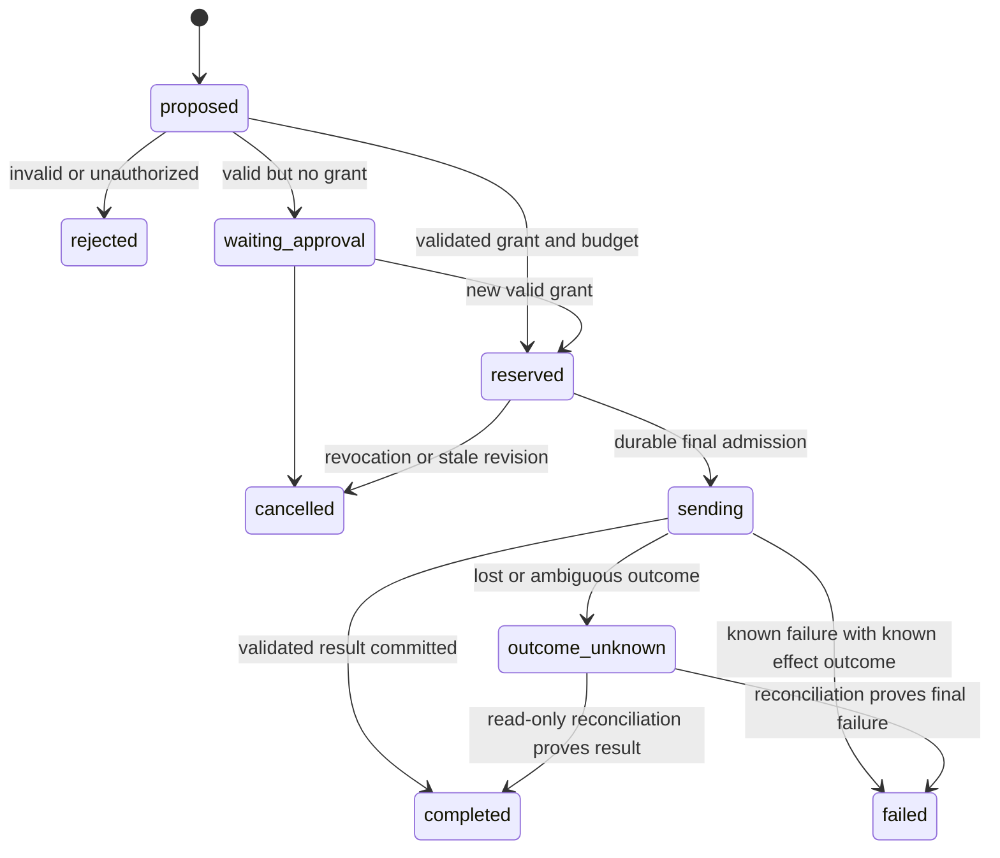

# R0 Data Model

**Contract version**: `0.1.0`. Scope: fixture proofs, not the production project schema.
See [research decisions](research.md), [pilot limits](contracts/pilot-profile.json), and
[interface contracts](contracts/engine-protocol.md). Fields below are required unless marked
optional. Wire objects reject unknown fields; extensions require a new compatible contract.

## Common value rules

- Canonical entity IDs are host-generated UUID v4 strings; opaque references do not confer authority.
  Enforce project/user/session ownership before resolving any referenced object.
- Fixed manifest/descriptor catalog IDs are not canonical entity IDs: package IDs such as
  `R0-01`, case IDs such as `CON-01`, profile IDs such as `macos-arm64-proof`, tool IDs,
  adapter IDs, and rule IDs retain their catalog-defined syntax, not UUID requirements.
- Transport `message_id` and `call_id` are sender-generated UUID v4 strings scoped to their
  authenticated binding; transport `correlation_id` refers to an existing message in the same
  binding. None is a grant or canonical entity identity. Deduplicate transport delivery only
  within that same binding; a cross-binding collision cannot deduplicate another actor's call.
  Reject cross-binding references rather than resolving them by an unscoped transport ID;
  canonical authority remains host-derived.
- Revisions, counts, byte lengths, and sequence numbers are nonnegative integers no larger
  than `9007199254740991` on the JSON wire; reject overflow, negative, fractional, or coerced
  values. WIT uses `u64`, with checked conversion at the JSON/host boundary.
- Contract versions are semantic versions; R0 accepts exact version `0.1.0`. Different versions
  are rejected, not guessed compatible. Digests are lowercase SHA-256 hex with 64 characters,
  except the explicitly labeled upstream image SHA-512 pin.
- Audit timestamps are UTC RFC 3339 strings with four-digit years. Reject leap-second
  `:60` inputs rather than silently normalizing them; checked arithmetic must not produce an
  out-of-range audit value. Deadlines and control latency use monotonic elapsed microseconds
  within a recorded `clock_epoch_id`, never wall-clock subtraction across restarts. Fixture
  IDs and enum values are case-sensitive.
- Limits in `pilot-profile.json` apply before parsing/allocation where possible. Strings are
  bounded by encoded UTF-8 bytes, not character count. No raw bodies, keys, or tokens in
  event records, general error strings, or exported diagnostics.

`usage` has exactly `units`, `bytes`, `cpu_us`, and `elapsed_us`, each an exact wire integer;
missing counters do not default during deserialization. Runtime `budget_summary` is distinct:
`limit`, `consumed`, and `reserved`, with checked `consumed + reserved <= limit`.
Attestation check maps contain catalog-keyed booleans, binary-digest maps contain SHA-256
digests, and observed-limit maps contain exact wire integers. CPU observations use separate
`cpu_quota_us` and `cpu_period_us` keys rather than an ambiguous formatted quota string.

## WorkPackage, ProofCase, and Run

| Record | Fields | Relationships / validation |
| --- | --- | --- |
| WorkPackage | `package_id`, `title`, `requires[]`, `requirement_ids[]`, `case_ids[]` | IDs R0-01 through R0-05; acyclic prerequisites from spec; cannot pass before prerequisites |
| ProofCase | `case_id`, `package_id`, `description`, `fixture_refs[]`, `expected`, `mandatory`, `requirement_ids[]`, `success_ids[]` | Fixed inventory in verification matrix; negative cases pass only when the expected denial is observed |
| Run | `run_id`, `contract_version`, `profile_id`, `profile_sha256`, `clock_epoch_id`, `started_at`, optional `finished_at`, `environment`, `dependency_record_refs[]`, `fixture_manifest_sha256` | Single owner/writer; environment records all required profile metadata; changes to profile/fixtures/versions create a new run |
| ProofResult | `run_id`, `case_id`, `status`, `expected`, `observed`, `evidence_refs[]`, `elapsed_us`, `usage`, optional `error` | Unique `(run_id,case_id)`; status `passed`, `failed`, `blocked`, or `unexecuted`; absent evidence cannot be a pass |

`expected` and `observed` are bounded typed case-specific assertions, not free text interpreted
by a model. A failed operation may be the expected result of a negative case; it is not a
substitute for a mandatory transport happy path. R0-05's aggregate status is `passed` only
when every mandatory case is passed, all required references resolve, and versions/profile
match. A partial run remains incomplete even if all selected cases passed.

Run environments distinguish `isolation_status = not_required`, `unavailable`, or `prepared`.
Contracts-only runs use `not_required`; they retain the selected manager/backend/image pins
but omit unobserved guest-package, provisioning, effective-configuration, and seccomp hashes.
`prepared` requires all four measured hashes and observed Rust/Lima/bubblewrap versions.
Absent observations are omitted, never null, zero hashes, or claims of prepared isolation.
A full R0 exit requires actual prepared isolation and its passing behavioral proofs.

## Project, scope, identity, and authority

| Record | Fields | Rules |
| --- | --- | --- |
| FixtureProject | `project_id`, `user_id`, `scope_policy_id`, `revision` | Exactly owned fixture data; no production traffic or imported executable repository configuration |
| ScopePolicy | `scope_policy_id`, `project_id`, `revision`, `allowed_destinations[]`, `exclusions[]` | Each destination has scheme, canonical hostname/IP, effective port, path rule, allowed resolved addresses; exclusions win; no implicit private/loopback authorization |
| IdentityProfile | `identity_id`, `project_id`, `secret_ref_names[]` | Synthetic credential references only; values stay in trusted host memory and never become guest context |
| ToolDescriptor | `tool_id`, `version`, `input_contract`, `output_contract`, `effect`, `permissions[]`, `limits`, `retry_class` | Host-reviewed descriptor; effects `local_read`, `local_write`, `active_network`, `data_egress`, `sensitive`; retry class `safe_read`, `deduplicated`, or `non_retryable` |
| ApprovalGrant | `grant_id`, `project_id`, `tool_id`, `tool_version`, `provider_digest`, `scope_revision`, `identity_id`, `bounded_input_sha256`, `limits`, `expires_at`, `revoked` | Host-derived binding; parameter/destination/version changes require reevaluation; no guest may supply a grant as authority |
| Budget | `budget_id`, optional `parent_budget_id`, `limit`, `consumed`, `reserved`, `revision` | One persisted aggregate; `consumed + reserved <= limit`; checked arithmetic; children reserve from parent, never copy its balance |

Canonicalize using a single reviewed URL/address path; check the scheme/host/effective port,
CONNECT authority, server name, request authority, each resolved address, and the actual chosen
connection address. Reject userinfo, ambiguous authorities, unsupported address-zone forms,
and mismatched interception authorities. Normalize mapped IPv4/IPv6 consistently. Recheck
redirects, scope revision, control revision, and grant validity at each effect admission.
Fixture loopback addresses/ports are explicitly granted; other private or local services remain
denied. Hostname discovery and valid DNS answers do not enlarge a grant.

## Immutable snapshots, patches, and evidence

- **Snapshot**: `snapshot_id`, `project_id`, `revision`, `sha256`, `length_bytes`, `body_ref`,
  `representation`, `headers[]`, `truncated`, optional `derived_from`. Headers are ordered
  name/value entries preserving legal duplicates and binary body bytes; H2 representation is
  semantic, not a promise of original TLS frames. Body reads are bounded offset/count ranges.
- **Patch**: `patch_id`, `project_id`, `base_snapshot_id`, `base_revision`, `base_sha256`,
  `operations[]`, `actor_ref`. An accepted patch creates a new snapshot. A stale base, overflow,
  ambiguous framing, or cross-project reference is rejected; unchanged content keeps original
  body bytes. R0 exercises contract fixtures, not a production editor.
- **Artifact**: `artifact_id`, `project_id`, `kind`, `relative_path`, `sha256`, `length_bytes`,
  `origin_invocation_id`, `redaction_status`. Paths must stay under the owned run directory;
  reject traversal/symlinks to external locations. Validate hash/length before use or export.
- **EvidenceRef**: exactly one strict variant, without an inferred/default revision:
  - Snapshot variant: `snapshot_id`, `revision`, `sha256`, optional `range_start/range_end`.
  - Artifact variant: `artifact_id`, `sha256`, optional `range_start/range_end`.
  A snapshot reference requires `revision` and forbids `artifact_id`.
  An artifact reference forbids `revision` and `snapshot_id`.
  Both range endpoints must be present together or both omitted. Ranges are half-open byte
  offsets in the specified representation, bounded by length. Resolve ownership and validate
  the referenced record's hash before use; artifacts are immutable and changed bytes require
  a new artifact ID. Decoded/redacted views reference their derived artifact; their offsets
  cannot silently apply to original/compressed bytes.
- **ObservationProposal**: `proposal_id`, `project_id`, `rule_id`, `title`, `evidence_refs[]`,
  `actor_ref`, `status = proposed`. Only host validation can accept the observation; R0 does
  not implement a vulnerability-confirmation lifecycle or allow model/guest assertions to
  create confirmed findings.

Use canonical evidence references, not copies of full bodies in every layer. Raw synthetic
fixture data is not a claim of encrypted production storage. Never persist real secrets or CA
private keys. Maintain any redacted derivation separately from its immutable original fixture.

## Invocation and effect state

**Invocation** fields: `invocation_id`, `run_id`, `project_id`, `investigation_id`, `session_id`,
`actor_ref`, `tool_id`, `tool_version`, `provider_digest`, `input_ref`, `input_sha256`,
`input_revision`, `control_revision`, `scope_revision`, `identity_id`, optional state-dependent `grant_id`, `budget_id`,
`attempt`, `causation_id`, `deduplication_key`, `state`, `usage`, optional `output_ref/error`.
The host creates the authority fields from the authenticated binding, not from runtime output.
Unique `(run_id,deduplication_key)` prevents duplicate effect admission; each attempt remains
attributed even when duplicate delivery is rejected.

The host ledger separately persists immutable `requested` usage ceilings and the original
submitted `source_control_revision`. These are storage metadata, not added Invocation wire
fields. The submitted revision supports exact duplicate detection only; it never replaces
the trusted originating revision. Reservation and final admission validate the requested
ceilings, not the initially zero actual-usage counters. SQLite schema 3 rejects older stores
rather than silently initializing or weakening them.

Successful input preparation persists its host-owned `proposed` invocation before returning
the artifact reference. Explicit approval or later delivery resumes that same invocation
and input; preparation assigns no grant and reserves no quota. Serialize input publication
outside provider execution and priority control so duplicate preparation cannot produce a
second unresolvable origin or a second effect.

Closed-run verification opens existing ledger/evidence stores read-only. Shared native
inspection leases exclude active writers; missing layout is an integrity failure, not an
opportunity to repair it. Inspect every budget, including unused child escrow, and export
historical events through bounded pages rather than truncating at the delivery-queue limit.

Known non-unit resource overruns are failed `budget_exhausted` outcomes with measured usage,
not successful outputs or clamped counters. Fatal integrity loss closes common admission;
retain the last durable invocation and its hold rather than fabricate a terminal outcome
or release an uncertain reservation. Evidence stores allow one writer; reopening requires
releasing that writer first.

`grant_id` is omittable, never nullable.
`grant_id` is absent in `proposed`, `rejected`, and `waiting_approval`.
`grant_id` is required in `reserved`, `sending`, `completed`, `failed`, and `outcome_unknown`.
For `cancelled`, preserve `grant_id` if and only if a valid grant was assigned before cancellation.
`grant_id` is omitted when absent; JSON null and placeholder grant IDs are invalid.
Recorded transition history determines cancellation provenance: cancellation from `reserved`
retains the assigned grant; cancellation before authorization omits it. Never invent a grant UUID.
Atomic reservation/admission requires a current valid host-derived grant. Valid assignment
means valid at assignment/admission, not necessarily at later record validation. Once authorized,
retain the historical grant on later records even after expiry or revocation, including
`cancelled`; historical presence does not authorize another admission. Recheck current grant
validity before every new effect.

Schema validation MUST accept grant-absent preauthorization records, grant-present authorized
records, and both `cancelled` shapes only with matching transition provenance. It MUST reject
null grants, grants on preauthorization records, missing grants from `reserved` onward, and
cancelled grant/history mismatches. Retained historical grants are valid record provenance
after expiry or revocation, but expired or revoked grants MUST fail any new reservation/admission.
ID validation MUST accept catalog-defined handles and same-binding sender-generated transport
UUIDs separately from host-generated canonical entity UUIDs; reject malformed UUIDs in UUID
namespaces, cross-binding transport correlations, and peer IDs offered as canonical authority.

Allowed transitions:

There is no automatic `outcome_unknown -> sending` transition. Recovery of a reserved,
not-yet-admitted action cancels/reconciles the reservation; it does not replay the command.
A crashed `sending` action is conservatively unknown, even if the receiver later proves zero
arrivals. A deliberate new user-authorized action requires a new admission, not a retry shim.
Pre-dispatch validation failures are `rejected`; known cancellation before dispatch is
`cancelled`. Tool results have explicit retryability; empty successful output cannot hide error.

## Durable checkpoint, events, and control

- **Checkpoint**: `checkpoint_id`, `run_id`, `schema_version`, `control_revision`,
  `scope_revision`, `budget_refs[]`, `invocation_refs[]`, `lease_refs[]`, `event_cursors`,
  `created_at`. Written transactionally with affected quota/state, not a serialized runtime
  conversation. The ledger is owned by one host process with an exclusive lock.
- **ControlState**: `investigation_id`, `revision`, `mode`, `admission_open`, `instruction_ref`.
  A pause/cancel request closes affected admission, increments revision, invalidates incompatible
  reservations/tickets, commits that state, and only then acknowledges the active barrier.
  Host control does not await runtime, network I/O, guest termination, or a model response.
- **ControlMeasurement**: `request_id`, `clock_epoch_id`, `received_us`, `barrier_active_us`,
  `acknowledged_us`, `affected_revision`, `late_admissions`. The elapsed receipt-to-ack must
  meet the profile; record host-local timing, not SSH round-trip latency. Work admitted before
  the barrier may already be in flight; no later stale admission is permitted.
- **Event / OutboxEntry**: `event_id`, `schema_version`, `project_id`, `aggregate_id`,
  `aggregate_sequence`, `event_type`, `timestamp`, `correlation_id`, `causation_id`, optional
  `control_revision`, `data_refs[]`, `published`. Commit state and event/outbox entry together.
  Delivery is at least once, ordered per aggregate; consumers deduplicate by event ID. No
  global ordering or exactly-once external effect is promised.
- **Lease**: `lease_id`, `invocation_id`, `owner_binding_id`, `control_revision`, `expires_at`,
  `state`. Guest supervision has a separate monotonic lease timer; host/transport loss expires
  it. Restoring a checkpoint never makes an old lease valid or resets budget.
  Lease states are `active`, `expired`, `revoked`, and `closed`. Audit `expires_at` does not
  replace the independent guest monotonic timer. Losing the owning process revokes an
  active recorded lease even before audit expiry; restoration preserves identity/expiry
  and cannot renew it. Terminal historical lease records remain terminal.

Persist reservation and `sending` state before external dispatch. Restart verifies ledger
integrity/schema and current policy/version bindings; it does not trust the checkpoint's
expired grants. Disk/sync/corruption errors close admission and produce a blocked/failed proof,
not a guessed recovered success. The receiver is an independent surviving process with its own
per-action counter, so killing the host cannot erase the observation used to prove no resend.

## Runtime binding and sandbox attestation

**RuntimeBinding**: `binding_id`, `run_id`, `adapter_id`, `adapter_version`, `runtime_digest`,
`capabilities[]`, `investigation_id`, `session_id`, `state`. Lifecycle states: `created`,
`running`, `waiting_approval`, `paused`, `cancelling`, `cancelled`, `completed`, `failed`,
`closed`. Models have a separate capability contract; R0 uses a local simulation and zero
provider network access. A completed binding does not confirm a finding.

Runtime capabilities use one shared domain/wire enum: mandatory `brokered_calls`, `events`,
`results`, `usage`, `cancellation`, and `closure`; optional `native_pause` and `native_steering`.
Duplicates, missing mandatory capabilities, and unknown capabilities are invalid. Lifecycle
completion/cancellation may close a binding but cannot reopen a terminal binding. I/O routers
retain an `Arc` to the original host binding rather than copy/rebind identity; synchronous
policy checks borrow it. The host caches its one authenticated control endpoint, registers
new durable contexts without reopening old gates, and admits no contexts after owner shutdown.

**SandboxAttestation**: `attestation_id`, `run_id`, `backend`, `manager_version`, `image_digest`,
`kernel_version`, `effective_config_sha256`, `provisioning_sha256`, `binary_digests`,
`seccomp_sha256`, `namespace_checks`, `controller_checks`, `mount_checks`, `socket_checks`,
`uid_checks`, `observed_limits`, `created_at`. Configuration inspection is necessary but not
sufficient: actual prohibited-operation and descendant tests must also pass. Missing required
controllers, namespaces, version pins, or clean configuration block launch.

## Knowledge contracts: examples only

- **Investigation / InvestigationSession**: `investigation_id`, `goal`, `control_revision`,
  `session_id`, `user_id`, `branch_refs[]`, `evidence_refs[]`. One persistent product session
  survives runtime/model changes; no agent owns its canonical state.
- **Asset / AssetRelation**: identity/type/version and relationship provenance. Discovery does
  not grant scope. **InvestigationNode / Relation**: hypotheses, actions, observations, and
  support/refutation links. **WorkflowDefinition**: versioned DAG/dependencies. **Trace**:
  actual attributed execution. These are linked types, not one interchangeable graph.
- **MemoryItem**: `memory_id`, `level`, `user_id`, optional `session_id`, `kind`, `content_ref`,
  `origin_ref`, `status`, `valid_until`, optional `promotion_source_id`. `level = user` forbids
  a session ID; `level = session` requires one. Retrieval examples prefilter owner/level/session
  before searching. Promotion creates a generalized user item with lineage and review;
  confidential session content is not copied into user knowledge. Explicit user decisions alone
  change general rules; no memory or graph expands authority.

## DependencyRecord and DecisionRecord

A DependencyRecord contains `name`, `source_url`, `checked_at`, `latest_stable_observed`,
`selected_version`, `artifact_digest`, `license_expression`, `minimum_rust`,
`compatibility_evidence_refs[]`, and optional `approved_exception_ref`. Distinguish published
checksum observation from verified downloaded bytes. Direct, transitive, guest image/package,
and tooling provenance are separate records; no floating selector is an execution pin.

A DecisionRecord contains `decision_id`, `subject`, `decision`, `rationale`, `alternatives[]`,
`evidence_refs[]`, `status`, `reviewer`, `reviewed_at`. Exit review references all required
records and limitations. Pending/blocked decisions cannot silently become approved. Neither
record type grants authority to install packages, disclose data, or weaken a failed proof.
