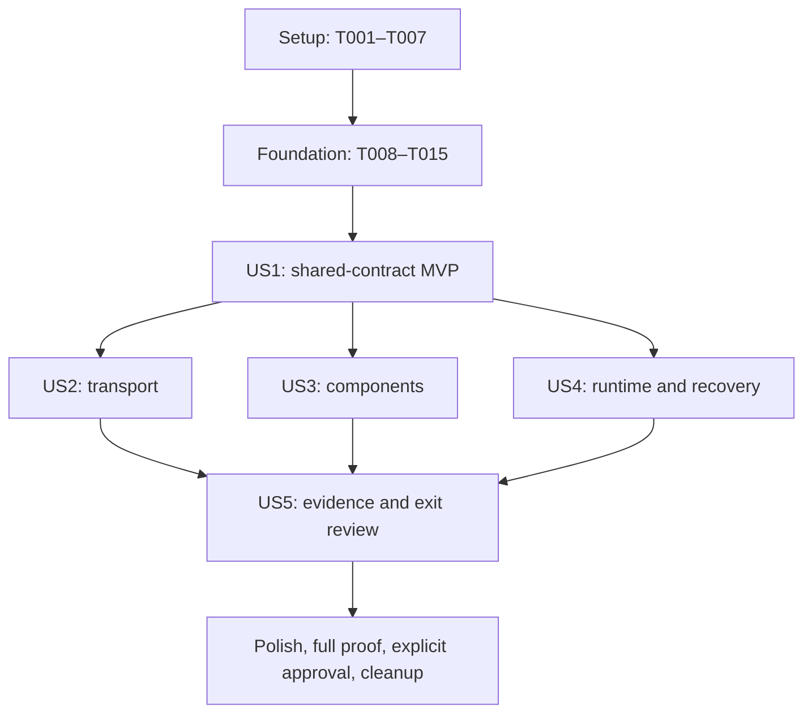

# Tasks: R0 Feasibility and Shared Contracts

**Input**: Design documents in `specs/001-r0-feasibility/`.

**Prerequisites**: [plan.md](plan.md), [spec.md](spec.md), [research.md](research.md),
[data-model.md](data-model.md), [contracts/](contracts/), [quickstart.md](quickstart.md), and
[constitution](../../.specify/memory/constitution.md).

**Tests**: Required by the specification's proof scenarios, FR-008/010/012/016, and the
[35-case verification inventory](contracts/verification-matrix.md). Author failing behavioral
checks before the corresponding implementation. A missing receiver, config inspection,
restored-state mock, source-text assertion, or empty successful response is not proof.

**Organization**: Five story increments. US1 is the shared-contract MVP. US2, US3, and US4
require US1, then can proceed independently; US5 reviews their complete evidence. This file
records implementation work. Checked tasks have observed implementation/setup evidence;
unchecked tasks and runtime proof gates remain incomplete until explicitly verified.

**Baseline amendment boundary (2026-11-18)**: Follow
[Baseline Amendment Scope](spec.md#baseline-amendment-scope) and constitution 1.1.0.
The general specification's FUN-95 / CA-81–82 require an independent backend with the
approved Tauri frontend in R1. They are not completed by these 102 R0 tasks. Preserve task
IDs/checkmarks and the recorded proof scope; do not append R1 deployment or browser-client
work to this completed R0 list.

## Format: `[ID] [P?] [Story] Description`

- IDs are sequential T001–T102. `[US1]` through `[US5]` identify story ownership.
- `[P]` means different output files and no dependency on unfinished peers in the explicitly
  identified same-stage group. It does not waive phase, red-test, or US1 prerequisites.
- A task's named files are its outputs; linked design documents are authoritative inputs.
  Preserve all listed data fields, constraints, versions, and failure semantics.
- Shared integration files have one integration owner: host/workspace manifests and lockfiles,
  `crates/engine/src/lib.rs`, shared module facades, suite dispatch, and the proof/engine binaries.
  Serialize T028–T029, T044, T056, T079, and T094 when their shared files overlap.
- Use real assertions and controlled side effects. Keep production features, automatic target
  testing, OS trust changes, live models, and R1–R5 specifications outside this work.

## Path Conventions

All implementation paths are repository-relative. The host package is `crates/engine/`; component
and Linux fixture packages are separate workspaces in `fixtures/components/` and
`fixtures/linux-runner/`, each with its own exact lockfile. Generated evidence goes under
owned `target/r0-evidence/` directories, never into source fixtures or unrelated directories.

Data constraints quoted in tasks are normative excerpts of `data-model.md` and the contracts,
not implementation-time choices. Common constraints from T011/T014 apply to every later model,
message, persistence operation, and export, including models implemented by another story.

## Phase 1: Setup (Shared Infrastructure)

**Purpose**: Establish the reviewed build graph and explicit provisioning inputs without
implementing future products or silently changing the machine's trust/dependency policy.

- [X] T001 Refresh the authoritative stable/non-yanked observations for every selected host, component, Linux, VM, and image dependency; record exact candidates, MSRVs, licenses, source dates/checksums and any incompatibility in `specs/001-r0-feasibility/research.md`; retain the current selections unless a newer stable release is verified and the register/pins are explicitly updated, never silently downgrade or adopt a prerelease.
- [X] T002 Establish the selected Rust 1.100.0 workspace toolchain and WASI P2 target from T001 in `rust-toolchain.toml` and record deliberate toolchain/Lima provisioning commands in `scripts/proofs/README.md`; detect installed Rust 1.93.1/Lima 2.1.1 as insufficient rather than running the proofs with them, and do not mutate OS trust or start a VM implicitly.
- [X] T003 Define the `razen-engine` host workspace/package and exact reviewed dependency features in `Cargo.toml`, `Cargo.lock`, and `crates/engine/Cargo.toml`; exclude both fixture workspaces, preserve the retained Rama/Wasmtime/WIT stack, use one Rustls/ring provider, and do not create fake proof binaries or a future-module crate tree.
- [X] T004 Define independent exact-pinned cdylib package `razen-component-fixtures` and Linux fixture package `razen-runner-fixtures` build graphs in `fixtures/components/Cargo.toml`, `fixtures/components/Cargo.lock`, `fixtures/linux-runner/Cargo.toml`, and `fixtures/linux-runner/Cargo.lock`; use wit-bindgen only for the component and Linux-only libc/seccompiler for approved syscall/filter fixtures, without compiling either as a host workspace target.
- [X] T005 Configure owned generated-output exclusions in `.gitignore` and document host/WASI/Linux build commands in `scripts/proofs/README.md`; preserve existing ignore entries, use standard Cargo formatting/clippy conventions, and exclude private control material, temporary roots, VM state, and `target/r0-evidence/` from committed source.
- [X] T006 Define the reviewed 35-case fixture inventory with unique IDs, expected observations, synthetic canaries and approved target identities in `fixtures/scenarios/manifest.json`, plus target-classified valid/invalid seed bytes and their versioned digest manifest in `fixtures/scenarios/parser-corpus/manifest.json`; preserve every case in `specs/001-r0-feasibility/contracts/verification-matrix.md`, use fixture data only, and never substitute a no-op for an actual operation or parser fuzz target.
- [X] T007 Record the explicit network-enabled preparation versus offline execution boundary, exact workspace-lockfile workflow, signed/checksummed-source provenance expectations and clean owned `LIMA_HOME` policy in `scripts/proofs/README.md`; no opening-source hook, ordinary proof run, or plan generation may install/upgrade packages or provision the VM automatically.

**Checkpoint**: The build/provisioning graph is reviewable. No transport, SDK, runtime, or R0
acceptance capability is claimed by setup alone.

## Phase 2: Foundational (Blocking Prerequisites)

**Purpose**: Supply bounded values, framing, private workspaces and healthy independent fixture
receivers. Complete this phase before any story; it deliberately does not pre-implement US1.

- [X] T008 [P] Add failing profile-validation tests in `crates/engine/tests/foundation_profile.rs` against `specs/001-r0-feasibility/contracts/pilot-profile.json`, covering invalid units/versions, unbounded or inconsistent limits, missing required modes, OS-trust permission, and forbidden direct network/mount/socket inheritance.
- [X] T009 [P] Add failing private-workspace and real receiver tests in `crates/engine/tests/foundation_workspace.rs`, covering traversal/symlinks/unrelated-output protection, private permissions, authenticated loopback counter operations, independently observed duplicate POST counts, and receiver survival when a separate owned child is killed.
- [X] T010 [P] Add failing value/framing/error tests in `crates/engine/tests/foundation_values.rs` and `crates/engine/tests/foundation_protocol.rs`, and the reusable stable-Rust deterministic byte-mutation helper in `crates/engine/tests/support/parser_mutation.rs`; exercise canonical/catalog/peer ID namespaces, malformed/duplicate JSON, oversized frames, authenticated runtime-versus-supervisor direction/kind/payload dispatch (including their different started shapes), redaction and queue limits, and fuzz the actual codec using the profile's complete per-target input/deadline/seed budget with round-trip/rejection oracles and replayable corpus evidence, not bare no-throw or source-text assertions.
- [X] T011 Implement shared value validation in `crates/engine/src/domain/values.rs` and the reusable structured ErrorCode/ProofError/Retryability contract in `crates/engine/src/protocol/error.rs` before profile/workspace consumers: "Fields below are required unless marked optional."; "Canonical entity IDs are host-generated UUID v4 strings; opaque references do not confer authority."; "Revisions, counts, byte lengths, and sequence numbers are nonnegative integers no larger than `9007199254740991` on the JSON wire; reject overflow, negative, fractional, or coerced values."; preserve "R0 accepts exact version `0.1.0`." and "Digests are lowercase SHA-256 hex with 64 characters, except the explicitly labeled upstream image SHA-512 pin."; validate fixed catalog handles by their manifest syntax and sender-generated transport UUIDs within their authenticated binding, never as entity authority.
- [X] T012 [P] Implement the strict immutable pilot-profile loader in `crates/engine/src/application/profile.rs` after T008/T011; apply "Wire objects reject unknown fields; extensions require a new compatible contract.", enforce positive finite parser_fuzz budgets and aggregate component invocation/host-call caps as well as all existing limits, hash exact profile bytes for run identity, and reject incompatible or permissively defaulted profiles.
- [X] T013 [P] Implement the owned-run directory and safe cleanup boundary in `crates/engine/src/adapters/workspace.rs` after T009/T011; create 0700 directories/0600 private files and sockets, prevent traversal and unsafe symlink resolution, refuse unrelated preexisting output, and delete only material belonging to the recorded run.
- [X] T014 Implement bounded JSON Lines and redacted diagnostic buffers in `crates/engine/src/protocol/codec.rs` after T010–T013, reusing T011's structured error contract; use "Audit timestamps are UTC RFC 3339 strings." and "Strings are bounded by encoded UTF-8 bytes, not character count."; preserve "Deadlines and control latency use monotonic elapsed microseconds within a recorded `clock_epoch_id`, never wall-clock subtraction across restarts.", reject duplicate/unknown fields before losing them in a generic map, propagate T011's exact error/retryability enums, and never carry secrets/full bodies in errors or silently drop required evidence on queue saturation.
- [X] T015 Implement the independently owned authenticated loopback receiver in `crates/engine/src/bin/razen-fixture-receiver.rs`, expose completed foundation modules through `crates/engine/src/lib.rs`, and add process helpers in `crates/engine/tests/support/processes.rs`; provide real POST-increment/GET-count behavior without deduplicating duplicates, keep receiver state outside the killed engine, then run the four foundation targets including the full framing fuzz budget and preserve seed/corpus/count/failure replay evidence in `target/r0-evidence/foundation/`.

**Checkpoint**: Bounded infrastructure and a demonstrably healthy independent receiver exist.
No story may use an absent receiver to claim denied effects or claim the full CLI is complete.

## Phase 3: User Story 1 - Agree on Shared Contracts (Priority: P1) — MVP

**Goal**: Deliver R0-01's executable, versioned authority/evidence/knowledge contract pack with
consistent host decisions for two simulated consumers.

**Independent Test**: CON-01 through CON-05 pass without a desktop, model, component runner,
transport implementation, or VM; the contracts-only CLI produces an explicitly partial packet.

### Tests for User Story 1 — Write First and Observe Failure

- [X] T016 [P] [US1] Add failing CON-01 and CON-02 record/version/state/range round-trip tests in `crates/engine/tests/us1_records.rs`, `crates/engine/tests/us1_evidence.rs`, and `crates/engine/tests/us1_proofs.rs`, transactional quota/revision/outbox/durability tests in `crates/engine/tests/us1_ledger.rs`, and deterministic real typed-parser mutation fuzzing in `crates/engine/tests/us1_parser_fuzz.rs` reusing T010's helper; cover strict snapshot/artifact reference variants with required/forbidden revision and paired ranges, grant-absent preauthorization, authorized/historical/cancelled grant shapes, valid catalog/peer IDs and shared checkpoint/event records, execute the complete per-target profile fuzz budget with typed round-trip/invariant/rejection oracles, and retain reproducible seed/corpus/counterexample evidence.
- [X] T017 [P] [US1] Add failing CON-03 and CON-04 host-authority tests in `crates/engine/tests/us1_authority.rs`, `crates/engine/tests/us1_host_admission.rs`, `crates/engine/tests/us1_registry.rs`, and `crates/engine/tests/us1_protocol.rs`, with shared-control tests in `crates/engine/tests/us1_control.rs` and `crates/engine/tests/us1_control_owner.rs`, using direct-harness and simulated-runtime inputs to reject foreign/stale evidence, revoked grants, forged entity authority, cross-binding transport correlations/dedup collisions and child scope/quota escalation; require valid current grants before reservation/effects without rejecting historical expired/revoked grant provenance; exercise the actual independent host control path with blocked consumers, persist revision/ticket invalidation before acknowledgment, record ControlMeasurement within control.ack_deadline_ms, and deny every stale post-barrier admission without components, transport or a VM.
- [X] T018 [P] [US1] Add failing CON-05 graph/session/memory examples in `crates/engine/tests/us1_knowledge.rs`, proving the four structures remain distinct, ownership is filtered before retrieval, third memory levels/cross-session history are denied, and promotion cannot elevate authority.

### Implementation for User Story 1

- [X] T019 [P] [US1] Implement WorkPackage, ProofCase, Run and ProofResult in `crates/engine/src/domain/proofs.rs` after T016; preserve "IDs R0-01 through R0-05; acyclic prerequisites from spec; cannot pass before prerequisites", "Fixed inventory in verification matrix; negative cases pass only when the expected denial is observed", "Single owner/writer; environment records all required profile metadata; changes to profile/fixtures/versions create a new run", and "Unique `(run_id,case_id)`; status `passed`, `failed`, `blocked`, or `unexecuted`; absent evidence cannot be a pass"; `finished_at` and `error` remain optional.
- [X] T020 [P] [US1] Implement FixtureProject, ScopePolicy, IdentityProfile, ToolDescriptor, ApprovalGrant and Budget in `crates/engine/src/domain/authority.rs` after T017; preserve "Exactly owned fixture data; no production traffic or imported executable repository configuration", "exclusions win; no implicit private/loopback authorization", "Synthetic credential references only; values stay in trusted host memory and never become guest context", "Host-reviewed descriptor; effects `local_read`, `local_write`, `active_network`, `data_egress`, `sensitive`; retry class `safe_read`, `deduplicated`, or `non_retryable`", "Host-derived binding; parameter/destination/version changes require reevaluation; no guest may supply a grant as authority", and "One persisted aggregate; `consumed + reserved <= limit`; checked arithmetic; children reserve from parent, never copy its balance"; `parent_budget_id` remains optional.
- [X] T021 [US1] Implement Snapshot, Patch, Artifact, EvidenceRef and ObservationProposal in `crates/engine/src/domain/evidence.rs` using every required/optional field from `data-model.md`; enforce "Headers are ordered name/value entries preserving legal duplicates and binary body bytes; H2 representation is semantic, not a promise of original TLS frames.", "An accepted patch creates a new snapshot.", "A stale base, overflow, ambiguous framing, or cross-project reference is rejected; unchanged content keeps original body bytes.", "Ranges are half-open byte offsets in the specified representation, bounded by length.", and "Paths must stay under the owned run directory; reject traversal/symlinks to external locations."; preserve "A snapshot reference requires `revision` and forbids `artifact_id`." and "An artifact reference forbids `revision` and `snapshot_id`.", paired-or-absent evidence range endpoints, immutable artifact IDs/hash validation, and optional `derived_from` and "Only host validation can accept the observation; R0 does not implement a vulnerability-confirmation lifecycle or allow model/guest assertions to create confirmed findings."
- [X] T022 [US1] Implement the four graph/trace structures and InvestigationSession/MemoryItem examples in `crates/engine/src/domain/knowledge.rs` after T021; preserve "One persistent product session survives runtime/model changes; no agent owns its canonical state.", "`level = user` forbids a session ID; `level = session` requires one.", prefilter owner/level/session, reviewed generalized promotion with source lineage/status/expiry, and explicit-user-only general rule changes; implement contract examples, not a production retrieval engine.
- [X] T023 [US1] Implement typed Invocation/state transitions in `crates/engine/src/domain/invocation.rs` and shared Checkpoint, ControlState, ControlMeasurement and Event/OutboxEntry records in `crates/engine/src/domain/execution.rs` before ledger use, then the strict pack parser/examples in `crates/engine/src/protocol/contracts.rs` and `fixtures/scenarios/contracts.json` after T019–T022; preserve "optional `output_ref/error`", "`grant_id` is absent in `proposed`, `rejected`, and `waiting_approval`.", "`grant_id` is required in `reserved`, `sending`, `completed`, `failed`, and `outcome_unknown`.", "For `cancelled`, preserve `grant_id` if and only if a valid grant was assigned before cancellation.", and "`grant_id` is omitted when absent; JSON null and placeholder grant IDs are invalid."; retain historical grants, exact transitions, optional event control revision, per-aggregate deduplication, and every common value/ownership/evidence constraint without a second runtime schema.
- [X] T024 [US1] Implement the minimal single-writer transactional ledger in `crates/engine/src/adapters/ledger.rs` using T023's completed common execution types and T016's red tests in `crates/engine/tests/us1_ledger.rs` and `crates/engine/tests/us1_catalog.rs`; apply profile journal/sync/fullfsync/foreign-key/busy settings, atomically persist state-dependent grant presence, quota/revision/attempt/outbox/checkpoint records, preserve historical grant provenance, reject corrupt/incompatible state, and keep fixture-only redacted data rather than a production store.
- [X] T025 [US1] Implement common host admission and quota accounting in `crates/engine/src/application/admission.rs` plus the shared durable revision-barrier service in `crates/engine/src/application/control.rs` after T020/T023/T024; derive authority from trusted bindings, require a current valid host grant at reservation and immediately before effects, retain rather than reuse historical grants, recheck scope/identity/versions/control, reserve parent-backed quota, serialize final admission with revocation, close admission immediately on control receipt, persist revision/ticket invalidation before acknowledgment, record ControlMeasurement and keep all runtime/network/termination waits outside the priority control path, and preserve "There is no automatic `outcome_unknown -> sending` transition."
- [X] T026 [US1] Implement the host-owned registry and actual local snapshot/context/observation handlers in `crates/engine/src/application/registry.rs` after T021–T025; expose only implemented providers, enforce the exact input/output contracts and chunk/output budgets, keep guest results as proposals, and reject unavailable tools explicitly rather than register no-op networking/model handlers.
- [X] T027 [US1] Implement authenticated binding, versioned envelopes and typed caller routing in `crates/engine/src/protocol/engine.rs`, the two real consumers in `crates/engine/src/application/consumers.rs`, and independent process/control loops in `crates/engine/src/application/engine_entry.rs` and `crates/engine/src/bin/razen-engine.rs` after T025; apply exact protocol/kind/correlation rules and host-derived identity, reject guest-supplied authority, wire the genuine US1 control service independently of peer output so its durable receipt-to-ack barrier works before US3/US4, and keep control capability/credential material outside all peer payloads.
- [X] T028 [US1] Wire genuine contracts-only execution into `crates/engine/src/bin/razen-proof.rs`, `crates/engine/src/bin/razen-engine.rs`, `crates/engine/src/application/proof_entry.rs`, `crates/engine/src/application/engine.rs`, `crates/engine/src/application/packet.rs`, and `crates/engine/src/application/suites/contracts.rs`; emit actual bounded result/trace/artifact records for CON cases, refuse unknown or unimplemented suites without fake success, and report `r0_exit_ready = false` for this partial increment.
- [X] T029 [US1] Serialize shared module/dispatch integration in `crates/engine/src/lib.rs` and `crates/engine/src/application/suites/mod.rs`, keeping domain types independent of Rama/Wasmtime/SQLite internals; make completed US1 APIs usable by all three later proof stories without introducing stub modules for their unimplemented functionality.
- [X] T030 [US1] Run the targeted US1 record, authority, shared-control, knowledge, ledger and typed-parser fuzz tests from `crates/engine/tests/us1_records.rs`, `crates/engine/tests/us1_authority.rs`, `crates/engine/tests/us1_control.rs`, `crates/engine/tests/us1_knowledge.rs`, `crates/engine/tests/us1_ledger.rs`, and `crates/engine/tests/us1_parser_fuzz.rs`; require the complete fuzz input budget and seed/corpus/generator/count/replay evidence, treat deadline/truncation/counterexamples as failure, and fix contract discrepancies rather than weaken cases or bypass validation; require every shared-control sample to meet the profile deadline with durable invalidation and zero stale admissions.
- [X] T031 [US1] Launch the actual contracts-only CLI from `crates/engine/src/bin/razen-proof.rs` with the canonical profile and record CON-01–CON-05 observations in a fresh owned run beneath `target/r0-evidence/us1-contracts/`; inspect stdout/stderr, failure codes, hashes and partial-readiness status, and demonstrate US1 independently without executing later stories.

**Checkpoint**: A useful shared-contract MVP is demonstrated. US2/US3/US4 are now unblocked;
this is not a passing R0 exit or a delivered manual workbench.

## Phase 4: User Story 2 - Demonstrate Authorized Traffic Handling (Priority: P1)

**Goal**: Deliver R0-02's four successful traffic modes, verified isolated TLS trust, and
actual destination/limit/error observations through the shared host boundary.

**Independent Test**: NET-01 through NET-08 pass using healthy controlled clients/servers and
US1, with no component runtime, VM, or model dependency. Every required happy path succeeds.

### Tests for User Story 2 — Write First and Observe Failure

- [x] T032 [P] [US2] Add failing NET-01, NET-02, NET-03 and NET-04 success tests in `crates/engine/tests/us2_modes.rs`, requiring real HTTP/1.1 forwarding, opaque CONNECT tunneling, HTTPS HTTP/1.1 interception and HTTPS HTTP/2 interception with H2 ALPN on both legs, semantic headers, two concurrent streams and exact unchanged bodies.
- [x] T033 [P] [US2] Add failing NET-05 and NET-06 scope/TLS tests in `crates/engine/tests/us2_scope_tls.rs`, covering DNS changes/redirect/address pivots, CONNECT/SNI/request-authority mismatch, invalid upstream certificates, receiver-observed zero forbidden effects, before/after OS trust equality and no secret/key-log disclosure.
- [x] T034 [P] [US2] Add failing NET-07 and NET-08 bounded-body/encoding/H2-reset tests in `crates/engine/tests/us2_stream_bounds.rs`, requiring visible truncation/errors, no corrupted/incomplete replacement, and an unaffected valid stream after another stream is reset; expected errors must never substitute for NET-01–NET-04 success.

### Implementation for User Story 2

- [x] T035 [P] [US2] Implement healthy HTTP/TLS/H2 fixture servers, ephemeral in-memory CA keys, explicit isolated client roots and upstream trust in `crates/engine/tests/support/transport_fixtures.rs`; use controlled loopback ports and deliberately reachable denied receivers, expose public roots only, and never use OS trust installation, disabled verification or environment key logging.
- [x] T036 [P] [US2] Implement the product-owned scope-aware Rama connector in `crates/engine/src/adapters/transport/scope_connector.rs`; normalize scheme/host/effective port/mapped addresses, reject userinfo/ambiguous authorities/unsupported zones, re-resolve/check/pin each actual connection address and redirect, and consult current shared admission instead of treating a URL parser or CONNECT grant as authorization.
- [x] T037 [US2] Implement HTTP/1.1 forwarding and opaque authorized CONNECT tunneling in `crates/engine/src/adapters/transport/http1.rs` and `crates/engine/src/adapters/transport/tunnel.rs` after T035/T036; validate framing, preserve legal repeated headers/binary bodies, enforce profile limits and timeouts, and label tunnels as uninspected rather than fabricate snapshots of decrypted traffic.
- [x] T038 [US2] Implement verified HTTPS HTTP/1.1 interception in `crates/engine/src/adapters/transport/intercept.rs` after T036/T037; match CONNECT, TLS server name and decrypted authority, use isolated fixture trust on both TLS legs, recheck each new egress, keep keys host-memory-only, and do not copy Rama's verification-disabled or key-log-enabled example settings.
- [x] T039 [US2] Implement genuine H2 ALPN negotiation, forwarding, concurrent stream identity and reset containment in `crates/engine/src/adapters/transport/http2.rs`; use H2 on both legs, preserve semantic headers and body bytes, attribute per-stream errors, and reject a downgrade as satisfying the required H2 mode.
- [x] T040 [US2] Implement bounded streaming capture and original/derived snapshot production in `crates/engine/src/adapters/transport/capture.rs`; use profile-sized chunks/references, label truncation/representation, reject edits requiring unavailable complete buffers, enforce decompression/encoding policy and visible errors, and never turn an error into an empty successful response.
- [x] T041 [US2] Connect the actual `http.send` provider to common registry/admission in `crates/engine/src/application/http_send.rs`; validate the referenced base snapshot and explicit identity, persist final admission/usage before dispatch, recheck each connection/redirect and report actual partial/unknown outcomes without granting extra network or data-egress authority.
- [x] T042 [US2] Bind approved transport scenario inputs/expected receiver observations in `fixtures/scenarios/transport.json` and `crates/engine/src/application/suites/transport.rs`; ensure all eight NET cases execute actual operations with trace/evidence references and cannot pass because a fixture endpoint is absent.
- [x] T043 [US2] Implement direct-versus-proxy warm local timing and resource sampling in `crates/engine/src/application/measurements.rs`, recording the profile's warmup/sample counts, body size, hardware/version/fixture context and raw samples under `target/r0-evidence/us2-measurements/`; do not claim R1 latency/load targets have passed or time compilation/provisioning/WAN/model work.
- [x] T044 [US2] Serialize transport suite/provider/module registration through `crates/engine/src/application/suites/mod.rs`, `crates/engine/src/application/registry.rs`, and `crates/engine/src/lib.rs`; add actual completed handlers only and preserve the contracts-only consumer and host-policy path.
- [x] T045 [US2] Run the three targeted US2 integration test targets from `crates/engine/tests/us2_modes.rs`, `crates/engine/tests/us2_scope_tls.rs`, and `crates/engine/tests/us2_stream_bounds.rs`; require every positive mode and negative assertion to pass without suppressing protocol or TLS failures.
- [x] T046 [US2] Launch the actual transport suite from `crates/engine/src/bin/razen-proof.rs` and preserve NET-01–NET-08 receiver, ALPN, trust, byte-fidelity, timing and error evidence under `target/r0-evidence/us2-transport/`; confirm the selected-suite packet remains partial R0 evidence and cleanup leaves OS trust unchanged.

**Checkpoint**: Four traffic modes and the declared negative matrix are demonstrated, not
inferred from a library name or accepted as unsupported errors.

## Phase 5: User Story 3 - Contain Component Failures (Priority: P1)

**Goal**: Deliver R0-03's public passive WIT proof and supervised resource/permission isolation,
including successful fresh execution after every adversarial variant.

**Independent Test**: CMP-01 through CMP-07 pass using US1 and the public component contract,
without a production SDK/plugin manager, transport implementation, VM, or model.

### Tests for User Story 3 — Write First and Observe Failure

- [X] T047 [P] [US3] Add failing public-WIT conformance/CMP-01, CMP-04 and CMP-06 tests in `crates/engine/tests/us3_component_contract.rs`, exercising actual built components, permitted chunks, foreign/stale/hash/range rejection, invalid output and denied filesystem/socket/environment/credential access without private engine APIs.
- [X] T048 [P] [US3] Add failing CMP-02, CMP-03, CMP-05 and CMP-07 tests in `crates/engine/tests/us3_component_limits.rs` for real loops/growth/output faults/blocked calls and aggregate invocation/host-call saturation; use barriers to overlap actual admissions/broker reads, require immediate budget_exhausted with no spawn/effect/queue growth, slot release after success/trap/timeout/cancellation and a fresh valid successor after EACH variant, while the engine and control remain responsive; reuse the completed US1 control path and record each ControlMeasurement from host receipt to active durable-barrier acknowledgment within control.ack_deadline_ms, without depending on US4.

### Implementation for User Story 3

- [X] T049 [US3] Generate minimal guest/host bindings from the same pinned WIT in `fixtures/components/src/bindings.rs` and `crates/engine/src/adapters/components/bindings.rs`; configure the native `wasm32-wasip2` component path, pin WIT content/hash plus independent runtime/binding versions, and do not add cargo-component or P3 async imports.
- [X] T050 [US3] Implement valid and adversarial cdylib variants in `fixtures/components/src/lib.rs` and `fixtures/components/Cargo.toml` after T049 against `specs/001-r0-feasibility/contracts/plugin-sdk.wit`; add `scripts/proofs/build-components.sh` to build all six reviewed mutually exclusive features fixture-valid, fixture-loop, fixture-grow, fixture-output, fixture-host-call and fixture-denied-access with exact WASI P2 lock/toolchain pins, emit distinct hashed artifacts and a build manifest under `target/proof-components/`, and never alter source scenarios or return hardcoded proof outcomes.
- [X] T051 [US3] Implement configured Wasmtime Store/linker execution in `crates/engine/src/adapters/components/runner.rs`; apply per-Store linear-memory/table/instance/fuel/epoch and deadline/output bounds only after engine-wide invocation admission, distinguish those limits from aggregate caps, and expose no WASI environment/preopens/network/inherited stdio or assumption that fuel stops blocked host operations.
- [X] T052 [US3] Implement the WIT snapshot-reader broker in `crates/engine/src/adapters/components/snapshot_reader.rs`; bind reads to host invocation/project/revision/hash, enforce checked range/chunk/cumulative byte limits before copying and the engine-wide host-call slot before I/O, reject saturation immediately with budget_exhausted, release on every completion/trap/timeout/cancellation path, and apply "Ranges are half-open byte offsets in the specified representation, bounded by length." to observations/derived views.
- [X] T053 [US3] Implement the supervised component process in `crates/engine/src/bin/razen-component-runner.rs` and `crates/engine/src/adapters/components/supervisor.rs`; own/share the profile's aggregate invocation and host-call counters across all stores/runners in one engine, reject full capacity before spawning/I/O without queues, release slots on every terminal path, keep independent host-call deadlines/output/RSS sampling, terminate failed runners without the engine, and distinguish RSS monitoring from a hard guest allocation cap.
- [X] T054 [US3] Implement passive component proof dispatch and host result validation in `crates/engine/src/application/component_proof.rs`; reject substituted snapshots/cross-project results, retain explicit trap/timeout/output-invalid diagnostics, and keep observations proposed rather than confirmed findings or empty successful failure fallbacks.
- [X] T055 [US3] Implement CMP scenario execution and per-failure/saturation fresh-valid recovery in `crates/engine/src/application/suites/components.rs` and `fixtures/scenarios/components.json`; consume T050's distinct approved build-artifact manifest, preserve immutable fixture/WIT hashes and actual limit/termination/broker-cap observations and timed durable-barrier ControlMeasurement records from the shared US1 handler, and account for every slot release and successor result.
- [X] T056 [US3] Serialize completed component suite/module registration through `crates/engine/src/application/suites/mod.rs` and `crates/engine/src/lib.rs`; preserve US1 independently and avoid shared-file edits concurrent with T044 or T079.
- [X] T057 [US3] Build every approved component variant with `scripts/proofs/build-components.sh` using `fixtures/components/Cargo.toml` and its lockfile, then run `crates/engine/tests/us3_component_contract.rs` and `crates/engine/tests/us3_component_limits.rs` after completed scenario/module wiring; require real WIT/compiler conformance, aggregate saturation/release and fresh-success observations, never fixture presence or balanced syntax alone.
- [x] T058 [US3] Launch the actual component suite from `crates/engine/src/bin/razen-proof.rs` and record CMP-01–CMP-07 public-contract, denial, failure-containment and fresh-valid evidence under `target/r0-evidence/us3-components/`; no production SDK completeness, unrestricted native code or absolute sandbox guarantee is claimed.

**Checkpoint**: The public component boundary and actual failure recovery are demonstrated.
An engine that merely reports runner failure, or a config-only memory limit, is insufficient.

## Phase 6: User Story 4 - Prove a Neutral, Controlled Runtime Boundary (Priority: P1)

**Goal**: Deliver R0-04/CA-65: a genuine simulated adapter, host-owned control and effects,
real process/descendant isolation, and forced-restart quota/uncertain-effect reconciliation.

**Independent Test**: RUN-01 through RUN-08 and REC-01 through REC-05 pass using US1, the
foundation receiver and selected VM backend, without US2/US3, a real framework or model.
All ten blocked-runtime control samples meet the one-second active-barrier deadline.

### Tests for User Story 4 — Write First and Observe Failure

- [x] T059 [P] [US4] Add failing RUN-01, RUN-06 and RUN-07 lifecycle/broker/control tests in `crates/engine/tests/us4_runtime.rs`, covering exact lifecycle payloads and the separate authenticated supervisor launch/reply/control schemas, rejecting runtime/supervisor started-payload substitution, wrong directions and mismatched launch/attestation IDs, a blocked/noncooperative adapter, native-control absence, duplicate/late results, zero real model egress and receipt-to-durable-barrier acknowledgment rather than just queue acceptance.
- [x] T060 [P] [US4] Add failing RUN-02, RUN-03, RUN-04 and RUN-05 real isolation tests in `crates/engine/tests/us4_isolation.rs`, requiring healthy permitted controls plus parent/descendant filesystem, credential, IPv4/IPv6 TCP/UDP/DNS, AF_UNIX/AF_VSOCK, privilege/namespace/cgroup/descriptor escape and actual resource-flood observations; no absent-controller skip or native fallback may count as pass.
- [x] T061 [P] [US4] Add failing REC-01, REC-02, REC-03, REC-04 and REC-05 tests in `crates/engine/tests/us4_recovery.rs`, SIGKILLing the owned engine at all five named protocol seams, including after_reservation_commit before final admission and after_sending_commit before dispatch while the independent receiver survives, then checking zero POSTs and released unspent reservation at both reservation seams, conservative outcome_unknown at both sending/receiver seams, saved consumption, current policy/grants/versions, duplicate handling and zero automatic POST resends under sync/full-disk/corruption faults.
- [x] T062 [P] [US4] Add failing RUN-08 host/SSH-loss and descendant-termination tests in `crates/engine/tests/us4_orphans.rs`, verifying monotonic guest lease expiration, empty invocation cgroups and recorded owned-VM containment escalation rather than treating a killed SSH client as proof that remote descendants stopped.

### Implementation for User Story 4

- [X] T063 [P] [US4] Implement RuntimeBinding and Lease records in `crates/engine/src/domain/runtime.rs`, reusing US1 Invocation from `crates/engine/src/domain/invocation.rs` and Checkpoint/ControlState/ControlMeasurement/Event/OutboxEntry from `crates/engine/src/domain/execution.rs` instead of redefining them; preserve lifecycle states "`created`, `running`, `waiting_approval`, `paused`, `cancelling`, `cancelled`, `completed`, `failed`, `closed`", keep `expires_at` as audit metadata while T072 enforces live guest monotonic timing, and enforce "Restoring a checkpoint never makes an old lease valid or resets budget."
- [x] T064 [P] [US4] Implement SandboxAttestation with all required version/hash/namespace/controller/mount/socket/UID/observed-limit fields in `fixtures/linux-runner/src/attestation.rs` and matching host decoding in `crates/engine/src/adapters/guest/attestation.rs`; preserve "Missing required controllers, namespaces, version pins, or clean configuration block launch." and require actual prohibited-operation evidence in addition to configuration inspection.
- [x] T065 [US4] Implement the neutral simulated adapter and separate offline model fixture in `crates/engine/src/adapters/runtime/simulated.rs` and `crates/engine/src/adapters/models/simulated.rs`; exercise start/context/broker calls/events/results/usage/cancel/close, fixed fixture proposals and declared capabilities, return explicit provider-unavailable for real providers, and give neither adapter authority or a hidden network path.
- [x] T066 [US4] Extend the already functioning US1 priority control receipt and durable revision-barrier acknowledgment with RuntimeBinding lifecycle routing in `crates/engine/src/application/control.rs` and the owned engine control loop in `crates/engine/src/bin/razen-engine.rs`; reuse the shared handler rather than introducing its first implementation in US4, map runtime-specific pause/steer/cancel/revoke requests, close admission immediately, advance/persist revision and invalidate tickets before acknowledgment, measure host receipt-to-ack within 1 second, and never wait on runtime output, guest termination or network I/O before servicing control.
- [x] T067 [US4] Extend `crates/engine/src/adapters/ledger.rs` with complete checkpoint/outbox/reservation/attempt reconciliation from `data-model.md`; preserve "Delivery is at least once, ordered per aggregate; consumers deduplicate by event ID.", "There is no automatic `outcome_unknown -> sending` transition.", current grant/version checks, no quota reset and fail-closed disk/integrity/sync behavior; do not invent exactly-once external effects or a production storage subsystem.
- [x] T068 [US4] Implement effective pinned-backend preflight in `crates/engine/src/adapters/guest/preflight.rs`, inspecting private `LIMA_HOME`, global/instance overrides, VZ/plain mode, raw image digest, manager/kernel/binary versions, mounts/forwards/agents/proxy inheritance and mandatory controllers/namespaces; block contaminated/missing configuration instead of choosing defaults or disabling the mandatory pilot proof.
- [x] T069 [US4] Implement reviewed idempotent VM preparation in `scripts/proofs/lima.yaml` and `scripts/proofs/provision-guest.sh`, pinning the research image/source bytes and exact tool/package manifests, building Linux fixture binaries natively under their lockfile, disabling mounts/static and socket forwards/containerd/Rosetta/agents, and separating explicit network-enabled provisioning from offline workloads without changing host trust or requiring implicit host sudo.
- [x] T070 [US4] Implement the trusted guest supervisor in `fixtures/linux-runner/src/bin/razen-tool-supervisor.rs` with a dedicated no-sudo workload UID, final cgroup placement before child release, the strict authenticated supervisor-role launch/reply/control payloads from engine-protocol.md, bounded stdio-only protocol, parent-only controller management and checked profile resource limits; keep management supervision outside the workload cgroup and never run hostile code as Lima's default sudo-capable user.
- [x] T071 [US4] Implement mandatory namespace/filesystem/descriptor/capability setup and the reviewed AArch64 seccompiler allowlist in `fixtures/linux-runner/src/sandbox.rs`; enforce read-only approved runtime/inputs, bounded tmpfs, fresh local proc/minimal devices, cleared environment, no home/sys/run/cgroup/management mounts or inherited sockets, denied socket creation including AF_VSOCK, allowed bounded ordinary fork/exec and denied privilege/namespace escapes; fail closed if any required isolation primitive is unavailable.
- [x] T072 [US4] Implement independent monotonic guest leases, whole-cgroup termination and verified emptiness in `fixtures/linux-runner/src/lifecycle.rs`, plus owned-VM force-stop escalation in `crates/engine/src/adapters/guest/lifecycle.rs`; use the profile's deadlines, retain actual already-sent/unknown effects, and ensure host acknowledgment is not delayed by guest cancellation or management failure.
- [x] T073 [US4] Implement actual adversarial/healthy operations in `fixtures/linux-runner/src/bin/razen-sandbox-adversary.rs` and `fixtures/linux-runner/src/adversaries/` using the pinned syscall fixtures; attempt all RUN-03–RUN-05 parent/descendant canary reads, socket families, descriptor escapes, privilege changes and CPU/memory/PID/tmpfs/output floods, with independent observer counts and a permitted successor rather than hardcoded expected denials.
- [x] T074 [US4] Implement bounded authenticated guest-transport and broker routing in `crates/engine/src/adapters/guest/transport.rs`; fix authenticated supervisor-role decoding before dispatch and reject runtime-kind/payload substitution, validate host-assigned launch IDs and strict replies, use no PTY/agent/X11/socket forwarding, bind host-derived identity/revisions/quotas to the invocation, pass only approved fixture IDs and immutable references, reject arbitrary shell/path/socket operations, and keep runtime stdout parsing isolated from the control path.
- [x] T075 [US4] Implement trusted crash seams and actual owned-process restart orchestration in `crates/engine/src/application/recovery.rs` and `crates/engine/src/bin/razen-engine.rs`; expose every named protocol fault barrier (before_reservation_commit, after_reservation_commit, after_sending_commit, after_receiver_increment, after_completion_commit) only to the trusted fixture orchestrator, preserve the durable-reserved/pre-admission seam, persist `sending` before effect dispatch, leave the receiver alive through SIGKILL, restore from the same durable ledger and reconcile uncertain actions read-only without replaying commands.
- [x] T076 [US4] Implement canonical event/outbox delivery, cursor/ID deduplication and late-origin handling in `crates/engine/src/application/events.rs`; retain attribution/attempt/causality, prevent obsolete results from reopening admission, bound queues and mark lost required evidence incomplete instead of silently dropping it or turning a failure into empty success.
- [x] T077 [US4] Implement cancellation/isolation/reconstruction for adapters lacking native pause/steering in `crates/engine/src/application/runtime_control.rs`; preserve the persistent investigation/session/evidence/consumed budget, revalidate current policy before any resumed effect and leave no stale worker running unseen, without rewriting an outer workflow or implementing an actual agent product.
- [x] T078 [US4] Implement runtime/recovery scenario drivers and attested result collection in `crates/engine/src/application/suites/runtime.rs`, `crates/engine/src/application/suites/recovery.rs`, and `fixtures/scenarios/runtime.json`; bind every actual syscall/receiver/control/termination observation to immutable run/profile/version references and record missing evidence as blocked/unexecuted, not passed.
- [x] T079 [US4] Serialize completed runtime/recovery suite, registry and engine/module integration in `crates/engine/src/application/suites/mod.rs`, `crates/engine/src/application/registry.rs`, `crates/engine/src/lib.rs`, and `crates/engine/src/bin/razen-engine.rs`; reuse the US1 authority/ledger boundary, keep the runtime/model ports separate and avoid concurrent shared-file integration with T044/T056.
- [x] T080 [US4] Explicitly prepare/verify the approved guest and build its Linux fixture workspace, then execute `crates/engine/tests/us4_runtime.rs`, `crates/engine/tests/us4_isolation.rs`, `crates/engine/tests/us4_recovery.rs`, and `crates/engine/tests/us4_orphans.rs` after completed runtime/engine integration; require actual process/restart/descendant/control observations, with no implicit provisioning by tests, unavailable-backend skips, narrowed cases or reruns merely disputing user-reported failures.
- [x] T081 [US4] Launch the real runtime suite from `crates/engine/src/bin/razen-proof.rs` and preserve RUN-01–RUN-08 attestation, actual denied-operation/healthy-control, resource/descendant termination and ten blocked-runtime barrier samples under `target/r0-evidence/us4-runtime/`; every sample must meet the profile and no stale admission may occur.
- [x] T082 [US4] Launch the real recovery suite from `crates/engine/src/bin/razen-proof.rs` and preserve REC-01–REC-05 crash-point, ledger-integrity, current-policy, receiver-count and no-resend evidence under `target/r0-evidence/us4-recovery/`; fixture-only restored-state simulations, reset quotas and auto-replayed uncertain actions cannot satisfy this checkpoint.

**Checkpoint**: CA-65's simulated adapter AND real process-boundary evidence are available.
The independent receiver proves actual restart behavior; one-second acknowledgment means a
committed active barrier, not a queued cancellation or an eventually stopped model.

## Phase 7: User Story 5 - Make an Evidence-Based R0 Exit Decision (Priority: P2)

**Goal**: Deliver R0-05's provenance/decision register, measured evidence, strict full-inventory
verification and honest separation of passing proofs from explicit maintainer approval.

**Independent Test**: EXIT-01/EXIT-02 validate complete, partial, modified, failed, blocked and
unreviewed packets. No absent observation or automatic approval can produce R0 readiness.

### Tests for User Story 5 — Write First and Observe Failure

- [x] T083 [P] [US5] Add failing EXIT-01 provenance/profile/measurement tests in `crates/engine/tests/us5_provenance.rs`, covering exact versions/checksums/licenses/MSRV/source dates, guest manifests, separate lockfiles, required decision/environment fields, reproducible raw samples and explicit distinction between published and downloaded-and-verified digests.
- [x] T084 [P] [US5] Add failing EXIT-02 packet/CLI/gate tests in `crates/engine/tests/us5_exit.rs`, rejecting missing/duplicate/modified cases or artifacts, mixed run/profile/version sets, unsupported positive modes, wrong summary counts, secret leakage, unsafe output/cleanup paths and missing/stale/rejected approval while preserving honest partial results and command exit codes.

### Implementation for User Story 5

- [x] T085 [US5] Implement DependencyRecord and DecisionRecord in `crates/engine/src/domain/decisions.rs` with all fields from `data-model.md`, optional `approved_exception_ref`, authoritative `latest_stable_observed`/`selected_version`/artifact-digest evidence, reviewer/time/status and exact run-manifest references; preserve "Pending/blocked decisions cannot silently become approved." and do not turn a source checksum observation into verified downloaded-byte provenance.
- [x] T086 [US5] Implement the full versioned 35-case manifest and coverage/dependency evaluator in `crates/engine/src/application/inventory.rs`, consuming `fixtures/scenarios/manifest.json`; retain all FR/SC/package mappings, one result per case including unexecuted cases, observed expected-denial semantics, and the rule that partial suites or unsupported required traffic modes cannot satisfy a full exit.
- [x] T087 [US5] Implement measured environment/version/profile collection and raw-sample reporting in `crates/engine/src/application/provenance.rs`, using T043 measurements and actual guest attestation/lockfiles/image/binary digests; record pilot/TLS/backend/language/persistence/permission decisions and limitations without claiming unmeasured MVP thresholds, build compatibility or unsupported platforms.
- [x] T088 [US5] Implement bounded private evidence/result/trace packet writing in `crates/engine/src/application/packet.rs`; preserve immutable hashes/lengths/ownership and original-versus-redacted references, keep CA keys/control/SSH secrets out of exports, atomically retain available partial diagnostics on failure and reject traversal, unrelated output or unsafe symlinks.
- [x] T089 [US5] Implement full packet-integrity and outcome verification in `crates/engine/src/application/packet.rs`; rehash required evidence, match run/profile/fixture/version manifests and unique results/counts, reject missing or altered records and incompatible aggregates, and require every mandatory case passed without treating a negative observation as a required transport success.
- [x] T090 [US5] Implement explicit maintainer review processing in `crates/engine/src/application/review.rs`; parse the contract's `review.json` DecisionRecord against the exact immutable run manifest, keep `review_status` as `unreviewed`, `approved`, or `rejected`, and set readiness true only after all mandatory proofs AND valid approval, never from an LLM's inference or a passing command alone.
- [x] T091 [US5] Implement the actual read-only preflight/doctor command in `crates/engine/src/application/environment.rs` and `crates/engine/src/application/proof_entry.rs`, composing host/profile/version/private-workspace and guest preflight checks; record unavailable or contaminated tooling/isolation as blocked rather than creating a VM, fetching packages, rewriting source or silently accepting installed outdated versions.
- [x] T092 [US5] Implement explicit approved preparation dispatch in `crates/engine/src/application/isolation.rs` and `crates/engine/src/application/proof_entry.rs` using `scripts/proofs/lima.yaml` and `scripts/proofs/provision-guest.sh`; require `--confirm-provision`, verify pinned source/image bytes and effective configuration, restrict execution to the owned VM/approved fixture inputs, and keep downloading/provisioning outside ordinary proof runs.
- [x] T093 [US5] Implement safe owned-resource cleanup in `crates/engine/src/application/isolation.rs` and `crates/engine/src/application/proof_entry.rs`; stop only bound child processes/owned VM execution, remove only temporary client trust/input/output material, retain redacted packets/checkpoints, leave OS trust and unrelated files/VMs unchanged, and run cleanup as a finally path on failed/cancelled proof attempts as well as success.
- [x] T094 [US5] Serialize full CLI/suite integration in `crates/engine/src/bin/razen-proof.rs` and `crates/engine/src/application/suites/exit.rs`; implement all command arguments, one bounded JSON stdout summary with `protocol`, `command`, `status`, optional `run_ref`, `counts`, `review_status`, `r0_exit_ready` and `error_refs[]`, redacted stderr, counts summing to total, and exact exit codes 0/1/2/3/4 without fake successful handlers.
- [x] T095 [US5] Execute targeted provenance/exit tests from `crates/engine/tests/us5_provenance.rs` and `crates/engine/tests/us5_exit.rs`, then launch actual CLI error/partial/preflight/verification paths from `crates/engine/src/bin/razen-proof.rs`; inspect output/state, ensure invalid inputs have no effects and distinguish a passing proof command from approved R0 readiness.
- [x] T096 [US5] Execute EXIT-01 and EXIT-02's complete/partial/corrupt/unreviewed packet scenarios using `crates/engine/src/application/suites/exit.rs` and record honest reviewer-facing outcomes under `target/r0-evidence/us5-exit/`; controlled packet fixtures validate gate behavior but must not be presented as runtime observations for unexecuted NET/CMP/RUN/REC cases.

**Checkpoint**: The review/verification surface is complete. Full R0 readiness still requires
a single coherent all-case execution and an explicit maintainer decision, not assembled claims
from incompatible selected-suite packets.

## Phase 8: Polish & Cross-Cutting Concerns

**Purpose**: Finish only R0 documentation/distribution checks, execute the integrated inventory,
request the real review decision and clean owned resources without expanding product scope.

- [x] T097 [P] Update actual build/run/rollback/recovery and known-limit instructions in `specs/001-r0-feasibility/quickstart.md` and `scripts/proofs/README.md`, replacing planned-only command descriptions with observed availability while preserving unmeasured/unverified limits and no later-phase delivery or schedule claim.
- [x] T098 [P] Review the actual host/component/Linux lockfiles, downloaded sources, guest package manifest, signatures/checksums and license notices; record dependency/security/license findings and required attribution under `target/r0-evidence/distribution/` and `docs/r0-distribution.md`, including LGPL/LLVM/guest-package obligations, without asserting that a signature proves harmlessness or claiming whole-image permissive licensing.
- [x] T099 Build all component fixtures and host binaries, explicitly prepare/check the pinned guest, then run root formatting, all-target clippy/workspace tests (including both complete seeded parser fuzz targets) and guest-native checks in the order prescribed by `specs/001-r0-feasibility/quickstart.md`; retain exact lockfile/tool/profile/corpus/seed/count/replay output under `target/r0-evidence/final-checks/`, fix owning R0 files without suppression, and finish prerequisite compilation/provisioning before the final timed proof.
- [x] T100 Run the actual `run --suite all` and `verify` interface from `crates/engine/src/bin/razen-proof.rs` using the canonical profile and a fresh `target/r0-evidence/final-r0/` packet; require all 35 mandatory cases, ten blocked-runtime control samples, four successful traffic modes, real receiver/descendant/restart observations and exact current manifests, with no compilation/provisioning during timing or reuse of incompatible evidence.
- [x] T101 Present the observed final packet and limitations from `target/r0-evidence/final-r0/exit.json` to the maintainer and record their explicit decision in `target/r0-evidence/final-r0/review.json`; validate exact manifest binding and preserve pending/rejected/blocked status if approval is absent, never invent approval or silently call the full R0 gate complete.
- [x] T102 Perform the actual owned-run cleanup/optional owned-VM stop through `crates/engine/src/bin/razen-proof.rs`, preserve reviewable evidence/checkpoints and verify OS trust remains unchanged; record the observed final outcome/limits in `specs/001-r0-feasibility/quickstart.md` and stop, without implementing R1 or deleting unrelated artifacts.

## Dependencies & Execution Order

### Phase Dependencies

- Setup is sequential where manifests/pins are shared. Foundation test authoring can fan out
  after setup; its implementations follow their red tests and common values.
- US1 establishes the reusable schema, policy, transactional ledger, registry and typed host
  boundary. US2/US3/US4 depend on this real boundary, not on each other's implementation.
- US4's recovery receiver comes from foundation, so it does not secretly depend on US2's
  proxy. US3's passive snapshot fixtures do not require captured traffic or a VM.
- US5 may draft test cases from the already specified interfaces, but its completed integration
  and complete evidence review require all three proof stories. Full readiness is separate
  from passing a selected suite or generating an exit report.
- Polish and the single coherent final all-case run follow US5. Cleanup also occurs on failure;
  a missing maintainer decision leaves readiness false rather than blocking safe cleanup.

### Within Each User Story

Write and observe failure in the named tests before implementing their behavior; then build
models, services/adapters, protocol/CLI integration and the independent demonstration.
Finish prerequisites before scheduling `[P]` tasks. Do not schedule two writers of the same
manifest, ledger module, facade, registry or binary concurrently. During parallel proof-story
work, keep leaf-file ownership and use one owner to serialize shared integration changes.

### Parallel Opportunities

- Foundation test authoring T008/T009/T010; after T011, T012/T013 have disjoint outputs.
- US1 tests T016/T017/T018; after their red checks, T019/T020 are disjoint model work.
- US2 tests T032/T033/T034; fixture-server work T035 and scope connector T036 are independent
  after the US1 boundary and red tests are ready.
- US3 test authoring T047/T048 has disjoint files. Bindings T049 must finish before component
  variants T050; different file ownership alone does not make that dependency parallel.
- US4 tests T059/T060/T061/T062; runtime records T063 and attestation records T064 are disjoint
  after red tests. VM preparation and sandbox/supervisor work retain explicit dependencies.
- US5 tests T083/T084; final documentation T097 and distribution evidence T098 have disjoint
  outputs after integration. No parallel marker authorizes racing shared CLI integration.

## Parallel Example: User Story 1

After T015, assign T016 (`crates/engine/tests/us1_records.rs`), T017
(`crates/engine/tests/us1_authority.rs`) and T018 (`crates/engine/tests/us1_knowledge.rs`) to separate
writers. After red tests, T019/T020 may run together; serialize T023–T029 afterward.

## Parallel Example: User Story 2

After US1 and the red test group, run T035 (`crates/engine/tests/support/transport_fixtures.rs`)
and T036 (`crates/engine/src/adapters/transport/scope_connector.rs`) together. Neither may modify
the other's output or the shared registry; T037 onward consumes those completed prerequisites.

## Parallel Example: User Story 3

After US1, author T047 (`crates/engine/tests/us3_component_contract.rs`) and T048
(`crates/engine/tests/us3_component_limits.rs`) concurrently. Complete binding generation T049
before variant implementation T050; complete scenario/module integration T051–T056 before the build-and-test step T057.

## Parallel Example: User Story 4

After US1, author T059/T060/T061/T062 concurrently in their separate test files, then implement
T063's runtime records and T064's attestation records together. Do not treat guest provisioning,
final cgroup placement, seccomp setup, broker routing or cancellation as dependency-free peers.

## Parallel Example: User Story 5

After the three proof stories are ready, run T083 (`crates/engine/tests/us5_provenance.rs`) and
T084 (`crates/engine/tests/us5_exit.rs`) together. The later gate/CLI integration is serialized;
T097/T098 can then proceed together before the final scoped checks and all-case proof.

## Implementation Strategy

### MVP First (User Story 1 Only)

Complete setup, foundation and US1; demonstrate CON-01–CON-05 with the actual contracts-only
CLI and partial-readiness packet. This is the useful R0 contract MVP, not the R1 manual MVP
and not authorization to omit the remaining mandatory R0 proofs.

### Incremental Delivery

Add US2, US3 and US4 in the requested priority order or as independent owned workstreams after
US1. Each must pass its own actual demonstration before its story box is complete. Add US5
for strict coherent evidence/review, then perform the final integrated run and explicit
maintainer decision. Record observed failures/blocked prerequisites; do not narrow the matrix,
reset usage, relabel missing proof as success or generate later-phase features to fill gaps.

### Parallel Team Strategy

One integration owner maintains shared manifests/facades/CLI and authority boundaries. Other
workers own disjoint red tests or leaf modules in the allowed groups. Coordinate contracts
before fan-out, retain exact field constraints and do not add a second protocol/state model.
US5 joins completed proof work rather than making each proof depend on every future product.

## Notes

- Data-model field lists and optional markers remain authoritative alongside the quoted task
  constraints. Every required enum/range/ownership/version rule must have observable coverage.
- The full proof inventory covers FR-001–FR-018 and SC-001–SC-007; CON maps to US1, NET to US2,
  CMP to US3, RUN/REC to US4 and EXIT to US5. Every contract has a red-test task before its
  consumer/provider implementation, including profile/framing, WIT, runtime, CLI and review.
- Upstream stable metadata is not a tested build; publication checksums are not downloaded-byte
  verification; configuration is not isolation; a stopped SSH client is not descendant death.
- Every active uncertain outcome is reconciled, never blindly retried. A user-reported failure
  is already evidence; do not rerun merely to dispute it.
- Original task generation was documentation-only; checked rows record the subsequent R0
  implementation and verification. Future product deployment needs its own scoped feature,
  not a rewritten R0 task history.
